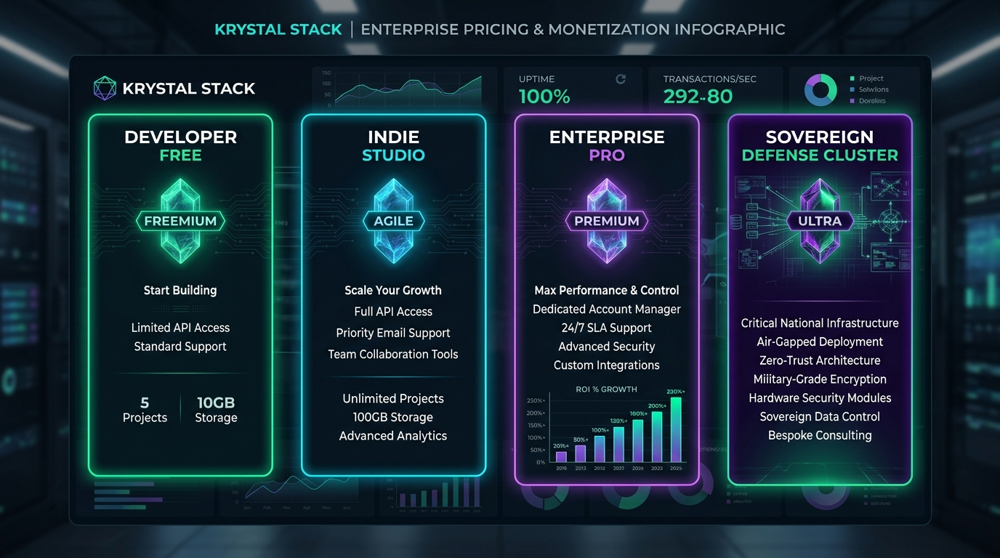
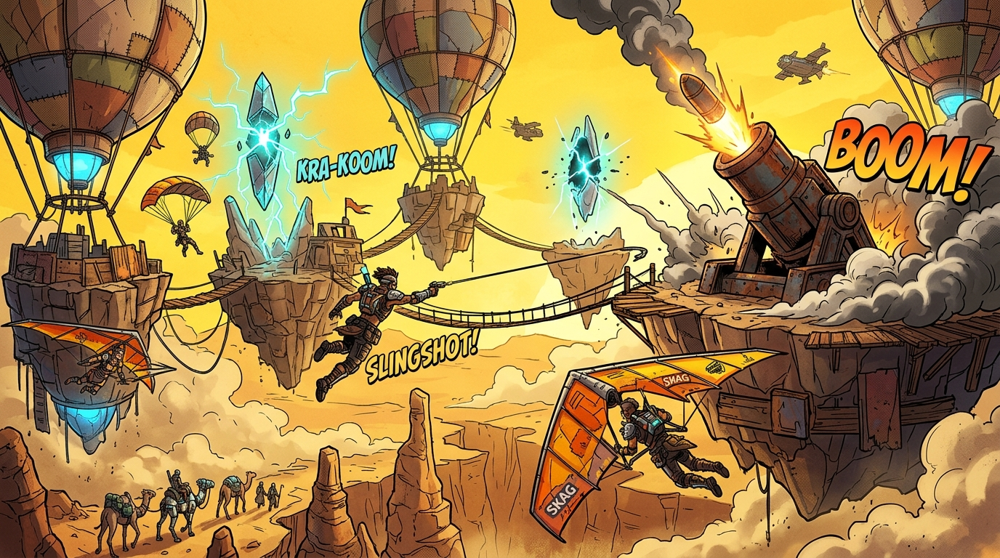
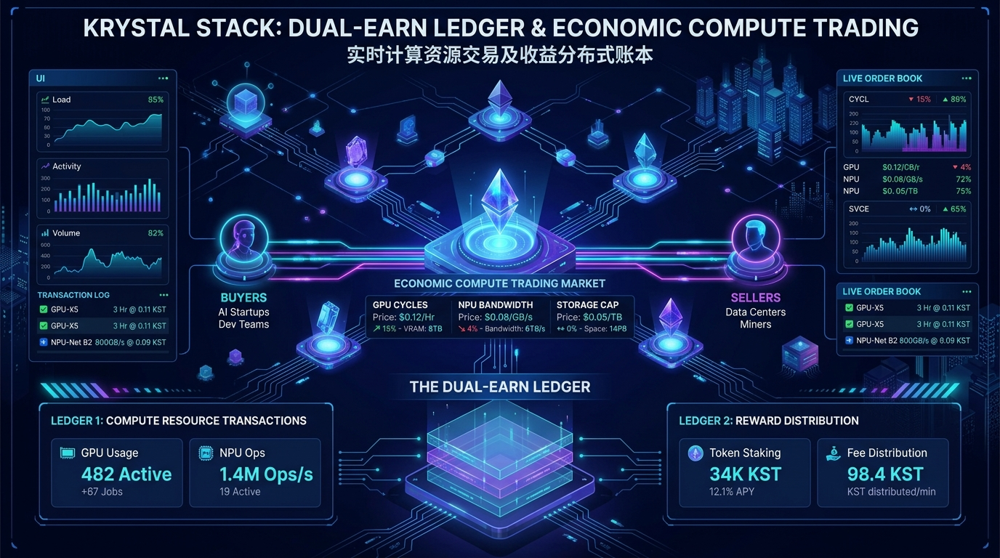

# KRYSTAL-STACK PLATFORM FRAMEWORK 🌌
### Heterogeneous Compute Kernel · Janet DSL · Procedural Godot 4.x · Local AI Cascades · Strict 6 Max HP Invariant

<div align="center">

[-22c55e?style=for-the-badge&logo=pytest)](tests/)
[](krystal_janet/)
[](docs/architecture/)
[](godot_project/)
[](docs/architecture/)
[](LICENSE)

---

### 🌐 Multilingual Documentation Hub / Jazykové Mutácie
[ **🇸🇰 Slovenčina** ](docs/i18n/sk/README.md) &nbsp;|&nbsp; [ **🇬🇧 English** ](docs/i18n/en/README.md) &nbsp;|&nbsp; [ **🇩🇪 Deutsch** ](docs/i18n/de/README.md) &nbsp;|&nbsp; [ **🇨🇿 Čeština** ](docs/i18n/cs/README.md)

---

</div>

> ### ⚡ Stop Paying Cloud GPU Rent. Start Evolving Sovereign Compute.
> **Krystal Stack** unites CPU SIMD, Vulkan Raymarching, and local NPU Neural Inference into an unbroken 60 FPS feedback loop that **slashes enterprise AI cloud bills by 40% to 65%**.
>
> 🚀 **[Explore Commercial Tiers & ROI](docs/monetization/README.md)** &nbsp;|&nbsp; 🌐 **[Decentralized Dual-Earn Ledger](docs/monetization/TOKENOMICS_AND_DUAL_EARN.md)** &nbsp;|&nbsp; 📈 **[Copywriting & Growth Playbook](docs/marketing/COPYWRITING_SCHEMES_AND_GROWTH_FRAMEWORKS.md)**

---

## 💎 Enterprise Pricing & Monetization Matrix

[](docs/monetization/README.md)

| Plan | Price | Target Market | Key Deliverables |
| :--- | :--- | :--- | :--- |
| **Developer Free** | **$0 / forever** | Open-source devs, hobbyists, students | Full source access, CPU SIMD fast-path, local inference, community support |
| **Indie Studio** | **$49 / mo** ($399/yr) | Independent game & VR studios | Up to $250k revenue, 10-block procedural generator, Godot export, 5-mode typography |
| **Enterprise Pro** | **$499 / node / mo** | Enterprise IT, defense, machine shops | CrystalSec 3.0 UMCI, 24/7 SLA, KATG-006 CNC governor, micro-profiling |
| **Sovereign Cluster** | **From $50,000 / yr** | Semiconductor vendors, datacenter operators | TSC voting seat, custom NPU adaptation, quarterly on-site audits |

👉 *Read the full [Monetization Strategy & Commercial Evidence Framework (CEL)](docs/monetization/README.md).*

---

## 🌟 Prehľad & Kľúčové Schopnosti Ekosystému

**Krystal-Stack Platform Framework** je modulárny heterogénny výpočtový, simulačný a herný ekosystém. Prepája nízkoúrovňovú akceleráciu hardvéru (**Vulkan Compute Shaders, DirectML NPU offload, OpenVINO inference**) s vysokoexpresívnym funkcionálnym procedurálnym metaprogramovaním (**Janet Lisp AST & DSL Engine**), 3D procedurálnym generovaním herných scén pre **Godot Engine 4.x**, taktickým kartovým RPG systémom s **256 144 kombináciami** a kinetickou fyzikou v štýle **Just Cause** s vizuálnou estetikou **Borderlands** na sýtom žltom podklade (`#facc15`).

Celý systém je zviazaný striktným deterministickým pravidlom – **Vitálnym Invariantom 6 Max HP** (žiadna jednotka, hrdina ani posádka nemôže prekročiť 6 životov), dvojpodvojným ekonomickým účtovníctvom s auditom a aéterickým protokolom Ordinals.



---

## 🌐 The Decentralized Dual-Earn Ledger

Monetize your idle night-time compute or procure spot GPU/NPU cycles at up to **60% discount** compared to legacy hyperscaler clouds:

[](docs/monetization/TOKENOMICS_AND_DUAL_EARN.md)

- **Compute Providers:** Automated order book trading for idle GPU/NPU capacity with zero-latency local preemptibility.
- **Compute Buyers:** Frictionless spot compute for AI inference, batch rendering, and simulation.
- **Invariant Guard:** All transactions verified against `assert VITAL_MAX_HP == 6` to eliminate host overdraw.

👉 *Read the complete [Tokenomics & Compute Arbitrage Guide](docs/monetization/TOKENOMICS_AND_DUAL_EARN.md).*

---

## 🧩 Hlavné Architektonické Súčasti

### 1. Heterogénne Výpočtové Jadro & Edge Kognitívna Inteligencia
* **Definícia**: Paralelný orchestrátor hardvérových výpočtov vyťažujúci grafické procesory, neurónové koprocesory (NPU) a malé jazykové modely (SLM).
* **Manifestácia**:
  * **Vulkan Compute Pipeline**: Volumetrická detekcia kolízií a raymarching signovaných dištančných polí (SDF).
  * **DirectML / ONNX NPU Offload**: Beží na procesoroch Intel Tiger Lake / Meteor Lake s nízkou spotrebou.
  * **IBM Granite 4B / Edge SLM**: Generovanie taktických dialógov, vyhodnocovanie trhových spreadov a automatická správa zdrojov bez závislosti od cloudu.

### 2. Janet Lisp S-Expression & AST Kompilačný Most
* **Definícia**: Deterministický procedurálny metaprogramovací most, ktorý kompiluje matematické variety a herné pravidlá do AST reprezentácií nezávislých na platforme.
* **Manifestácia**:
  * **20 validovaných Janet DSL súborov** v [`krystal_janet/`](krystal_janet/).
  * Parser S-výrazov a AST validátor [`janet_bridge.py`](krystal_janet/janet_bridge.py) s garanciou vyvážených zátvoriek.
  * Generovanie procedurálneho PEG gramatického vstupu pre antistresovú hernú logiku.

### 3. Taktické Bojové RPG "Posledný Kmeň" & 256k Kombinatorika
* **Definícia**: Komplexný kartový a hexový ťahový systém s astronomickým stavovým priestorom a hlbokou strategickou voľbou.
* **Manifestácia**:
  * **256 144 Kombinačných Stavov ($2^{18}$)**: 512 makro-vetiev $\times$ 512 priestorových trajektórií na hexovej mape.
  * **Mulligan Fáza Výmeny Kariet**: Možnosť strategickej výmeny počiatočnej ruky s prepočtom conduit dosahu.
  * **Striktný Invariant 6 Max HP**: Všetky bytosti, hrdinovia a pevnosti majú škálu $0 \dots 6$ HP. Každý zásah a mitigácia je matematicky overená testami.

### 4. Vzdušný Bojový Ekosystém: Balónové Ostrovy, 240mm Mínomet & Rogala
* **Definícia**: Vzdušná taktická vrstva modelujúca aerostatický vztlak, gravitačnú strmú balistiku a akrobatický pohyb.
* **Manifestácia**:
  * **Vznášajúce sa Ostrovy (Aerial Islands)**: Nesené obrími solárno-tepelnými a aéterickými plynovými balónmi ($24\,000\,\text{m}^3$), prepojené visutými lanovými a oceľovými mostami (**Skybridges**).
  * **Pevnostný 240mm Obliehací Mínomet**: Paľba z výšky $280\,\text{m}$ s gravitačným urýchlením granátu až na $263\,\text{m/s}$ a dopadovou kinetickou energiou cez $9\,990\,\text{kJ}$.
  * **Rogalo (Flexibilné Delta-Krídlo)**: Kĺzavosť $7.5 : 1$, využívanie stúpavých termických prúdov a dolet cez $730\,\text{m}$.

### 5. VorpX VR & Ncon by Korrado Optika (130° FOV)
* **Definícia**: Stereoskopická 3D injekcia a podpora širokouhlých periférií novej generácie pre plnú imerziu.
* **Manifestácia**:
  * Podpora profilov: **HTC Vive Pro**, **Meta Quest 3**, a ultra-širokouhlý **Ncon by Korrado** ($130^\circ$ FOV, Dual 4K HDR, $144\,\text{Hz}$, Direct-Drive IMU $1.2\,\text{ms}$).
  * Vizuálny štýl **Borderlands**: Žlté pozadie `#facc15`, tušové kontúry hrúbky 3.5px, kvantované tiene a halftone bodky.

---

## 🎮 Interaktívne Web Štúdiá (Port 8080)

Po spustení servera sú priamo v prehliadači dostupné špecializované riadiace konzoly:

| Štúdio / Modul | URL cesta | Kľúčové Vlastnosti |
|---|---|---|
| **Model Cascade Studio** | [`/static/cascade_model_studio.html`](http://localhost:8080/static/cascade_model_studio.html) | 4-panelový LM-Studio workbench, kaskády modelov, štatistický benchmark, kinetická typografia |
| **Mission Control Hub** | [`/static/index.html`](http://localhost:8080/static/index.html) | Centrálna riadiaca matica, telemetria Vulkan/NPU, prepojenie systémov |
| **Balónové Ostrovy & Mínomet** | [`/static/aerial_balloons_mortar_studio.html`](http://localhost:8080/static/aerial_balloons_mortar_studio.html) | Balistika 240mm mínometu, kĺzanie rogala 7.5:1, padáky, visuté cesty |
| **Ncon VR & Kinetika Just Cause** | [`/static/ncon_vorpx_marketing_studio.html`](http://localhost:8080/static/ncon_vorpx_marketing_studio.html) | Simulácia ťahu lana, slingshotu, Borderlands shader a predaj Ncon VR |
| **Mulligan & 256k Ťahov** | [`/static/mulligan_cards_studio.html`](http://localhost:8080/static/mulligan_cards_studio.html) | Interaktívna výmena kariet, dosah kryštálových vedení, 6 Max HP |

---

## 🚀 Rýchle Spustenie (CLI)

```bash
# 1. Klonovanie repozitára
git clone https://github.com/RhodosBerger/Krystal-stack-platform-framework.git
cd Krystal-stack-platform-framework

# 2. Vytvorenie virtuálneho prostredia & inštalácia
python -m venv venv
.\venv\Scripts\activate      # Linux: source venv/bin/activate
pip install -r requirements.txt

# 3. Spustenie testovacieho balíka
python -m unittest tests/test_parametric_render_set.py tests/test_text_animation_engine.py tests/test_hybrid_mcp_antigravity_connector.py tests/test_model_cascade_runtime.py

# 4. Spustenie živého Web Hub servera na porte 8080:
python start_localhost.py
```

Navštívte v prehliadači: **`http://localhost:8080/static/cascade_model_studio.html`**

---

## 💳 Komerčná Podpora, Fakturácia & Kontakt:

| Metóda | Spojenie / Adresa | Poznámka |
|---|---|---|
| **Priamy Bankový Prevod / Faktúra (SEPA / SWIFT)** | **`dusan.kopecky0101@gmail.com`** | Oficiálna komerčná faktúra s DPH (Net 30 pre zmluvných partnerov) |
| **GitHub Sponsors** | [github.com/sponsors/RhodosBerger](https://github.com/sponsors/RhodosBerger) | Automatické pridelenie rolí, repozitárov a licenčných kľúčov |
| **Alternatívne Krypto Kanály (Web3)** | `TRhodosBergerKrystalStack2026USDT` / `bc1q_krystal_stack_foundation_2026` | Zúčtovanie v USDT / BTC / ETH |

---

## 👥 Autori & Licencia

* **Hlavný Architekt & Vývojár**: Dušan Kopecký ([@RhodosBerger](https://github.com/RhodosBerger))
* **Kontakt**: `dusan.kopecky0101@gmail.com`
* **Licencia**: Apache License 2.0 (Pozri súbor [`LICENSE`](LICENSE))
