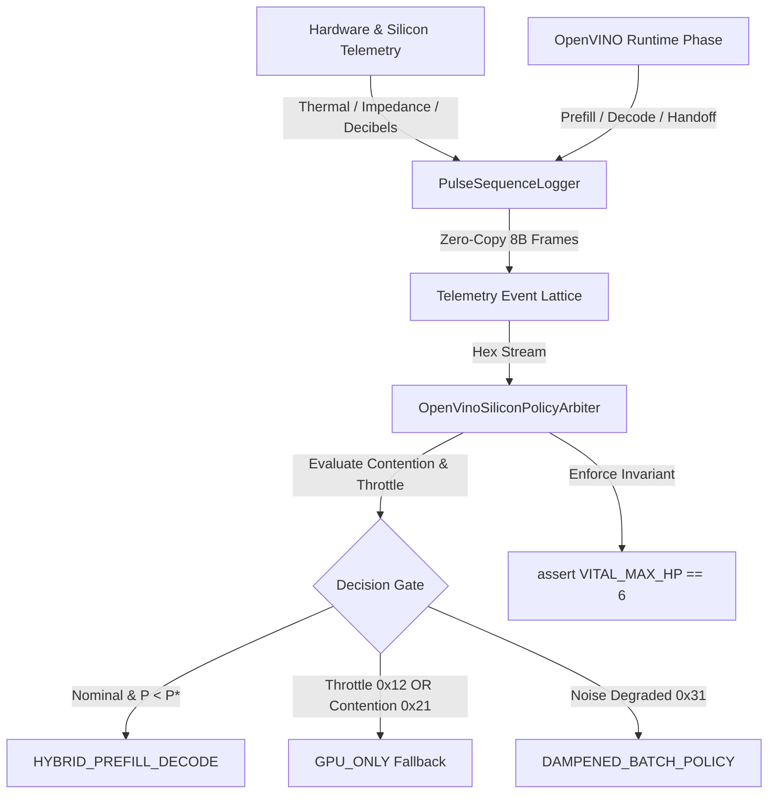

# EXPERIMENT SPECIFICATION: E-07 / H-07
# SILICON TELEMETRY, HEXADECIMAL EVENT CODE LATTICE & OPENVINO DYNAMIC POLICY ARBITER

**Experiment ID:** `E-07-SILICON-TELEMETRY-HEX-LATTICE`  
**Parent Hypothesis:** H-04 (Boundary Cost Decomposition) & H-06A (Autonomous Policy Re-Derivation)  
**Target Invariant:** `VITAL_MAX_HP == 6`  
**Execution Environment:** Intel Core i5-1135G7 (AVX-512 VNNI) + Intel Iris Xe Graphics (80 EUs Gen12 Xe-LP)  
**Memory Architecture:** Tiger Lake Unified Memory Architecture (UMA) Coherent Ring Bus  
**Epistemic Scope:** Prevod fyzikálnej a operačnej telemetrie kremíka (teplota, napäťový šum v dB, impedancia UMA zbernice, fázy inferencie) do deterministického hexadecimálneho lexikónu a nízkorežijného pulzného logovania.

---

## 1. Motivácia a vedecký rámec

V predchádzajúcich experimentoch:
- **E-06A (`H06A_ARBITRATION_REPORT.md`):** Dokázal autonómne preklápanie topologickej stratégie (`HYBRID` vs `GPU_ONLY`) na základe sklonu latencií $\tau_{\text{prefill}}$ a $\tau_{\text{decode}}$, no odhalil anomálnu inverziu pri dlhom prompte ($P=128$), kde saturácia pamäťovej zbernice UMA degradovala výkon GPU dekódovania.
- **E-04 (`H04_HANDOFF_DECOMPOSITION_SPEC.md`):** Zadefinoval 4-zložkový rozpad hranice GPU $\to$ CPU:
  $$\tau_{\text{handoff}} = \tau_{\text{dispatch\_api}} + \tau_{\text{sync\_fence}} + \tau_{\text{cache\_transit}} + \tau_{\text{copy}}$$

Tradičné logovacie mechanizmy (JSON, reťazce, Python `logging`) prinášajú réžiu v rádoch **$10\ \mu\text{s} - 100\ \mu\text{s}$**, čo je rádovo viac než samotný prechod cez zbernicu ($\sim 11.97\ \mu\text{s}$).

**Cieľ modulu H-07:**
1. Nahradiť pomalý textový logging **1-bajtovou hexadecimálnou mriežkou stavov (`0x00` – `0xFF`)**.
2. Zaviesť **Pulse Sequence Logger** s latenciou pod **$0.05\ \mu\text{s}$ na udalosť** využívajúci pevnú štruktúru rámca.
3. Prepojiť telemetrické dáta (termálna impedancia Foster/Cauer, útlm odrazu/šum $RL$ v dB, UMA ring contention) s **OpenVINO inferenčným profilerom**.

---

## 2. Hexadecimálny telemetrický lexikón (Hex Event Code Lattice)

Každý kód má pevne definovanú triedu, ID a sémantický rozsah:

| Hex Kód | Symbolický identifikátor | Meraná fyzikálna veličina | Prah / Podmienka | Trieda v Pythone / C ABI |
| :---: | :--- | :--- | :--- | :--- |
| `0x10` | `SILICON_NOMINAL_ACTIVE` | $T_j$ (Junction Temp) | $T_j \le 65.0^\circ\text{C}$ | `SiliconNominalActiveEvent` |
| `0x11` | `SILICON_THERMAL_ELEVATED` | $T_j$ (Foster-Cauer Pole 3/4) | $65.0^\circ\text{C} < T_j \le 82.0^\circ\text{C}$ | `SiliconThermalElevatedEvent` |
| `0x12` | `SILICON_THERMAL_THROTTLE` | $T_j$ / PL1 Clamp | $T_j > 82.0^\circ\text{C}$ | `SiliconThermalThrottleEvent` |
| `0x20` | `UMA_CONTENTION_LOW` | $\tau_{\text{cache\_transit}}$ | $< 2.5\ \mu\text{s}$ | `UmaContentionLowEvent` |
| `0x21` | `UMA_CONTENTION_HIGH` | $\tau_{\text{cache\_transit}}$ | $\ge 5.0\ \mu\text{s}$ (Bus saturated) | `UmaContentionHighEvent` |
| `0x30` | `NOISE_FLOOR_NOMINAL_DB` | Return Loss $RL = -20 \log_{10}\|\Gamma\|$ | $RL \ge 25.0\ \text{dB}$ (Čisté napájanie) | `NoiseFloorNominalEvent` |
| `0x31` | `NOISE_FLOOR_DEGRADED_DB` | Return Loss $RL$ | $RL < 18.0\ \text{dB}$ (Zvlnenie / Odraz) | `NoiseFloorDegradedEvent` |
| `0x40` | `OPENVINO_GPU_PREFILL` | GPU EU Saturation | $> 80\%$ (Iris Xe 80 EUs) | `OpenVinoGpuPrefillEvent` |
| `0x41` | `OPENVINO_CPU_DECODE` | AVX-512 VNNI Saturation | Active decode stream | `OpenVinoCpuDecodeEvent` |
| `0x50` | `HANDOFF_SYNC_WAIT` | `zeEventHostSynchronize` | Synchronizačná bariéra | `HandoffSyncWaitEvent` |
| `0x51` | `HANDOFF_COMPLETE` | $\tau_{\text{handoff}}$ | Úspešný prenos rámca | `HandoffCompleteEvent` |
| `0xFE` | `POLICY_STRATEGY_SHIFT` | Arbitrovaná topológia | Preklopenie HYBRID $\leftrightarrow$ GPU | `PolicyStrategyShiftEvent` |
| `0xFF` | `CONSTITUTIONAL_HEARTBEAT` | `VITAL_MAX_HP == 6` | Periodický invariant | `ConstitutionalHeartbeatEvent` |

---

## 3. Formát pulzného rámca (Pulse Frame Specification)

Každá telemetrická pulzná udalosť je kódovaná do **8 bajtov** (64 bitov):

```text
 0                   1                   2                   3
 0 1 2 3 4 5 6 7 8 9 0 1 2 3 4 5 6 7 8 9 0 1 2 3 4 5 6 7 8 9 0 1
+-+-+-+-+-+-+-+-+-+-+-+-+-+-+-+-+-+-+-+-+-+-+-+-+-+-+-+-+-+-+-+-+
|       Delta Time (uint32_t microseconds since epoch)          |
+-+-+-+-+-+-+-+-+-+-+-+-+-+-+-+-+-+-+-+-+-+-+-+-+-+-+-+-+-+-+-+-+
| EventCode (u8)| Invariant (u8)|      Payload / Value (uint16_t)|
+-+-+-+-+-+-+-+-+-+-+-+-+-+-+-+-+-+-+-+-+-+-+-+-+-+-+-+-+-+-+-+-+
```

- **Delta Time (32-bit):** $\mu\text{s}$ rozlíšenie pre časovú rekonštrukciu sekvencie.
- **EventCode (8-bit):** Hexadecimálny identifikátor z lexikónu.
- **Invariant (8-bit):** Vždy rovné `VITAL_MAX_HP` (hodnota `0x06`).
- **Payload / Value (16-bit):** Kvantizovaná hodnota (napr. teplota $\times 100$, napätie/šum v dB $\times 10$, latencia $\mu\text{s}$).

---

## 4. Architektúra modulu a integrácia s OpenVINO



---

## 5. Arbitračné pravidlá (Policy Arbitration Rules)

1. **Rule 1 (Thermal Throttle Guard):** Ak je prítomný kód `0x12` (`SILICON_THERMAL_THROTTLE`), CPU frekvencie sú znížené. Planner okamžite presmeruje decode na GPU alebo obmedzí paralelizmus.
2. **Rule 2 (UMA Saturation Guard):** Ak kód `0x21` indikuje $\tau_{\text{cache\_transit}} \ge 5.0\ \mu\text{s}$, intermediárne prenosy medzi GPU a CPU sú zablokované; stratégia prepína na monolitický režim (`GPU_ONLY` alebo `CPU_ONLY`).
3. **Rule 3 (Noise Floor Stability):** Pri poklese $RL < 18\ \text{dB}$ (`0x31`) sa aplikuje hysterézna brzda na zmenu frekvencií a napätia.
4. **Rule 4 (Constitutional Invariant):** V každom stave platí $\text{Invariant} \equiv 6$. Akýkoľvek pokus o záznam s poškodeným invariantom vyvolá `ContractViolation` a uzamkne stav ($\Delta S = 0$).
