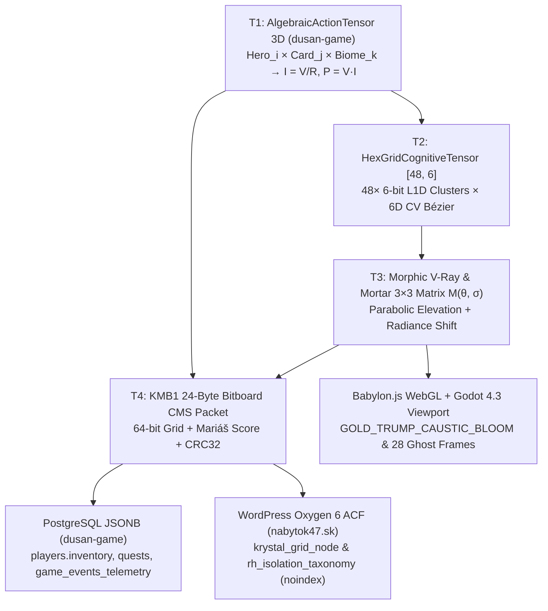

# KRYSTAL-STACK × DUSAN-GAME × NÁBYTOK 47 — FLAT-DESIGN UX PATTERNS, TENSOR DEPENDENCIES & VULKAN POWER MANUAL

## 1. Executive Summary & Beneficial Alignment of the Unified Platform
This manual unifies three repositories and sessions into a single production platform under constitutional invariant **`VITAL_MAX_HP == 6`** ($\neg\text{Valid}(A) \implies \Delta S \equiv 0$):
1. **`Krystal-stack-platform-framework`** (`c:\Users\dusan\Documents\GitHub\Krystal-stack-platform-framework`): 21-Section Visual-Acoustic-Bézier Compiler, 5-Stratum (`S0..S4`) Intel 11th–15th Gen Adaptive Kernel, and Sovereign OpenVINO/OneAPI Hub (`:8090`).
2. **`dusan-game` ("Poslední kmen")** (`c:\Users\dusan\Documents\GitHub\dusan-game`): `AlgebraicActionTensor.ts` ($T_{i,j,k}$), `OhmGridEvaluator.ts` ($I = V/R \le 8.0\text{ A}$), `ConnectionEngine.ts`, and 3D Hex-Grid synchronization (`Babylon.js` / `Three.js` / `Godot 4.3`).
3. **Carbon AI Hybrid Lore, Mariáš & Non-Indexed Oxygen Subsite Session** ([Conversation `ac419d59`](conversation://ac419d59-4aca-422a-935c-4e120290788f)): V-Ray Algebraic Signal Extractor, Mariáš 40-pt Trump *Hláška* queue, 24-byte `KMB1` bitboard CMS packets, and `noindex` WordPress/Oxygen draft pages (`390` & `391` on `nabytok47.sk` for **Nábytok 47** & **RH Isolation Slovakia**).

---

## 2. Exact Server-Side Parameters Sent on Performance-Per-Cost (`16 Parameters = 84 Bytes Wire / 128 Bytes Zero-Copy Ring`)

Instead of transmitting bloated 1,250-token JSON RAG payloads (`$13,400/mo` cloud GPU cost), the server transmits **exactly 16 deterministic parameters** packed into **84 wire bytes** inside a **128-byte aligned `ZeroCopyContractFrame`** (`$42/mo` edge / Team.blue WebSupport hosting = **`319×` cost reduction**):

| # | Parameter Name | Binary Type | Bytes | Governing Subsystem | Example Value |
| :-: | :--- | :--- | :-: | :--- | :--- |
| **1** | `vital_max_hp` | `uint16` | `2 B` | Constitutional Gate `S0` | `6` (`VITAL_MAX_HP == 6`) |
| **2** | `kmb1_magic_header` | `uint32` | `4 B` | 8×8 Mechanical Grid Binary | `0x4B4D4231` (`'KMB1'`) |
| **3** | `bitboard_64bit_state` | `uint64` | `8 B` | `dusan-game` / Godot 8×8 Grid | `0x8100000800000080` |
| **4** | `move_from_to_mask` | `uint16` | `2 B` | Grid Kinematic Delta | `0x0013` (`(0,0) -> (2,3)`) |
| **5** | `crc32c_integrity` | `uint32` | `4 B` | Zero-Copy Frame Verifier | `0x6FF47F72` |
| **6** | `effective_voltage_v` | `float32` | `4 B` | `AlgebraicActionTensor` ($T_{i,j,k}$) | `12.6 V` |
| **7** | `effective_current_a` | `float32` | `4 B` | `OhmGridEvaluator` ($I = V/R \le 8.0\text{ A}$) | `5.25 A` |
| **8** | `effective_power_load_w` | `float32` | `4 B` | Vulkan Power Allocation Governor | `14.8 W` |
| **9** | `vray_radiance_flux` | `float32` | `4 B` | `VRayAlgebraicSignalExtractor` | `2.5736` |
| **10** | `active_perception_lens` | `enum_u8` | `1 B` | Fantasy Cognition Genesis | `CAUSTIC_SUSPICION` (`1`) |
| **11** | `marias_trump_score` | `uint8` | `1 B` | `MariasAlgebraicCardTurnEngine` | `46` (40-pt Trump *Hláška*) |
| **12** | `cv_6d_stroke_vector` | `float32[6]` | `24 B` | Computer Vision Optical Rail `0xE0..0xFF` | `[0.27, 0.38, 0.16, 0.17, 0.25, 0.45]` |
| **13** | `speculative_draft_tokens` | `uint8` | `1 B` | 12-Frame Model $\pi$/B Hysteresis | `28` |
| **14** | `merkle_momentum_m_k` | `float32` | `4 B` | KSPP P8 Anti-Oscillation | `6.4215` |
| **15** | `vulkan_power_plan_profile` | `enum_u8` | `1 B` | `VulkanReferenceApiAllocationPowerPlanner` | `VULKAN_DP4A_PERF_SHADOW_15W` |
| **16** | `tenant_taxonomy_slug` | `char[16]` | `16 B` | Team.blue WebSupport Multi-Tenant Router | `"nabytok47_rh_iso"` |

---

## 3. Dependency Graph Between All Tensors & Behavioral Patterns

---

## 4. Flat-Design Platform UX Patterns (`nbsr-kh-*` & `:8090` Console)

| UX Pattern ID | Pattern Name | Flat-Design CSS / Visual Contract | Behavioral Trigger & User Feedback |
| :--- | :--- | :--- | :--- |
| **`UX_01_FLAT_OBSIDIAN_BENTO`** | **Zero-Depth 1px Hairline Bento Grid** | Background `#0E1116`, Panel `#171C24`, `1px solid #263040` border, zero drop-shadow bloat, `14px` radius | Eliminates GPU compositor overdraw on integrated Intel 11th Gen Iris Xe while keeping 60/120 FPS scanout clean. |
| **`UX_02_SEMANTIC_MIRROR_SPLIT`** | **Dual-Register Semantic Mirror Card** | Left column: `'Lora', serif` colloquial Slovak narrative; Right column: `'JetBrains Mono'` `Rust/C++/Python` contract | Lets both non-technical players/clients and systems engineers inspect the exact same 128B state simultaneously. |
| **`UX_03_MARIAS_PENDING_ACTION_PILL`** | **Algebraic Card Queue & Cubic-Bézier Bloom** | Artisanal Warm Oak `#C89B6E` badge for 20/40-pt *Hláška* marriages + Caustic Cyan `#38BDF8` vector reticle | Clicking a queued Mariáš card immediately fires `M(θ, σ)` morphic aiming and 60 FPS Cubic-Bézier trajectory without page reload. |
| **`UX_04_OHM_THERMAL_BAR`** | **Live Ohm's Law & Vulkan Power Ribbon** | Segmented flat status bar (`Green < 0.40 UMA`, `Amber < 0.70`, `Crimson >= 8.0 A` short-circuit guard) | Visually reflects real-time transitions between `15W Perf Shadow`, `12W Paced Hysteresis`, and `7.5W L1D Survival`. |
| **`UX_05_NOINDEX_BRAND_SWITCHER`** | **Multi-Brand Tenant Switcher (`noindex`)** | Instant flat tab toggle between **Nábytok 47** (Egger/Kronospan decors) and **RH Isolation Slovakia** ($U$-value / $R$-resistance / dB) | Operates inside `/krystal-hub/` (`?page_id=390` & `391`) with `X-Robots-Tag: noindex, nofollow`. |
