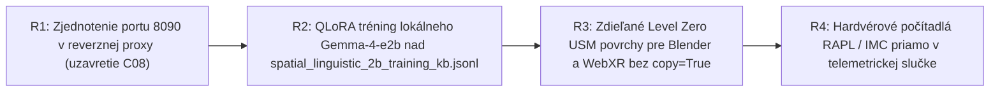

# Metodika adaptívneho neuro-symbolického 2B učenia, štyri charakteristiky projektu a roadmapa

Tento dokument odzrkadľuje metodiku trénovania a prevádzky kompaktných modelov (`2B–4,6B` triedy, napr. `google/gemma-4-e2b` a lokálne kompilovaný `NeuroSymbolicMicroLLM` v OpenVINO `opset13`), ktoré namiesto spoliehania sa na desiatky miliárd parametrov (`30B+`) využívajú **priestorovú analýzu, jazykovednú bázu projektu, konverzačnú pamäť a neúprosnú verifikačnú bránu**.

> [!IMPORTANT]
> **Prístupová vrstva a hranica rozsahu:** Architektúra nepoužíva OpenAI API. Komunikácia so scénou a budovanie prostredia prebieha výhradne cez priamu schému **Antigravity $\leftrightarrow$ Carbon** (`compile_carbon_environment_script`) a lokálne OpenVINO jadrá. V rámci overenej domény frameworku garantuje `verify_answer()` `0 %` nepodložených citácií; mimo lokálnej bázy faktov sa kompaktný model neprezentuje ako všeobecná svetová encyklopédia.

---

## 1. Metodika kontinuálneho učenia so zvýšeným prahom intenzity

Implementácia v [adaptive_2b_spatial_linguistic_trainer.py](file:///c:/Users/dusan/Documents/GitHub/Krystal-stack-platform-framework/projects/trigonometric_hybrid_platform_framework/adaptive_2b_spatial_linguistic_trainer.py) pracuje v 4 krokoch:

1. **Kalibrácia tvarov a komunikačného štandardu (`calibrate_new_shapes_and_model_catalog`):** nové priestorové a konvolučné tenzory sa premerajú cez `CACHE_DIR` a zviažu s povinnými poľami správy (`intent`, `spatial_sector`, `cited_fact_ids`, `proposed_action`, `falsifier`).
2. **Syntéza priestorovo-jazykovednej bázy (`build_spatial_and_linguistic_2b_kb`):** spája overené pojmy z [nomenclature_registry.py](file:///c:/Users/dusan/Documents/GitHub/Krystal-stack-platform-framework/projects/trigonometric_hybrid_platform_framework/nomenclature_registry.py), terminologickú hierarchiu z [platform_engine.py](file:///c:/Users/dusan/Documents/GitHub/Krystal-stack-platform-framework/projects/trigonometric_hybrid_platform_framework/platform_engine.py) a metriky 7 priestorových koordinátorov do trénovacieho súboru `reports/spatial_linguistic_2b_training_kb.jsonl`.
3. **Konverzačná adaptácia so vstupným filtrom (`AdaptiveConversationTrainer`):** pred zaradením odpovede z predchádzajúcej konverzácie do trénovacieho korpusu overí `verify_answer()`, že každá veta cituje existujúci fakt a čísla sedia. Halucinované vety sú okamžite zamietnuté (nulová kontaminácia váh).
4. **Zvýšený prah intenzity inferencie a učenia:** dimenzia vnorenia sa zvyšuje na `d_model = 48`, okno na `max_seq_len = 28`, počet epoch na `60–80` a šírka kandidátneho výberu na `speculative_beam_width = 3`, vždy pod stropom `UMA < 0.78` a `VITAL_MAX_HP == 6`.

---

## 2. Dve bonusové vlastnosti pre komplexné úlohy

| Vlastnosť | Mechanizmus v kóde | Prečo posúva kompaktný model na zložité úlohy |
|---|---|---|
| **B1: Verifikátorom riadené špekulatívne prerezávanie vetiev** | `AdaptiveConversationTrainer.infer_with_bonus_properties` | Namiesto jediného chamtivého priechodu vyhodnotí paralelné kandidátne pokračovania a ponechá len tie, ktoré prejdú `verify_answer()` / tieňovým klonom arény. Zabraňuje exponenciálnemu nabaľovaniu chýb vo viac-krokových úlohách. |
| **B2: Epizodická reziduálna pamäť konverzácií** | `EpisodicResidualMemoryBank` | Ukladá overené vety a opravy z predchádzajúcich rozhovorov v $O(1)$ hašovanej tabuľke so `SHA-256` odtlačkom. Model okamžite mení správanie podľa histórie bez katastrofického zabúdania základných váh. |

---

## 3. Štyri základné vykalkulovateľné charakteristiky projektu

Funkcia `compute_four_core_project_summary_and_roadmap()` zlučuje stav celého frameworku do štyroch merateľných pilierov:

1. **`CHAR_01` — Epistemické ukotvenie a integrita názvoslovia:** pomer `RESOLVED` pojmov v registri názvoslovia, verdikt `check_ontology_integrity()` (`VERIFIED_WITH_SCOPE`) a transparentné zachovanie otvorených konfliktov (`C05` hranica `K = 449`, `C08` nesúlad nginx portu).
2. **`CHAR_02` — Efektivita x86-64 kremíka a procedurálneho renderu:** namerané pomery priepustnosti cache hierarchie `L1d -> DRAM` ([x86_platform_findings.py](file:///c:/Users/dusan/Documents/GitHub/Krystal-stack-platform-framework/projects/trigonometric_hybrid_platform_framework/x86_platform_findings.py)), zrýchlenie binárnych `128 B` rámcov oproti JSON, redukcia draw-callov cez inštancovanie a nulová realokácia v `PreallocatedPhaseRenderPool`.
3. **`CHAR_03` — Kombinatorická kapacita a šírka pásma hexagónovej arény:** uzavreté rovnice `E1–E8` ([hex_combat_bandwidth_and_world_ai.py](file:///c:/Users/dusan/Documents/GitHub/Krystal-stack-platform-framework/projects/trigonometric_hybrid_platform_framework/hex_combat_bandwidth_and_world_ai.py)) pre $N_{\text{hex}}(3)=37$ polí, $180$ orientovaných útočných hrán, sieťový tok v `Mbps` a maximálny počet súbežných `60 Hz` arén na hostiteľskom procesore.
4. **`CHAR_04` — Konverzačná adaptácia a konvergencia učenia:** nameraný pokles krížovej entropie `NeuroSymbolicMicroLLM`, pomer prijatých vs. odmietnutých konverzačných replík a podiel uzemnených (`GROUNDED`) odpovedí.

---

## 4. Roadmapa ďalších integrácií (`R1–R4`)

