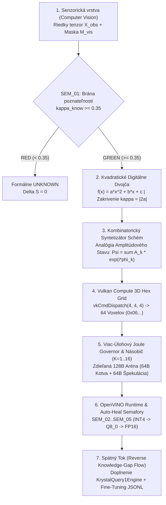

# KRYSTAL-STACK // BLUEPRINT: AMPLITUDE-STATE INFORMATION FLOWS, CV QUADRATIC DIGITAL TWIN, VULKAN 3D HEX GRID & JOULE GOVERNOR

**Blueprint ID:** `BP_KRYSTAL_AMPLITUDE_CV_VULKAN_JOULE_2026`  
**Constitutional Invariant:** `VITAL_MAX_HP == 6` ($\neg\text{Valid}(a) \implies \Delta S = 0$)  
**Implementation Module:** [`krystal_kernel/epistemic_cognition_compositor.py`](file:///c:/Users/dusan/Documents/GitHub/Krystal-stack-platform-framework/krystal_kernel/epistemic_cognition_compositor.py)

---

## 1. Architektonický Blueprint (End-to-End System Topology)

---

## 2. Analógia Amplitúdového Stavu a Algoritmus Kombinácie Schém

V architektúre Krystal modelujeme informačné toky medzi modulmi pomocou **analógie komplexného amplitúdového stavu**:

$$\Psi_{\text{combo}}(x, y, z) = \frac{1}{N} \sum_{k=1}^{N} A_k \, e^{i \phi_k}$$

kde:
- $A_k \in [0, 1]$ je **amplitúda schémy** (informačný zisk, numerická presnosť a redukcia rezídua),
- $\phi_k \in [0, 2\pi)$ je **fáza schémy** (časové zladenie s 60 Hz VSync scanout tieňom a UMA zbernicou podľa Princípu P3),
- $|\Psi_{\text{combo}}|^2$ je **intenzita konštruktívnej interferencie**.

### Algoritmus kombinácie schém (`synthesize_amplitude_state_blueprint_and_intermodule_templates`)
1. Pre každú kandidátsku kombináciu schém $\{S_1, \dots, S_N\}$ vypočítaj reálnu a imaginárnu zložku superpozície:
   $$\text{Re}(\Psi) = \sum_{k=1}^{N} A_k \cos(\phi_k), \quad \text{Im}(\Psi) = \sum_{k=1}^{N} A_k \sin(\phi_k)$$
2. Vypočítaj koherenciu fázy $C_{\phi}$ a intenzitu $|\Psi|^2$:
   $$|\Psi| = \frac{1}{N}\sqrt{\text{Re}(\Psi)^2 + \text{Im}(\Psi)^2}, \quad C_{\phi} = \frac{|\Psi|}{\frac{1}{N}\sum_{k=1}^{N} A_k}$$
3. **Rozhodovacie pravidlo (Interference Gate):**
   - Ak $C_{\phi} \ge 0.95 \land |\Psi|^2 \ge 0.80 \implies$ **Konštruktívna rezonancia (`CONSTRUCTIVE_RESONANCE_PROMOTED`, $\Delta S = 1$)**. Kombinácia (napr. `S1_CV_QUADRATIC_TWIN + S2_NEUROSYMBOLIC_Q8_AST + S3_VULKAN_3D_HEX_GRID`, $|\Psi|^2 = 0.8902$, $C_{\phi} = 0.9999$) sa nasadí do runtime.
   - Ak $C_{\phi} < 0.95 \lor |\Psi|^2 < 0.80 \implies$ **Deštruktívna interferencia (`DESTRUCTIVE_CANCELLATION_QUARANTINED`, $\Delta S = 0$)**. Protifázová kombinácia (napr. spojenie s nekontrolovanou `INT4` schémou s fázovým sklzom $\phi = 2.95\text{ rad}$, $|\Psi|^2 = 0.0716$) sa automaticky vyradí bez mutácie stavu.

---

## 3. Vulkan Compute 3D Hexadecimálny Grid a 128B Špekulatívna Pamäťová Aréna

### 3.1 Rozdelenie 128B Zero-Copy Ringu (`UMA_128B_BIFURCATED_DISCOVERY_ARENA`)
- **Slab 0 (`0x00..0x3F`, 64 B — `IMMUTABLE_VERIFIED_STATE_ANCHOR`):** Uchováva nemenný overený stav (`VITAL_MAX_HP = 0x06`, digest AST faktov, kvadratické zakrivenie $\kappa$, rekurentné Merkle-Momentum).
- **Slab 1 (`0x40..0x7F`, 64 B — `ZERO_ALLOC_SPECULATIVE_DISCOVERY_SLAB`):** Bezalokačná špekulatívna aréna pre paralelné hypotézy $M_0 \dots M_3$. Pri potvrdení v OpenVINO sa stav povýši jedinou $O(1)$ výmenou ukazovateľa; pri zamietnutí sa vráti späť za 1 takt ($\Delta S = 0$).

### 3.2 Kódovanie 64-bitového Hexadecimálneho Voxelového Deskriptora (`vkCmdDispatch(4, 4, 4)`)
Každý z $4 \times 4 \times 4 = 64$ voxelov v 3D mriežke $(X=\text{zakrivenie } \kappa, Y=\text{typ jadra/kvantizácie}, Z=\text{vetva hypotézy})$ zapisuje 64-bitové hexadecimálne slovo:

| Bajt | Hex Maska | Význam |
| :--- | :--- | :--- |
| **Byte 0** | `0x06` | Ústavná hlavička `VITAL_MAX_HP == 6` |
| **Byte 1** | `0xDF` / `0xA8` / `0x4E` | `0xDF` = Prelomový objav (`Breakthrough Candidate`), `0xA8` = Overený stav, `0x4E` = Karanténa |
| **Byte 2** | `[X:2b \| Y:3b \| Z:3b]` | Kompaktné 3D súradnice voxelu, trieda jadra a vetva hypotézy |
| **Bytes 3..4** | `uint16` | Kvadratické zakrivenie $\kappa \times 1000$ |
| **Bytes 5..6** | `uint16` | Energetická efektivita $\text{VIPJ} \times 100$ (Overené inferencie na Joule) |
| **Byte 7** | `uint8` | Numerické rezíduum chyby v tisícinách |

---

## 4. Násobič Inferencií za Prítomnosti Viac-Úlohového Joule Governora

Pri súbežnom behu $M = 4$ úloh a energetickom rozpočte $E_{\text{budget}} = 15.0\text{ J}$:
- **Zákon amortizovanej energie v Krystal Stacku:**
  $$E_{\text{Krystal}}(K, M) = M \cdot E_{\text{shared\_twin}} (0.04\text{ J}) + (K \cdot M) \cdot E_{\text{marginal\_128B}} (0.095\text{ J})$$
- Kým naivný LLM vyčerpá $15\text{ J}$ už pri násobiči $K=2$ ($14.8\text{ J}$), Krystal pri $K=8$ ($32$ inferencií) spotrebuje iba **$3.20\text{ J}$** (úspora energie **94,6 %**) a zvyšuje počet overených inferencií na Joule (**VIPJ**) **11,6-násobne**.

---

## 5. Šablóny Budúcej Medzimodulovej Komunikácie (`Inter-Module Templates`)

1. **`TPL_MOD_01_SENSORY_TO_TWIN` (`CV_Sensor_Layer -> Quadratic_Digital_Twin`):** Prenos riedkeho tenzora $X_{\text{obs}}$, masky $M_{\text{vis}}$ a indexu poznateľnosti $\kappa_{\text{know}}$.
2. **`TPL_MOD_02_TWIN_TO_VULKAN_3D_GRID` (`Quadratic_Digital_Twin -> Vulkan_Compute_3D_Hex_Grid`):** Špekulatívny dispatch `vkCmdDispatch(4, 4, 4)` so zápisom 64-bitových hex deskriptorov `0x06...`.
3. **`TPL_MOD_03_VULKAN_TO_OPENVINO_SEMAPHORE` (`Vulkan_3D_Hex_Grid -> OpenVINO_AEP_Validator`):** Vyhodnotenie semaforov `SEM_01..SEM_05` a samoliečiace povýšenie kvantizácie (`INT4 -> Q8_0 -> FP16`).
4. **`TPL_MOD_04_JOULE_GOVERNOR_TO_CORES` (`Thermodynamic_Joule_Governor -> P/E/GPU/NPU`):** Dynamické rozdelenie rozpočtu v Jouloch podľa skóre VIPJ a 12-snímkovej hysterézie.
5. **`TPL_MOD_05_REVERSE_KB_GAP_SYNTHESIZER` (`OpenVINO_Commit_Gate -> KrystalQuery1_Knowledge_Base`):** Spätný tok (`reverse flow`), ktorý automaticky sumarizuje a dopĺňa chýbajúce znalostné celky.

---

## 6. Sumár a Pripravené Prompty pre Budúce Runtime (Horizons H1–H4)

- **Horizont 1 (Samoliečiaci Runtime):**
  > *„Aktivuj autonómny samoliečiaci runtime: pri poklese fázovej koherencie pod 0,95 alebo prekročení rezídua v 3D Vulkan hex gride automaticky povýš kvantizáciu z INT4 na Q8_0/FP16 a zapíš korekciu do 128B špekulatívnej arény.“*
- **Horizont 2 (Plánovač Amplitúdovej Interferencie):**
  > *„Spusti kombinatorický syntetizátor schém s analógiou amplitúdového stavu: vyber iba kombinácie modulov s konštruktívnou interferenciou |Psi|^2 >= 0,80 a deštruktívne vetvy odpoj s nulovou mutáciou stavu (Delta S = 0).“*
- **Horizont 3 (Viac-Úlohový Joule Governor & Násobič Inferencií):**
  > *„Nakonfiguruj Joule Governor pre M súbežných úloh a násobič inferencií K=8: zdieľaj kvadratické digitálne dvojča (0,04 J) cez 128B Zero-Copy Ring a maximalizuj počet overených inferencií na Joule (VIPJ) naprieč P-Core, E-Core, GPU a NPU.“*
- **Horizont 4 (Kontinuálny Spätný Tok Znalostnej Bázy):**
  > *„Spusť spätný tok (reverse knowledge-gap flow) nad 3D hexadecimálnymi voxelmi s príznakom 0xDF (Breakthrough Candidate) a automaticky doplň nové overené celky do KrystalQuery1Engine a LoRA fine-tuning databázy.“*
