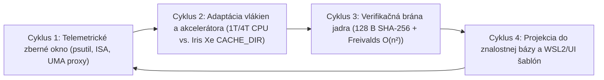

# Náučný článok: Ako navrhovať a generovať botov pre Krystal Stack nad 4 dátovými cyklami

Vývoj autonómneho bota (či už pre súbojovú arénu `ClashGame`, audit konzistencie, alebo riadenie heterogénnych výpočtov a WSL2 hypervízora) stojí v Krystal Stacku na jednom neprekročiteľnom pravidle: **bot je vždy len navrhovateľ (`PROPOSER`), nikdy priamy vlastník stavu (`AUTHORITY`)**. Každý jeho výstup prechádza zmluvnou bránou, ktorá pri chybe ponechá systém bezo zmeny ($\Delta S = 0$, `VITAL_MAX_HP == 6`).

> [!NOTE]
> **Presnosť telemetrie na Windows 11:** V používateľskom priestore čítajú boty skutočné vyťaženie CPU a RAM (`psutil`), príznaky inštrukčných sád (`AVX-512F`), latenciu kompilácie/inferencie v OpenVINO a časy `128 B` rámcov (`LOCAL_MEASURED`). Priama teplota čipsetu alebo spotreba v jouloch z MSR/RAPL vyžaduje jadrový ovládač — bez neho musí bot pracovať so zmluvnou obálkou (`DERIVED_ENVELOPE`) a nesmie si hardvérové senzory domýšľať.

---

## 1. Štyri dátové cykly, ktorými prechádza každý bot



1. **Dátový cyklus 1 — Telemetrické zberné okno (`ChipsetTelemetryMonitorAndForecaster`):**
   Bot načíta zaťaženie jadier, voľnú pamäť, počet predkompilovaných blobov v `CACHE_DIR` a vypočíta hornú hranicu $\text{EWMA} + 2\sigma^+$. Ak odhad prekročí `0,78`, bot okamžite prepína do ochranného režimu CPU; späť na iGPU sa vráti až po **12 čistých vzorkách** (ochrana proti kmitaniu).
2. **Dátový cyklus 2 — Frekvenčná adaptácia vlákien a tenzorového pohybu (`BattleArenaCacheAndTensorNavigator`):**
   Namiesto náhodného hľadania šíri bot potenciál po `37 × 37` prechodovej matici hexov v OpenVINO (`MatMul` difúzia $D^{-1}A$) a volí počet vlákien (`1T` úspora, `4T` fyzické jadrá `AVX-512` bez SMT kolízií).
3. **Dátový cyklus 3 — Verifikačná brána jadra (`CapabilityCombatTurnPlanner` + `freivalds_verify`):**
   Pred odoslaním ťahu bot vykoná celú sekvenciu na tieňovom klone (`copy.deepcopy(game)`). Maticové súčiny kontroluje Freivaldsovým testom v čase $O(\text{rounds}\cdot n^2)$ a každý prijatý krok balí do binárneho `128 B` rámca (`96 B` dáta + `32 B` `SHA-256`).
4. **Dátový cyklus 4 — Projekcia do znalostnej bázy, intranetových paketov a hypervízora (`run_neurosymbolic_datalink_and_hypervisor_exchange`):**
   Výsledok kola sa zapíše do grafu spotreby renderu (`TurnConsumptionAndRenderAuditGraph`), aktualizuje epizodickú pamäť konverzácií (`EpisodicResidualMemoryBank`) a cez `128 B` paket `KPKT` upraví odporúčanú kvótu `.wslconfig` pre WSL2 Ubuntu zobrazovanie cez `/dev/dxg`.

---

## 2. Praktický vzor bota v 20 riadkoch Pythonu

Každý bot v ekosystéme spája štyri volania bez priameho zásahu do vnútorného slovníka `game.state`:

```python
from projects.trigonometric_hybrid_platform_framework.clash_battle_royale import ClashGame
from projects.trigonometric_hybrid_platform_framework.combat_turn_planner import CapabilityCombatTurnPlanner
from projects.trigonometric_hybrid_platform_framework.cluster_pid_gemma_finetune_and_mesh_ml import (
    build_cluster_entity_pid_registry,
    pack_intranet_128b_packet,
    unpack_intranet_128b_packet,
)


def run_governed_arena_bot(uma_load: float = 0.35) -> dict:
    pids = build_cluster_entity_pid_registry()["entities"]
    bot_pid, gate_pid = pids[0]["pid"], pids[1]["pid"]

    game = ClashGame("VERIFY", seed=6)
    planner = CapabilityCombatTurnPlanner()
    # Tieňové overenie (commit=False -> Delta S == 0) pred skutočným zápisom (commit=True)
    verified_plan = planner.plan_turn(game, uma_utilization=uma_load, commit=True)

    pkt = pack_intranet_128b_packet(
        pkt_type=1,
        src_pid=bot_pid,
        dst_pid=gate_pid,
        uma=uma_load,
        body_str=f"ROUND={verified_plan['round']}|FRAMES={verified_plan['frames_used']}",
    )
    return {"plan": verified_plan, "packet": unpack_intranet_128b_packet(pkt)}
```

---

## 3. Päť kontrolných pravidiel pre generovanie nových botov

1. **Unikátne klastrové `PID`:** každá inštancia bota dostane `PID` z `build_cluster_entity_pid_registry()`, ktoré obmedzuje jej povolené procedúry a kombinatorický strop interakcií.
2. **Zákaz `CACHE_DIR` na dynamicky trénovaných mikro-modeloch na CPU:** ak bot počas behu mení váhy malého modelu (`NeuroSymbolicMicroLLM`), kompiluje ho v pamäti bez zdieľanej diskovej `CACHE_DIR`; disková cache patrí statickým GPU konvolúciám.
3. **Ochrana pred subnormálnymi číslami (`X03`):** ak bot počíta vlastné exponenciálne útlmy v `NumPy`, musí orezávať hodnoty pod `1e-37` na nulu, inak na x86-64 narazí na mikrokódové spomalenie subnormálov (kým `oneDNN` v OpenVINO ich nuluje cez `FTZ/DAZ`).
4. **Citovaná stopa pri jazykovom uvažovaní:** ak bot využíva kompaktný model (`Gemma-4-e2b` alebo `NeuroSymbolicMicroLLM`), každá veta musí prejsť `verify_answer()` so skutočným `[fact_id]`.
5. **Spätný audit ceny vykresľovania:** po každom súboji bot vyhodnotí `derive_render_optimization_procedure()`, aby drahé akcie (`GPU_ALLOCATE`, viacnásobné lúče hologramu) pri ďalšom behu prešli na inštancovaný `LOD1`.
