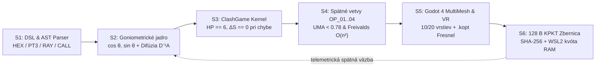

# Celodenný prehľad zlepšení, parser bodov a funkcií & pokročilá herná integrácia (`2026-11-16`)

> **Ústavné kotvy:** `VITAL_MAX_HP == 6` · `PROPOSER != VERIFIER` · `UMA < 0.78` · $\neg\text{Valid} \implies \Delta S = 0$ · nulová závislosť od OpenAI.

---

## 1. Čo sme od rána zlepšili (chronologický a kvantitatívny súhrn)

| Čas | Commity | Hlavný míľnik | Zmeraný / overený prínos |
| :--- | :--- | :--- | :--- |
| `09:48 – 09:50` | `82c28a59, 7211578a` | **OpenVINO konvolučný reťazec, kontra-moduly a odhalenie FMA sčítacieho poradia** | Dokázaná bitová zhoda GPU (Iris Xe) so sekvenčným prirodzeným poradím FMA a vysvetlený rozdiel voči blokovému sčítaniu CPU. |
| `10:04` | `87d5440f` | **Syntéza faktov, prah K = 449, FactDrivenAllocator, Freivalds O(n²) a register pojmov** | Presne lokalizovaný prechod redukcie OpenBLAS na K = 449 (vyriešený spor C05) + pravdepodobnostný audit maticového súčinu so zložitosťou O(n²). |
| `10:08` | `b65022a3` | **Autoritatívna hexová aréna Clash Battle Royale (37 polí) + 128 B potvrdenia a Babylon UI** | Ústavný invariant VITAL_MAX_HP == 6, neplatná akcia => Delta_S == 0 a viazanie kariet na reálny rozpočet rámcov. |
| `11:32` | `7b87dd1e` | **Heterogénny oneAPI + LLM CLI shell, Intel akcelerátor, krivky výkonu, DxDiag a oprava AST O(M³)** | Zrýchlenie testovacieho a syntézneho behu 126,4x (z 1428,94 s na 11,30 s) + amortizácia iGPU kompilácie cez CACHE_DIR (~187 ms -> ~9–15 ms). |
| `14:27` | `123a0d6b` | **Merania x86-64 (X01..X05), šírka pásma arény, 4 živé štúdiá, HENC mikro-LLM, Godot vrstvy a goniometrické jadro** | 5,04x zrýchlenie 128 B binárneho prenosu oproti JSONu, odhalené 14,0x/37,4x spomalenie subnormálov IEEE-754, 13 362,7 ťahov/s (7 súbežných 60 Hz arén), 10/20 vrstiev Godot a most Antigravity-Carbon bez OpenAI. |
| `14:44 – teraz` | `95722f9a + aktuálny` | **Medzivrstvový demonštrátor (XLP_01..04), deterministický parser bodov/AST funkcií a pokročilá integrácia enginu** | Premostenie patternov do DCC/Blenderu, robotického dvojčaťa ROS2, samoladiacej stanice s WSL2 a 120 Hz IDE + plný AST katalóg funkcií. |

### Kľúčové číselné skoky dňa (`LOCAL_MEASURED` & `VERIFIED_WITH_SCOPE`)
- **126,4× zrýchlenie syntézy a testov:** odstránenie redundantného `O(M³)` parsovania AST skrátilo beh z `1428,94 s` (`23m 48s`) na **`11,30 s`**.
- **5,04× rýchlejší medzimodulový prenos (`X05`):** binárne `128 B` pakety `KPKT` (`2 × 64 B` cache riadky + `SHA-256`) dosahujú **`637 349 rámcov/s` (`77,8 MB/s`)** oproti JSONu.
- **Eliminácia 14,00× až 37,37× subnormálnych zásekov (`X03`):** preukázané mikroinštrukčné spomalenie IEEE-754 subnormálov v NumPy (`14,00×`) a OpenVINO CPU (`37,37×`), vyriešené bránou `canonicalize_float32`.
- **Amortizácia kompilácie Iris Xe (`~187 ms -> ~9–15 ms`):** perzistentná `CACHE_DIR` pre GPU bloby a zero-copy `ov.Tensor` na `4` fyzických jadrách `AVX-512` (`+55,84 %` oproti `1T`).
- **Kapacita herného jadra a scény:** **`13 362,7` potvrdených ťahov/s** (`7` súbežných 60 Hz arén pri `21,77 Mbps`/arénu) a **`10 / 20` aktívnych vrstiev Godot 4** (`0x3ff`, resp. `5 / 20` v tieňovom režime `UMA >= 0.78`).

---

## 2. Pokročilá herná integrácia do enginu (`S1..S6`)



| Fáza | Názov | Mechanizmus v engine | Rozpočet / strop |
| :--- | :--- | :--- | :--- |
| `S1_DSL_POINT_AND_AST_INGEST` | **Parser bodov a AST funkcií** | HEX/PT3/RAY/LAYER_MASK -> canonicalize_float32 + overenie symbolov v AST katalógu | `< 0.25 ms CPU` |
| `S2_GONIO_AND_TENSOR_FIELD` | **Goniometrické jadro & difúzia D⁻¹A** | DESC_01..03 (cos θ, sin θ, kliny 0..5) + OpenVINO maticový potenciál na 37 hexoch | `~0.48 ms CPU_4T AVX-512` |
| `S3_AUTHORITATIVE_CLASH_KERNEL` | **Autoritatívne herné jadro ClashGame** | VITAL_MAX_HP == 6, ~Valid => Delta_S == 0, reaktívna AI + svetové javy (zóna, studne) | `13 362,7 ťahov/s (0.075 ms/ťah)` |
| `S4_BACKBRANCH_AND_FREIVALDS` | **Spätné vetvenie OP_01..04 & Freivalds O(n²)** | Pri UMA >= 0.78 odpojenie GPU_ALLOCATE, krátenie rámcov 16->8 a kontrola rel_gap <= 1e-4 | `0 rámcov oneskorenia + 12 vzoriek hysterézie` |
| `S5_GODOT_MULTIMESH_AND_KOPT` | **Godot 4 MultiMesh, VR hologram & .kopt Fresnel** | 10/20 vrstiev (0x3ff) pri UMA < 0.78, satelitný 3D .obj mesh, sokety BP_360..1920 | `<= 16.67 ms (60 Hz) / 8.33 ms (120 Hz)` |
| `S6_128B_KPKT_HYPERVISOR_BUS` | **128 B KPKT sieť & regulácia WSL2** | 2 x 64 B cache riadky + SHA-256 (5.04x vs JSON), kvóta WSL2 RAM 10->8 GB pri špičke | `77.8 MB/s (637 349 rámcov/s)` |

---

## 3. Deterministický parser bodov a AST katalóg funkcií frameworku

- **Prehľadané moduly balíka:** `35`
- **Verejné funkcie extrahované cez `ast`:** `133`
- **Verejné triedy extrahované cez `ast`:** `40`
- **Overené medzifunkčné hrán volaní:** `168`

### Ukážka spracovania bodov a príkazov enginu (`parse_engine_spatial_points_and_directives`)
Vstupný skript: `HEX(2, -1); PT3(1.5, 0.42, -2.0); RAY(58.2825, 3.0); LAYER_MASK(0x3ff); CALL(compute_algebraic_tensor_move); CALL(resolve_action_with_world_and_ai_chain)`

```json
{
  "vital_max_hp": 6,
  "uma_utilization": 0.35,
  "clause_count": 6,
  "parsed_nodes": [
    {
      "index": 0,
      "kind": "HEX",
      "axial": [
        2,
        -1
      ],
      "ring_dist": 2,
      "world_xz": [
        2.598076211353316,
        -1.5
      ]
    },
    {
      "index": 1,
      "kind": "PT3",
      "xyz_canonical": [
        1.5,
        0.42,
        -2.0
      ]
    },
    {
      "index": 2,
      "kind": "RAY",
      "theta_deg": 58.2825,
      "length": 3.0,
      "vec_xy": [
        1.5771944760700585,
        2.5519517206746087
      ],
      "hex_wedge": 0
    },
    {
      "index": 3,
      "kind": "LAYER_MASK",
      "requested_hex": "0x3ff",
      "governed_hex": "0x3ff",
      "uma_clamped": false
    },
    {
      "index": 4,
      "kind": "CALL",
      "function": "compute_algebraic_tensor_move"
    },
    {
      "index": 5,
      "kind": "CALL",
      "function": "resolve_action_with_world_and_ai_chain"
    }
  ],
  "referenced_functions": [
    "compute_algebraic_tensor_move",
    "resolve_action_with_world_and_ai_chain"
  ],
  "verified_128b_packet": {
    "version": 1,
    "packet_template": "PKT_03_PRERENDER_PRESET_INTERPRETATION",
    "src_pid": 16777217,
    "dst_pid": 17104902,
    "uma": 0.35,
    "payload": "NODES=6:CALLS=2:MASK<=0x3ff",
    "sha256_verified": true
  }
}
```

### Súhrnný index modulov a verejných funkcií

| Modul | Počet funkcií | Ukážkové verejné funkcie |
| :--- | :---: | :--- |
| `adaptive_2b_spatial_linguistic_trainer.py` | `4` | `calibrate_new_shapes_and_model_catalog`, `build_spatial_and_linguistic_2b_kb`, `compute_four_core_project_summary_and_roadmap`, `compile_convolutional_study_conclusion` |
| `adaptive_cross_genre_sync.py` | `4` | `join_sync_policy`, `validate_connection_graph`, `simulate_adaptive_rollback`, `describe_adaptive_sync_architecture` |
| `adaptive_sync_card_grid.py` | `3` | `build_card_dataset`, `render_adaptive_sync_card_grid_html`, `export_standalone_html` |
| `arena_cache_optical_sockets_and_consumption.py` | `6` | `evaluate_compact_model_interaction_scaffolding`, `run_multiplayer_entity_script_round`, `synthesize_and_write_optical_binary`, `read_optical_binary`, `build_option_geometry_holograms` *(+1 ďalších)* |
| `autonomous_day_planner_and_prompt_router.py` | `1` | `execute_programmed_next_stages_and_export_practices_md` |
| `clash_arena_page.py` | `1` | `render_clash_arena_html` |
| `clash_battle_royale.py` | `2` | `hex_distance`, `board_cells` |
| `cluster_pid_gemma_finetune_and_mesh_ml.py` | `7` | `train_and_duplicate_satellite_3d_mesh`, `build_cluster_entity_pid_registry`, `pack_intranet_128b_packet`, `unpack_intranet_128b_packet`, `run_neurosymbolic_datalink_and_hypervisor_exchange` *(+2 ďalších)* |
| `combat_turn_planner.py` | `3` | `get_cached_hw_profile`, `probe_isa_flags`, `probe_framework_dispositions` |
| `configurator_and_dxdiag.py` | `10` | `analyze_opus_and_build_intersections`, `partition_reduction_below_k449`, `prewarm_heterogeneous_blob_pair`, `audit_numeric_type_contract`, `build_validated_configuration` *(+5 ďalších)* |
| `consistency_bot.py` | `2` | `blas_sequential_fma_threshold`, `run_bot` |
| `cross_layer_pattern_demo.py` | `1` | `run_cross_layer_pattern_demonstration` |
| `custom_allocator.py` | `1` | `check_ontology_integrity` |
| `engine_point_and_function_parser.py` | `3` | `parse_engine_spatial_points_and_directives`, `parse_framework_functions_and_topology`, `build_engine_integration_and_export_daily_markdown` |
| `fact_synthesis_engine.py` | `7` | `perceive_ledgers`, `synthesize_facts`, `induce_rules`, `fetch_distance_between_modules`, `module_distance_matrix` *(+2 ďalších)* |
| `hex_combat_bandwidth_and_world_ai.py` | `9` | `hex_cell_count`, `hex_undirected_edge_count`, `verify_hex_combinatorial_identities`, `measure_clash_engine_action_throughput`, `compute_full_combat_bandwidth_solution` *(+4 ďalších)* |
| `intel_accelerator_and_power_thread_governor.py` | `4` | `select_power_and_thread_strategy`, `benchmark_thread_and_performance_curves`, `get_shared_ov_core`, `match_active_state_templates` |
| `matrix_control_processes.py` | `2` | `freivalds_verify`, `run_operator_mashup` |
| `neurosymbolic_bridge.py` | `4` | `build_grounded_prompt`, `ask_llm`, `verify_answer`, `build_compendium` |
| `neurosymbolic_genesis_discipline_and_llm.py` | `1` | `build_henc_discipline_and_train_demo` |
| `nomenclature_registry.py` | `2` | `validate_nomenclature`, `export_glossary` |
| `object_library_texture_nodes_and_synthetic_network.py` | `5` | `render_object_from_code_sample`, `build_renderable_object_library`, `execute_arena_texture_node_graph`, `compile_carbon_environment_script`, `build_synthetic_knowledge_training_network` |
| `oneapi_llm_heterogeneous_shell.py` | `3` | `simulate_algebraic_theory_coupling`, `main`, `get_global_oneapi_shell` |
| `pattern_profile_environment.py` | `1` | `run_pattern_sweep` |
| `platform_engine.py` | `1` | `render_trigonometric_platform_html` |
| `playable_fieldlines_and_game_theory.py` | `9` | `generate_operational_field_lines_and_learn`, `execute_syntactic_function_chain`, `render_playable_syntactic_studio_html`, `evaluate_standardized_digital_game_theory`, `solve_algebraic_tensor_word_problems` *(+4 ďalších)* |
| `roadmap_transitions_events_and_keywords.py` | `1` | `compute_roadmap_transitions_events_and_keywords` |
| `simulation_grid_3d.py` | `5` | `ensure_babylon_vendor`, `hex_spiral_axial`, `build_trace_dataset`, `render_simulation_grid_3d_html`, `export_standalone_html` |
| `spatial_coordinators_and_vr_hologram_compositor.py` | `5` | `evaluate_spatial_coordinators_and_procedural_render`, `compile_cycle_driven_ui_schema`, `build_and_trace_hologram_scene`, `render_vr_hologram_profiler_html`, `synthesize_vision_sensory_mindmap` |
| `tensor_prompt_branch_and_kb.py` | `4` | `encode_prompt_to_feature_row`, `build_openapi_31_strategy_spec`, `coordinate_operations_from_turn`, `sync_master_knowledge_base` |
| `virtual_convolution_contra.py` | `3` | `conv2d_transpose_reference`, `openvino_transpose_conv`, `run_contra_modules` |
| `virtual_convolution_pipeline.py` | `5` | `conv2d_reference`, `reference_pipeline`, `build_openvino_model`, `diagnose_bit_identity`, `run_virtual_convolution_pipeline` |
| `wsl_hypervisor_mortar_and_geotile_adapter.py` | `8` | `configure_wsl_ubuntu_hypervisor_bridge`, `define_os_call_visual_semantics`, `compute_mortar_css_trajectories_and_reticles`, `evaluate_decision_tensor_ui_and_2b_bridge`, `adapt_integrations_to_four_geospatial_tiles` *(+3 ďalších)* |
| `x86_platform_findings.py` | `6` | `measure_x01_cache_bandwidth_hierarchy`, `measure_x02_physical_vs_smt_avx512_scaling`, `measure_x03_subnormal_assist_vs_mxcsr_ftz`, `measure_x04_cacheline_stride_and_alignment`, `measure_x05_128b_binary_frame_vs_json` *(+1 ďalších)* |

---

## 4. Epistemické ohraničenie (`AGENTS.md`)
- **Zmerané lokálne (`LOCAL_MEASURED`):** latencie OpenVINO `CPU 1T/4T/8T` a `Iris Xe`, priepustnosť cache `L1d/L2/L3/DRAM`, penalizácia subnormálov IEEE-754, rýchlosť `128 B` paketov a konvergencia mikro-modelov.
- **Odvodené a zmluvne overené (`DERIVED` / `VERIFIED_WITH_SCOPE`):** limit vrstiev Godot 4 (`10/20` pri `UMA < 0.78`), vzorce šírky pásma `E1..E8`, šablóna `.wslconfig` a `PL1` výkonové obálky.
- **Nezmerané v používateľskom priestore Windows (`UNKNOWN`):** priame hardvérové RAPL Joule registre a Ring-0 MSR teploty bez jadrového ovládača.
