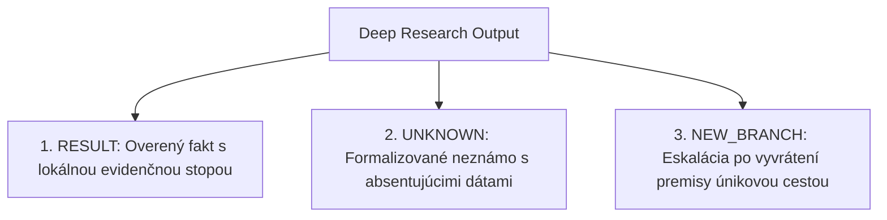

# Deep Research & Portfólio hypotéz: Priorita vs. Viera a Úniková cesta pre protidôkaz
**Document ID:** `SPEC-DEEP-RESEARCH-PORTFOLIO-01`  
**Milestone:** `V-DEEP-RESEARCH-01`  
**Classification:** Výskumný a epistemický operačný protokol  
**Constitutional Invariant:** `VITAL_MAX_HP == 6`  

---

## 1. Princíp: Priorita určuje čo skúmať, nie čomu veriť

Bežné asistenčné a vyhľadávacie systémy trpia skreslením: zamieňajú **prioritu skúmania** za **mieru presvedčenia o pravdivosti**. V dôsledku toho skúmajú iba to, čomu „veria“ (konfirmačné skreslenie), alebo preberajú populárny externý konsenzus namiesto preverovania lokálnej reality.

V Krystal Stack platí striktný epistemický dekompozit:
* **Priorita:** Riadi alokáciu výpočtových, meracích a výskumných cyklov.
* **Viera (Pravdivostný status):** Je výhradne funkciou rigoróznej empirickej a formálnej evidencie na nezávislom evidenčnom grafe.

$$\text{Priorita} \neq \text{Viera}$$

---

## 2. Evidenčná hierarchia: Najprv lokálna evidencia, potom externá

Deep Research sa vždy riadi štruktúrovaným `ResearchPlanom`:
1. **Lokálna evidencia (Primárna vrstva):** Fyzické telemetrické dáta projektu, lokálne systémové merania, profilovacie záznamy, hardvérové registre, prebehnuté integračné testy. Lokálna pravda je primárny základ.
2. **Externé zdroje (Sekundárna vrstva):** Vyhľadávanie v externej literatúre, benchmarkoch či webe je povolené **výhradne vtedy, ak očakávaný prírastok informácie ($\text{EVOI}$) prevyšuje náklady na jeho získanie**.
3. **Zákaz prepisu lokálnej pravdy:** Žiadny externý korpus, akademický konsenzus ani väčšinový názor nesmie prepísať lokálne empiricky nameranú realitu na hardvéri.

---

## 3. Portfólio konkurenčných hypotéz a prioritizačná funkcia

Systém nikdy neskúma jedinú obľúbenú hypotézu (prevencia tunelového videnia). Udržiava paralelné portfólio hypotéz naprieč 4 paradigmami (Konvenčná, Architektonická, Interakčná, Adversariálna).

Priorita každej vetvy výskumu $\mathcal{H}_i$ je deterministicky kalkulovaná:

$$\text{Priority}(\mathcal{H}_i) = \frac{\mathcal{R}_{\text{goal}}(\mathcal{H}_i) \times \Delta \mathcal{I}_{\text{expected}}(\mathcal{H}_i) \times \mathcal{V}_{\text{falsif}}(\mathcal{H}_i)}{\max(\text{Cost}(\mathcal{H}_i), 1\text{e-}6)}$$

* $\mathcal{R}_{\text{goal}}$: Relevancia k definovanému cieľu výskumu $[0.0, 1.0]$.
* $\Delta \mathcal{I}_{\text{expected}}$: Očakávaný zisk informácie (redukcia entropie) $[0.0, 1.0]$.
* $\mathcal{V}_{\text{falsif}}$: Falzifikačná hodnota (schopnosť testu vyradiť hypotézu alebo jej alternatívy) $[0.0, 1.0]$.
* $\text{Cost}$: Výpočtové, časové a energetické náklady na test v milisekundách.

> **Zákaz:** Prioritizácia podľa apriórnej pravdepodobnosti, intuitívnej sympatie či internetovej obľúbenosti je prísne zakázaná.

---

## 4. Parkovanie vedľajších nálezov (Side Findings Stash)

Počas hĺbkového výskumu často vznikajú nečakané pozorovania, ktoré nesúvisia s primárnym cieľom.
* **Chyba typu 1 (Tunelové ignorovanie):** Zahodenie dôležitého nálezu, pretože „nesúvisí so zadaním“.
* **Chyba typu 2 (Scope Drift):** Opustenie primárneho cieľa a prenasledovanie vedľajšej stopy.
* **Riešenie Krystal:** **Side Findings Stash**. Vedľajší nález je katalogizovaný, označený statusom `SIDETRACK_OBSERVATION`, vybavený kontextom a zaparkovaný pre budúce výskumné plány. Primárny výskum pokračuje bez prerušenia.

---

## 5. Úniková cesta pre protidôkaz (Premise Refutation Escape Hatch)

Ak sa pri skúmaní objaví **protidôkaz, ktorý priamo spochybňuje základnú premisu** výskumného plánu alebo architektúry:
1. Protidôkaz **nesmie byť potlačený**, reinterpretovaný ani zaparkovaný ako vedľajší nález.
2. Aktivuje sa **garantovaná úniková cesta (Escape Hatch)**.
3. Výskum okamžite eskaluje:
   * **Reframing problému:** Prehodnotenie okrajových podmienok a predpokladov modelu.
   * **Audit validátora:** Preverenie, či testovacie orakulum alebo stopky nemerajú skreslenú veličinu.
4. Výstupom sa stáva nová výskumná vetva (`NEW_BRANCH`), čím sa zabráni plytvaniu zdrojmi na optimalizáciu na chybných základoch.

---

## 6. Výstupná triáda s evidenčnou stopou

Každý výstup modulu Deep Research musí spadať do jednej z troch exaktných kategórií:

1. **`RESULT` (Výsledok):** Potvrdený empirický fakt podložený lokálnou telemetriou a testom, zapísaný do kryptografického provenance ledgeru.
2. **`UNKNOWN` (Neznáme):** Priznaný stav chýbajúcej evidencie s presným zoznamom absentujúcich premenných.
3. **`NEW_BRANCH` (Nová vetva):** Reštrukturalizovaný výskumný priestor po úspešnej falzifikácii základnej premisy.

---

## 7. Constitutional Invariant

$$\text{assert } \text{VITAL\_MAX\_HP} == 6$$

Všetky štruktúry (`ResearchHypothesis`, `ResearchGoalSpec`, `SideFinding`, `PremiseRefutationReceipt`, `DeepResearchPlan`, `EpistemicOutputTriad`) validujú `vital_max_hp == 6` v `__post_init__`, pri porušení vyvolávajú `ContractViolation`.
