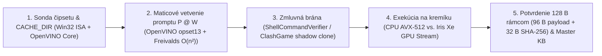
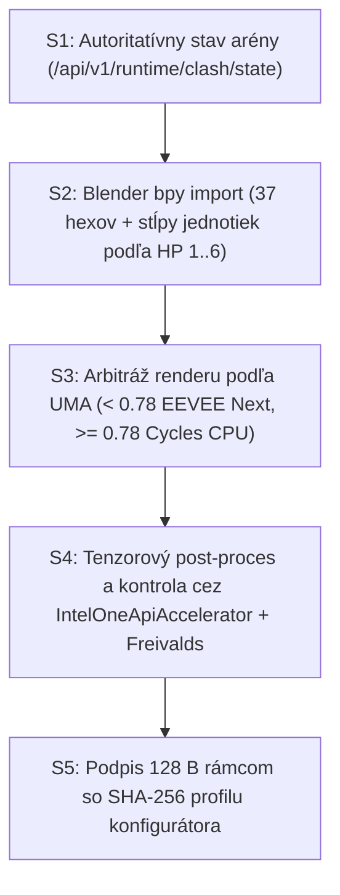

# Referenčná príručka vedenia heterogénnych výpočtov, čipsetu a stavových vzorov

Tento dokument slúži ako referenčná príručka pre riadenie heterogénnych výpočtov (Intel CPU `oneDNN` + iGPU `Iris Xe` cez OpenVINO/oneAPI), maticové vetvenie promptov, numerické kontrakty, diagnostiku tokov pamäte (`DxDiag` profil), súbojový plánovač a pracovnú schému pre Blender.

> [!IMPORTANT]
> **Epistemická hranica autority:** Žiadny návrh z UI, jazykového modelu (`:1234/v1`) ani tenzorovej matice v OpenVINO nemení stav priamo (`PROPOSER != VERIFIER`). Každý zásah prechádza zmluvnou bránou; pri porušení invariantu (`VITAL_MAX_HP == 6`, `UMA < 0.78`, `rel_error < 1e-3`) ostáva stav nedotknutý ($\Delta S = 0$).

---

## 1. K čomu v systéme dochádza (Prevádzkový cyklus)



1. **Sondáž disponovaných vlastností** ([combat_turn_planner.py](file:///c:/Users/dusan/Documents/GitHub/Krystal-stack-platform-framework/projects/trigonometric_hybrid_platform_framework/combat_turn_planner.py)): systém načíta skutočné inštrukčné sady cez `IsProcessorFeaturePresent` (`AVX512F=True`), dostupné OpenVINO zariadenia (`CPU`, `GPU`), počet predkompilovaných blobov v `artifacts/cache/openvino_blobs` a verdikty `C01..C08`.
2. **Maticové rozhodovanie v pamäti** ([tensor_prompt_branch_and_kb.py](file:///c:/Users/dusan/Documents/GitHub/Krystal-stack-platform-framework/projects/trigonometric_hybrid_platform_framework/tensor_prompt_branch_and_kb.py)): riadiace prompty sa kódujú do príznakovej matice $P \in \mathbb{R}^{B \times 8}$, OpenVINO spočíta $Y = P \cdot W \in \mathbb{R}^{B \times 6}$, Freivaldsov algoritmus ($k=6$, chyba $\le 2^{-6}$) overí súčin a symbolická brána odfiltruje vetvy porušujúce strop zbernice `UMA >= 0.78`.
3. **Koordinácia operácií a konfigurátor** ([configurator_and_dxdiag.py](file:///c:/Users/dusan/Documents/GitHub/Krystal-stack-platform-framework/projects/trigonometric_hybrid_platform_framework/configurator_and_dxdiag.py)): utilitná sada `U01..U06` preloží cieľ používateľa na podpísaný profil (`SHA-256`) s presným počtom vlákien, obálkou PL1 a synchronizačným horizontom.

---

## 2. Aké typy čísel sa v konfigurácii riešia

| Doména v systéme | Presný číselný typ | Kde sa používa | Dôvod voľby |
|---|---|---|---|
| **Autoritatívny stav a brány** | `int` (presné celé čísla) | `VITAL_MAX_HP = 6`, `hp` $\in [0, 6]$, hex súradnice `(q, r)` $\in [-3, 3]$, rozpočet `128 B` rámcov `[0..16]`, počet vlákien `1 / 4 / 8`, prah redukcie `K = 449` | Nulový zaokrúhľovací posun; deterministický SHA-256 odtlačok stavu |
| **Transakčné potvrdenia** | `bytes[128]` (`96 B` + `32 B` SHA-256) | Každý prijatý ťah v `ClashGame` a každé prepnutie zariadenia v CLI shelli | Pevná veľkosť záznamu a okamžitá kontrola integrity |
| **Tenzorové výpočty a matice vetiev** | `IEEE-754 float32` (`np.float32`, `ov.Type.f32`) | Konvolúcie `[1, C, H, W]`, matica promptov $P$, váhová matica $W$, `INFERENCE_PRECISION_HINT="f32"` | Natívny beh na `brgconv_avx512_f32` (CPU) aj `convolution_gpu_bfyx_os_iyx_osv16__f32` (Iris Xe); neasociatívne sčítanie (~`2.5e-6` rozdiel medzi CPU a GPU) |
| **Referenčné orákulá a riadiaca štatistika** | `IEEE-754 float64` (`np.float64`) | Sekvenčné FMA orákulum, CGLS inverzia, Freivaldsove projekcie $r \in \{-1,+1\}^n$, `EWMA + 2*sigma_upper` | Potlačenie akumulačného šumu pri verifikácii a výpočte horizontu |

Kontrakt nad týmito typmi vynucuje funkcia `audit_numeric_type_contract()` v [configurator_and_dxdiag.py](file:///c:/Users/dusan/Documents/GitHub/Krystal-stack-platform-framework/projects/trigonometric_hybrid_platform_framework/configurator_and_dxdiag.py).

---

## 3. Vedenie napájania, vlákien a kriviek očakávaného výkonu

Modul [intel_accelerator_and_power_thread_governor.py](file:///c:/Users/dusan/Documents/GitHub/Krystal-stack-platform-framework/projects/trigonometric_hybrid_platform_framework/intel_accelerator_and_power_thread_governor.py) rozlišuje:
- **Priamo ovládané parametre v používateľskom priestore (`LOCAL_MEASURED`):** `INFERENCE_NUM_THREADS` (`1`, `4` fyzické jadrá, `8` SMT vlákien), `PERFORMANCE_HINT`, výber zariadenia (`CPU` / `GPU`) a perzistentná `CACHE_DIR`.
- **Zmluvná energetická obálka (`DERIVED_ENVELOPE`):** cieľové pásmo `PL1` (`12 W` Eco / `18 W` fyzické jadrá / `25 W` SMT / `28 W` heterogénny burst) kontrolované v rozmedzí `10–40 W`. Bez jadrového MSR ovládača na Windows sa táto hodnota deklaruje čestne ako riadiaca obálka, nie ako hardvérový wattmeter.

### Očakávaná krivka celkového času pre $n$ inferencií
$$C(d, n) = T_{\text{compile}}(d) + n \cdot T_{\text{median}}(d), \qquad \text{prípustné len ak } T_{p95}(d) \le B_{\text{SLA}}$$

- **Studená cache (`CACHE_DIR` prázdna):** kompilácia iGPU trvá rádovo `~187–215 ms` oproti `~40 ms` na CPU $\implies$ bod zlomu $n^* \approx 530$ inferencií.
- **Teplá cache (`CACHE_DIR` naplnená):** opakovaná kompilácia iGPU klesá na `~9–15 ms` $\implies$ iGPU sa vypláca už pri nízkych desiatkach inferencií, pokiaľ je tenzor $\ge 16\text{ KB}$ a `UMA < 0.78`.
- **Ochrana proti kmitaniu (`ChipsetTelemetryMonitorAndForecaster`):** pri prekročení predikcie $\text{EWMA} + 2\sigma^+ \ge 0.78$ prebieha prechod na CPU okamžite (`0` vzoriek čakania), no návrat do heterogénneho režimu vyžaduje **12 po sebe idúcich čistých meraní**.

---

## 4. Šesť šablónovitých vzorov mapujúcich systémové stavy

| Šablóna | Podmienka stavu | Podpis kremíka a pamäte | Riadený prechod | Falzifikátor |
|---|---|---|---|---|
| `TPL_S0_COLD_UNPRIMED` | `warm_cache_blobs == 0` | Prázdna cache shaderov; GPU compile `~187–215 ms` | Drž beh na CPU, na pozadí predhrej `CACHE_DIR` | Výber GPU pre krátku dávku pri prázdnej cache |
| `TPL_S1_CPU_AVX512_LOW_LATENCY` | `payload < 16 KB` alebo krátky beh | `brgconv_avx512_f32` + `ov.Tensor(shared_memory=True)` | Pripni vlákna na fyzické jadrá (`4T`), drž 10 % maržu | `p95_ms > budget_ms` alebo `rel_error >= 1e-3` |
| `TPL_S2_GPU_IRIS_XE_WARM_THROUGHPUT` | `GPU` + teplá cache + `UMA < 0.78` | `convolution_gpu_bfyx_os_iyx_osv16__f32` cez `IntelStream` | Povoľ kartu `GPU_ALLOCATE` a asynchrónny GPU prúd | `UMA >= 0.78` alebo `rel_error >= 1e-3` |
| `TPL_S3_UMA_SHADOW_THROTTLE` | `UMA >= 0.78` | Zdieľaná zbernica obsadená scanoutom / pamäťou | Zablokuj `GPU_ALLOCATE`, zníž rozpočet arény `16 -> 8` rámcov | Akýkoľvek GPU dispatch počas `UMA >= 0.78` |
| `TPL_S4_NUMERICAL_BOUNDARY_AUDIT` | `K >= 449` alebo aktívny `CONFLICT` | OpenBLAS opúšťa sekvenčné FMA; posun `~2.5e-6` | Zákaz testu bitovej rovnosti naprieč zariadeniami; zapni Freivalds `k=6` | Falošné prijatie poškodenej matice |
| `TPL_S5_OFFLINE_LLM_AST_FALLBACK` | `:1234/v1` nedostupné | Lokálne OpenVINO matice + deterministická gramatika | Označ výstup `ONEAPI_AST_FALLBACK_LLM_OFFLINE` | Vydanie fallbacku za živú odpoveď LLM |

---

## 5. Schéma pre prácu v Blenderi v tomto systéme

Funkcia `build_blender_system_workflow_schema()` v [configurator_and_dxdiag.py](file:///c:/Users/dusan/Documents/GitHub/Krystal-stack-platform-framework/projects/trigonometric_hybrid_platform_framework/configurator_and_dxdiag.py) definuje 5-stupňový most medzi autoritatívnym jadrom a scénou v Blenderi:



- Ak na stanici nie je binárka `blender` v `PATH`, modul nevymýšľa falošný render, ale overí syntaktický strom (`ast.parse`) vygenerovaného `bpy` skriptu a označí stav `SCRIPT_AST_VERIFIED_BLENDER_NOT_ON_PATH`.

---

## 6. Rýchle príkazy riadeného CLI Shellu

Spustenie z koreňového priečinka v izolovanom prostredí `.venv`:

```powershell
.\.venv\Scripts\python.exe -X utf8 -m projects.trigonometric_hybrid_platform_framework.oneapi_llm_heterogeneous_shell --exec "probe; opus-audit; configure high_throughput_batch; sim-algebra 24"
```

Pre interaktívny režim vynechajte parameter `--exec`. Každý príkaz zadaný priamo alebo cez `ask --execute <zámer>` prechádza bránou `ShellCommandVerifier`.
