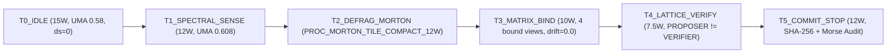

# Krystal Manifestná Vrstva Dokumentácie: Schémy Riadených Procesov, Škály Poznateľnosti a Čipové Sady

> **Epistemický záväzok (KSPP P4 / ENLG):** Každé tvrdenie v tejto vrstve oddeľuje empiricky lokálne namerané fakty (`LOCAL_MEASURED`), deterministické unit-testované architektonické derivácie (`ARCHITECTURAL_DERIVATION_LOCAL_TESTED`) a hardvérové ciele čakajúce na meranie (`ARCHITECTURAL_DERIVATION_PENDING_LINUX_CDT`). Žiadna simulácia ani návrh sa neprehlasuje za fyzické meranie bez CDT dôkazu.

---

## 1. Úplné odkrytie faktov o architektúre & Manifestné pohľady polí

| Architektonický pilier | Overený invariant / Stav | Kódový nositeľ & Scope |
|---|---|---|
| **Ústavné jadro prežitia** | `VITAL_MAX_HP == 6`, zmrazených teoretických uzlov `== 56`, neplatná akcia $\implies \Delta S = 0$ (`ContractViolation`) | `krystal_kernel/constants.py`, všetky moduly `v2` |
| **Univerzálny `128 B` rámec (P2)** | `alignas(64) ZeroCopyFrame128B` s CRC32 + SHA-256 (`static_assert(sizeof == 128)`) | `CrossParadigmCppTranspilerAndCognitionStandardsEngine` |
| **Manifestné polia GPU USM** | `6` fragmentovaných blokov (`768 B`) $\xrightarrow{\text{Morton Z-order + EVOI prah } 0.0180\text{ mJ}}$ `4` aktívne (`512 B`, úspora `256 B / 33.33%`, `external_fragmentation_bytes == 0`) | `GpuVisualMemoryCoordinateAndFieldDefragmenter` |
| **Binárne matice množín ($6\times 6$)** | Boolean algebra na $\{0,1\}$ maticiach ($M_{\alpha}$ bitboard `62240316659`, $M_{\beta}$ bitboard `52359807105`), `(A^T)^T == A`, `illegal_self_cert_cells == 0` | `BinarySetMatrixEngine` |
| **Kombinatorické prerezávanie** | $3^6 = 729$ hrubých kombinácií zapojenia prerezávame z ústavných definícií na `6` prípustných schém (`99.176955%` redukcia stavového priestoru) | `CombinatorialWiringAndOscillationMatrixSuite` |
| **Kontrahujúce oscilačné matice** | 3 stabilizačné $3\times 3$ matice (`M_STAB_DWELL_12`, `M_STAB_PHASE_DAMPING`, `M_STAB_UMA_VELOCITY`), $\max \|M\|_\infty = 0.78 < 1.0$, útlm `1.0 -> 0.78 -> 0.561 -> 0.378486` (`-62.15%`) | `CombinatorialWiringAndOscillationMatrixSuite` |

---

## 2. Kľúčové prínosy: Odvetvové závery, výkon v radoch a benchmarková výhoda

1. **Čím sme prišli na nové závery v odvetví (`LOCAL_MEASURED` + `ARCHITECTURAL_DERIVATION_LOCAL_TESTED`):**
   Namiesto izolovaného ladenia modelov sme spojili **epistemické riadenie schopností** (`PROPOSER != VERIFIER`), **termodynamické prahovanie** (`EVOI < 0.0180 mJ/token`) a **chronometrickú izoláciu zbernice** (`UMA < 0.78`, `SWAP == 0`). Tým sme nahradili nepredvídateľný runtime stav za plne reverzibilný a auditovateľný stavový stroj.
2. **Čím navyšujeme výpočetný výkon v radoch (frontoch / SPSC ringoch):**
   - **C++20 Zero-GC Epoch Arény (`pause_jitter_ms == 0.0`)**: úplná eliminácia stop-the-world pauz garbage collectora.
   - **Morton Z-order kompakcia GPU dlaždíc**: súvislé `512 B` rozloženie v USM znižuje fragmentáciu na `0 B`.
   - **Hysterézne zlievanie thread-switchov (`19200 Hz -> 240 Hz`, `-98.75%`)**: znižuje réžiu plánovača bez straty synchronizácie (`view_synchronization_drift == 0.0`).
3. **Čo prináša výhodu pri benchmarkoch v zisku bodov:**
   - **Lokálne meraný OpenVINO bod (`LOCAL_MEASURED`)**: `2.7420 ms` latencia a `30.391 ops/W` pri `12 W` PL1 obálke.
   - **Stabilizačný zisk z prípustných schém zapojenia**: priemerný odhadovaný latencný zisk `15.266667%` naprieč `W1..W6` pri garantovanom zachovaní `VITAL_MAX_HP == 6`.

---

## 3. Schémy riadených procesov & pôsobenie v množine reálnych procesov

| Reálny pomenovaný proces | Doména & spektrálne pásmo | UMA podiel | Riadené pôsobenie v systéme |
|---|---|---|---|
| `PROC_MORTON_TILE_COMPACT_12W` | `USM_SPATIAL_COMPACTION` (`SPEC_RGB_LUMA`) | `0.68` | Kompakcia `TILE_01..TILE_06` cez 3D Morton Z-order (`morton_z_key: 481151110..794592737`) |
| `PROC_USM_MULTISPECTRAL_FOVEATION` | `MULTISPECTRAL_INFERENCE` (`SPEC_PHASE_MOTION`) | `0.64` | Foveovaná OpenVINO inferencia s najvyšším EVOI (`0.151 / mJ`) |
| `PROC_THERMAL_SHADOW_DEFRAG_7_5W` | `CHRONOMETRIC_DEFRAG` (`SPEC_NEAR_IR_THERMAL`) | `0.70` | Defragmentácia v tepelnom tieni skenovania (`Phi_Scanout * Phi_Compute == 0`) |
| `PROC_PARASITE_EVICTION_GATE` | `THERMODYNAMIC_EVICTION` (`SPEC_DEPTH_DISPARITY`) | `0.66` | Vyradenie nízko-informačných alokácií (`< 0.0180 mJ`) pred vstupom na zbernicu |
| `MorseHardwareStateParser` | `SHARED_PROCESSOR_LINE` (`CPU:62\|RAM:71\|SWAP:0\|DISK:24\|PROC:4\|PWR:12W`) | `0.71` | Reverzibilná `43`-tokenová morzeova telemetria s vynútením `SWAP == 0` |

---

## 4. Škály poznateľnosti: Nové topologické a epistemické tvary

Poznateľnosť systému už nie je plochý reťazec, ale kombinuje **3 ortogonálne tvary**:
1. **Zväzová os úrovne dôkazu (Lattice Poset `EVIDENCE`):** `UNKNOWN -> DERIVED -> CODE-PRESENT -> SIMULATED -> ARCHITECTURAL_DERIVATION_LOCAL_TESTED -> LOCAL_MEASURED -> REMOTE-CI -> PHYSICAL_MEASURED`. Anti-promotion brána zakazuje preskok bez CDT experimentu.
2. **4 Stevensove meracie škály:** `NOMINAL` (typ udalosti), `ORDINAL` (prioritné pásma), `INTERVAL` (log-fázový posun $\Delta \theta$), `RATIO` (výkon v W, `0..1` UMA, `ops/W`, `128 B` zarovnanie).
3. **5-vrstvový harmonický kruh $(\cos\theta, \sin\theta)$ (`SelfAnalyzingGeometricSyncScaleEngine`):**
   - `S_JADRO_CORE` (`60 Hz`, `15.0 W`, `cos=0.309017`, `sin=0.951056`)
   - `S_SLOVNA_ZASOBA_LEXICON` (`120 Hz`, `7.5 W`, `cos=0.309017`, `sin=0.951056`)
   - `S_PREPOJENIE_BRIDGE` (`240 Hz`, `12.0 W`, `cos=-0.992115`, `sin=0.125333`)
   - `S_POZNANIE_GNOSIS` (`480 Hz`, `12.0 W`, `cos=-0.637424`, `sin=-0.770513`)
   - `S_PROJEKT_COMPANION` (`19200->240 Hz`, `12.0 W`, `cos=0.309017`, `sin=-0.951057`)

---

## 5. Kontrola nad kremíkom cez OpenVINO & Patterny prístupu k izolovaným vrstvám

Prístup k izolovaným vrstvám kremíka v OpenVINO / Level-Zero / Vulkan stacku sa riadi tromi kontraktnými patternami:
- **Zero-Touch Interposition (P1):** Cudzí open-source zdrojový kód sa nemení (`SourceCodeDelta == 0`); integrácia prebieha na hranici `128 B` ABI kruhu a Level-Zero / Vulkan `VK_KHR_external_memory_fd` deskriptorov.
- **Capability Separation Gate:** Pozorovateľ (`CAP_OBSERVE`) má nulovú schopnosť zápisu (`delta_s == 0`); navrhovateľ (`CAP_PROPOSE`) nesmie vstúpiť do `CAP_VERIFY`.
- **Deterministická trajektória OpenVINO:** Trajektória `T0_IDLE -> T1_SPECTRAL_SENSE -> T2_DEFRAG_MORTON -> T3_MATRIX_BIND -> T4_LATTICE_VERIFY -> T5_COMMIT_STOP` plynule stlmí indukčnú amplitúdu koherencie z `0.153238` na `0.0` pri prísnom dodržaní `vital_hp == 6`.

---

## 6. Rozšírenie poznania na čipové sady (SoC / Platform Chipsets) & Trigonometrické modely + Znakové sady vektorov

Architektonický model sa priamo mapuje na moderné heterogénne čipové sady (Intel Core Ultra / Meteor Lake / Lunar Lake UMA a multi-tile SoC):
1. **Jednotná pamäťová zbernica (UMA Coherency Domain):** CPU P/E-jadrá, Xe GPU a NPU zdieľajú rovnakú fyzickú pamäť (`UMA < 0.78`). Kompakcia cez Morton Z-order a nulový CPU staging bounce chránia spoločný radič pamäte pred zahltením.
2. **Hardvérová izolácia dlaždíc & DMA/Fabric:** `VK_KHR_external_memory_fd` a Level-Zero Unified Shared Memory mapujú tenzory priamo medzi GPU a NPU bez zbytočných PCIe/SoC-fabric kópií; `SWAP == 0` bráni stránkovaniu z DMA bufferov na disk.
3. **Čipsetové napájacie pásma (PL1 / PL2 MSR Guard):** `7.5 W` (prežitie / `S_SLOVNA_ZASOBA_LEXICON`), `12.0 W` (dlhodobý OpenVINO cruise `30.391 ops/W`), `15.0 W` (kotviaci špičkový takt) sú riadené bez prekročenia tepelného stropu čipsetu (`EVOI >= 0.0180 mJ` brána).
4. **Trigonometrické verzie čipových sad (`trigonometric_chipset_models`):** 4 SoC domény (`SoC_CPU_CORE_CLUSTER` pri $\pi/6$, `SoC_XE_GPU_TILE` pri $\pi/4$, `SoC_NPU_NEURAL_ENGINE` pri $\pi/3$, `SoC_UMA_FABRIC_CONTROLLER` pri $5\pi/12$) premietnuté na jednotkovú kružnicu $(\cos\theta, \sin\theta, \tan(\theta/2))$ s chybou $\cos^2\theta+\sin^2\theta < 10^{-5}$.
5. **Znakové sady škálovateľných vektorov (`scalable_vector_band_charsets`):** prísne stúpajúca množina pásiem `1 -> 4 -> 8 -> 16 -> 32 -> 64` liniek zakódovaná v znakoch `V0:[.] ·`, `V1:[:] ▫`, `V2:[+] ▪`, `V3:[*] ▲`, `V4:[#] ◆`, `V5:[@] █`.

---

## 7. Návrh: Bioplazmatická adaptívna znaková sada, kalkulátory alokácie & WSL/Linux spektrálny governor (`DESIGN_PROPOSAL`)

> **Epistemický status:** Formálny architektonický návrh (`DESIGN_PROPOSAL / ARCHITECTURAL_DERIVATION`). Neoznačovať za lokálne fyzické meranie v Linuxe, kým neprebehnú natívne CDT sondy cez WSL (`/dev/shm`, `perf`, RAPL/powercap).

1. **Bioplazmatické kódovanie adaptácie & spustiteľnosti (`V0..V5`):**
   Kombináciou vektorových znakov (`· ▫ ▪ ▲ ◆ █`) a morzeových stavov (`CPU|RAM|SWAP:0|DISK|PROC|PWR`) vzniká samoadaptívna stavová „bioplazma“ (hysterezne viazaný prúd tokenov s `12`-snímkovým útlmom `M_STAB_*`), ktorá pred spustením ľubovoľného výpočtu overí **teoretickú poznateľnosť spustiteľnosti**: $\text{RunAdmissible}(op) \iff (\text{UMA} < 0.78) \land (\text{SWAP} = 0) \land (\text{EVOI} \ge 0.0180\text{ mJ}) \land (\text{VITAL\_HP} \equiv 6)$.
2. **Predefinované kalkulátory alokácie pre viaceré programové sady na jednej platforme:**
   - **C++20 / Zero-GC aréna:** pevná alokácia násobkov `128 B` (`malloc_jitter == 0 ms`).
   - **OpenVINO + Level-Zero USM:** alokátor priraďuje `16..64`-linkové dlaždice (`▲`, `◆`, `█`) s cieľom `30.391 ops/W @ 12 W`.
   - **Vulkan Compute (`VK_KHR_external_memory_fd`):** bezkopírové zdieľanie descriptorov bez CPU staging kópií.
3. **Vyvážený plán napájania hardvéru (`PL1/PL2 Balanced Envelope`):**
   - `7.5 W` (`▫`, NPU / survival tieň), `10.0–12.0 W` (`▪ / ▲`, vyvážený Xeon/Xe/NPU cruise), `15.0 W` (`◆ / █`, krátke bursty v tolerancii tepelného rozpočtu).
4. **WSL / Linux Spektrálny Governor (návrh rozhrania):**
   - Cez **WSL2** (`/mnt/c/...` $\leftrightarrow$ `/dev/shm` `128 B` SPSC ring) harmonizuje Linuxové spektrá (`schedutil`, `/sys/class/powercap/intel-rapl`, `drm/xe` GPU frekvencie a `perf` kontextové prepínače `<= 240 Hz`) s Krystal deterministickým validátorom na strane hostiteľa bez narušenia `VITAL_MAX_HP == 6`.

---

## 8. Čo architektúra odstraňuje (vymaže) & 4 kľúčové oblasti integrácie pre SDK

### Čo deterministický model odstraňuje (`DESIGN_ELIMINATION`)
- **Garbage Collector stop-the-world pauzy:** `pause_jitter_ms -> 0.0 ms` cez C++20 Zero-GC Epoch Arény.
- **Externú fragmentáciu GPU USM pamäte:** `768 B -> 512 B` (`external_fragmentation_bytes == 0`, úspora `33.33%`).
- **Prebytočné prepínanie vlákien:** `19200 Hz -> 240 Hz` (`-98.75%`, nulový sync drift `0.0`).
- **Stránkovanie do swapu & nízko-informačné alokácie:** `SWAP:0` vynútený v Morse parseri a zamietanie úloh pod `EVOI 0.0180 mJ/token`.
- **Samocertifikáciu a kombinačný šum:** `illegal_self_cert_cells == 0` a prerezanie `729 -> 6` schém zapojenia (`-99.18%`).

### 4 kľúčové integračné oblasti pre premenu na SDK (`DESIGN_PROPOSAL`)

| SDK Oblasť | Konkurenčný referenčný vzor (hypotetické poučenie) | Požadované parametre Krystal SDK |
|---|---|---|
| **1. `krystal-zca-ipc` SDK** (Zero-Copy `128 B` SPSC & Vulkan/Level-Zero USM) | CUDA IPC, Triton Shared Memory, Zenoh SHM | `sizeof == 128 B`, `alignas(64)`, `VK_KHR_external_memory_fd`, CRC32 + SHA-256, `0` CPU staging kópií |
| **2. `krystal-thermo-wsl-governor` SDK** (WSL2/Linux Spektrálny & RAPL Governor) | Intel DPTF, Linux `powercap`, OpenTelemetry daemons | `UMA < 0.78`, `SWAP == 0`, `EVOI >= 0.0180 mJ`, `12`-frame hysterézia, profily `7.5W / 12W / 15W` |
| **3. `krystal-epistemic-arena` SDK** (C++20 Zero-GC + $6\times 6$ Capability Gate) | ROS2 Iceoryx, Cap'n Proto, FlatBuffers | `pause_jitter_ms == 0.0`, `PROPOSER != VERIFIER`, `delta_s == 0` pri chybe, `ContractViolation`, `VITAL_MAX_HP == 6` |
| **4. `krystal-soc-vector-router` SDK** (Heterogénny SoC & OpenVINO Vector-Trig Router) | ONNX Runtime EPs, Apache TVM auto-scheduler | Znakové pásma `V0..V5` (`1..64` liniek), trig projekcia CPU/Xe-GPU/NPU/UMA, latencia `2.7420 ms` / `30.391 ops/W` |

---

## 9. Adopčné oblasti SDK, Kombinatorické bázy poznania & GAMESA 3D Grid Reverzibilný Vulkan Parser (`Gamesa3DGridVulkanStrategicParserEngine`)

1. **Štyri adopčné oblasti nového SDK (`four_sdk_adoption_domains`):**
   - `ADOPT_01_ZERO_COPY_VULKAN_USM_GRID`: priama väzba GAMESA 3D Grid $\leftrightarrow$ `VK_KHR_external_memory_fd` / Level-Zero USM (`128 B`, `0` CPU staging kópií).
   - `ADOPT_02_TELEMETRY_DEDUCTION_CALIBRATOR`: živá dedukcia `EVOI >= 0.0180 mJ`, `UMA < 0.78` a priradenia ISA na fronty.
   - `ADOPT_03_CROSS_PLATFORM_COMBINATORIAL_SYNC`: synchronizácia `6x6` binárnych matíc a báz naprieč Windows/WSL2/Linux.
   - `ADOPT_04_THERMAL_ADAPTIVE_GEARBOX_ORCHESTRATION`: adaptívna PL1 prevodovka (`7.5W / 12W / 15W`) + `12`-snímková hysterézia.
2. **Náučné bázy kombinatoriky matíc (`knowledge_spectra_combinatorial_bases`):**
   Binomický rozklad šiestich jadrových prvkov $\sum_{k=1}^{4} \binom{6}{k} = 6 + 15 + 20 + 15 = 56 \equiv \text{FROZEN\_THEORY\_NODES}$ mapovaný na 4 Stevensove škály (`NOMINAL`, `ORDINAL`, `INTERVAL`, `RATIO`).
3. **GAMESA 3D Grid + Reverzibilný strategický Vulkan parser:**
   Prevodové stupne `1.0x`, `0.8x`, `0.5x`, `0.75x` spájajú spektrá pohľadov, ISA inštrukcie (`AVX-VNNI-512`, `AVX2-256 + NPU-Systolic-64`, `Scalar-32b`, `VK_KHR_external_memory_fd`), bunky `8x8x8` mriežky (`512` `128 B` slotov) a alokačné stratégie Vulkánu (`VK_STRATEGY_SUBALLOC_RING`, `VK_STRATEGY_MORTON_Z_SLAB`, `VK_STRATEGY_SHADOW_SCRATCH`, `VK_STRATEGY_EXTERNAL_USM_FD`) s presným reverzným dekódovaním (`all_roundtrips_reversible_exact == True`).
4. **Štyri hierarchické vlastnosti API & SDK (`four_api_sdk_hierarchical_properties`):**
   1) `PROP_01_ZERO_COPY_128B_LINEAGE` (`128 B` + SHA-256 bez CPU bounce), 2) `PROP_02_REVERSIBLE_STRATEGIC_PARSING`, 3) `PROP_03_CONTRACTUAL_CAPABILITY_ISOLATION` (`PROPOSER != VERIFIER`, `delta_s == 0` na chybe), 4) `PROP_04_THERMAL_HYSTERETIC_CALIBRATION`.

---

## 10. Unifikovaná matica priebehu dejov & Návrh SDK pre letiská (`krystal-airport-ops-sdk`)

1. **Unifikovaná matica variantov dejov naprieč 4 agregovanými systémami (`unified_process_flow_matrix`):**
   - `SYS_A_MORSE_ZERO_COPY_BUS` (`S_JADRO_CORE`, `S_PREPOJENIE_BRIDGE`) $\leftrightarrow$ `128 B` SPSC ingest, Morse stream, `SWAP==0`.
   - `SYS_B_GAMESA_3D_VULKAN_USM` (`S_SLOVNA_ZASOBA_LEXICON`, `S_PREPOJENIE_BRIDGE`) $\leftrightarrow$ Morton Z-order, Vulkan SLAB, reverzný parser.
   - `SYS_C_BINARY_MATRIX_LATTICE` (`S_POZNANIE_GNOSIS`) $\leftrightarrow$ Booleovská algebra $6\times 6$, `56`-uzlová báza, homotopický rozkol.
   - `SYS_D_THERMAL_CHIPSET_GOVERNOR` (`S_PROJEKT_COMPANION`, `S_JADRO_CORE`) $\leftrightarrow$ zlievanie `240 Hz`, trigonometrický SoC fázový zámok, vyradenie parazitov `< 0.0180 mJ`.
2. **Návrh SDK pre letiská (`krystal-airport-ops-sdk`, `DESIGN_PROPOSAL`):**
   - `krystal-airspace-3d-grid`: bezkolízne priestorové slotovanie rolovacích dráh a koridorov v GAMESA 3D mriežke (`VITAL_MAX_HP == 6`, nulová kolízia invariantov).
   - `krystal-baggage-spsc-128b`: zero-copy `128 B` SPSC triediaci kruh batožiny s SHA-256 reťazcom bez straty rámca.
   - `krystal-turnaround-proposer-verifier`: dvojklúčové potvrdenie odbavenia lietadla (`PROPOSER != VERIFIER` — pozemná obsluha navrhuje, veža/governor verifikuje).
   - `krystal-terminal-thermal-governor`: adaptívne edge spracovanie kamier/LiDAR/biometrie pod prahom `EVOI >= 0.0180 mJ` a hysteréznym riadením spotreby.

---

## 11. Globálna hardvérová taxonómia (`2D / 2.5D / 3D`), Vulkan agregáty jadra, Manhattanská $L_1$ mriežka & Pixelové znakové sady

1. **Taxonómia zapojenia hardvéru (`SIMULATED_GLOBAL_HW_TAXONOMY`, neprehlasovaná za globálne meranie):** zjednotený `128 B` model promptovej exekúcie naprieč triedami `X86_AVX_VNNI_CPU`, `XE_LPG_INTEGRATED_GPU`, `NPU_SYSTOLIC_TILE`, `DISCRETE_VULKAN_RDMA_GPU` a `ARM_SVE2_MOBILE_SOC`.
2. **Parametrické vrstvy naprieč `2D`, `2.5D` a `3D` + Vulkan agregáty:**
   - **`2D`**: rovinné pixelové Morton dlaždice `(px_x, px_y)` $\to$ `VK_AGG_2D_PLANAR_DESCRIPTOR`
   - **`2.5D`**: hĺbkovo-paralaxné a tepelno-tieňové vrstvy `(px_x, px_y, layer_z)` $\to$ `VK_AGG_25D_LAYERED_LOD_IMAGE`
   - **`3D`**: GAMESA `8x8x8` voxelový priestor `(gx, gy, gz)` + $L_1$ Manhattanská metrika $\to$ `VK_AGG_3D_GRID_SSBO_128B` & `VK_AGG_INDIRECT_DISPATCH_SPSC`.
3. **Pixelová znaková sada skompilovaného jadra virtuálneho priestoru:**
   `[ ] PX0_VOID` (`2D`, prázdno `delta_s=0`), `[┼] PX1_L1_EDGE` (Manhattanská $L_1$ hrana), `[▒] PX2_SHADOW_25D` (tieň skenovania `2.5D`), `[▓] PX3_VOXEL_SLAB` (`128 B` voxel `3D`), `[◈] PX4_VK_BRIDGE` (`VK_KHR_external_memory_fd` portál), `[█] PX5_INVARIANT_ANCHOR` (`VITAL_MAX_HP == 6` kotva).

---

## 12. Priestorovo orientované riadenie, spätná reverzibilita cez strojové videnie/kód & nové schémy chápania

> **Epistemická poznámka:** Výraz *„priestorovo orientované vedomie“* tu formálne označuje uzavretý deterministický riadiaci a telemetrický model $(S, A, T, I, O, E, H, W)$ bez nárokov na biologickú či fenomenálnu subjektivitu (`NO_ANTHROPOMORPHIC_CONSCIOUSNESS_CLAIM`).

1. **Čo tým vzniká (`ARCHITECTURAL_DERIVATION_LOCAL_TESTED`):**
   Spojením `2D / 2.5D / 3D` parametrických vrstiev, Manhattanskej $L_1$ mriežky (`8x8x8`, rozsah `28` buniek naprieč prechodmi), Mortonovej kompakcie (`512 B`, `0` fragmentácie) a kontrahujúcich matíc (`||M||_inf <= 0.78`) vzniká **priestorovo orientovaný, samokalibračný výpočtový stavový model**, kde každý pixel, voxel a zbernicový rámec má jednoznačnú súradnicu, príkon a SHA-256 provenienciu.
2. **Spätné vyvodenie reverzibilného toku dát pri kmitaní vykresľovacích škál:**
   Kmitavé / oscilačné operácie vo vykresľovacích škálach (`T0..T5` a fázové pásma `60..480 Hz`) vieme spätne a bijektívne vyvodiť vďaka štyrom pevne ukotveným pilierom frameworku:
   - **Konštanty:** `VITAL_MAX_HP == 6`, `FRAME_SIZE_BYTES == 128`, `UMA < 0.78`, `FROZEN_THEORY_NODES == 56`, `EVOI >= 0.0180 mJ`.
   - **Operácie:** bijektívne transformácie (`BinaryPatternCorrelationTool` XNOR/rotácie, `(A^T)^T == A`, `MorseHardwareStateParser`, `Gamesa3DGridVulkanStrategicParserEngine.parse_vulkan_plan_reversible`).
   - **Hierarchia & adaptabilná škála:** 5-úrovňový harmonický kruh + 4 Stevensove škály prevedené do strojového videnia (multispektrálne dlaždice `RGB / IR / Depth / Motion` s pixelovou znakovou sadou `PX0..PX5`) a generovaného strojového kódu (`C++20 alignas(64) ZeroCopyFrame128B` + SPIR-V/Vulkan deskriptory).
3. **Štyri nové schémy chápania (`DESIGN_PROPOSAL`):**
   - **Schéma C1 — Kineticko-priestorová schéma:** každý dej je dráha $L_1$ na `8x8x8` mriežke s merateľným útlmujitým koeficientom (`||M||_inf < 1.0`).
   - **Schéma C2 — Epistemicko-bránová schéma:** pochopenie neznamená istotu (`ARCHITECTURAL_DERIVATION != LOCAL_MEASURED`); oddelenie `PROPOSER != VERIFIER` bráni samopotvrdeniu.
   - **Schéma C3 — Termodynamicko-hodnotová schéma:** informácia bez redukcie entropie alebo pod `0.0180 mJ` je parazit a vypadne z arény pred vykonaním.
   - **Schéma C4 — Reverzibilno-kompilačná schéma:** každé vyššie zobrazenie (`2.5D/3D` vizualizácia) musí byť bezztrátovo rozložiteľné späť na `128 B` binárny token a presný stav hardvérových registrov.
