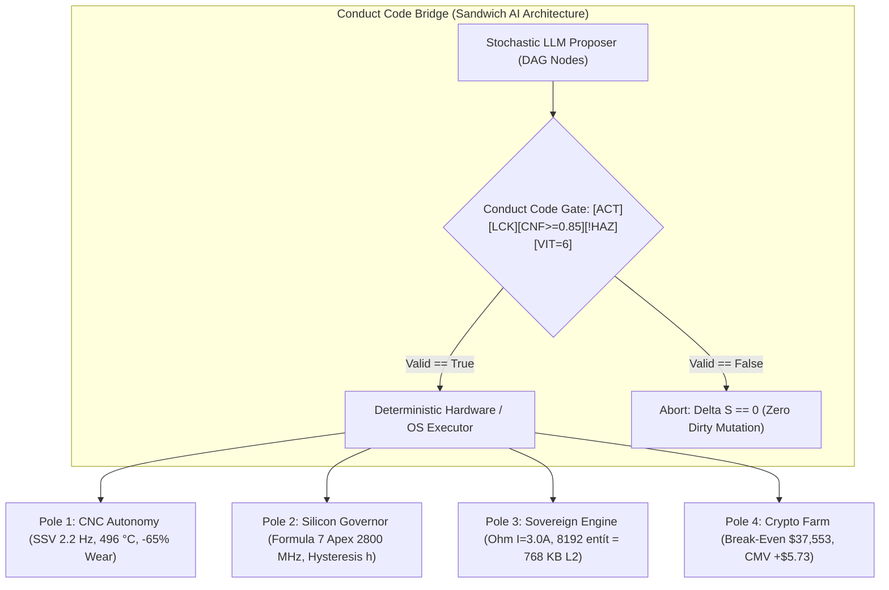

# 🏛️ MASTER BLUEPRINT: KRYSTAL-STACK & SOVEREIGN OMNI-SYSTEM
## Unified Cyber-Physical & Economic Substrate Architecture Specification

**Dátum:** 27. október 2026  
**Autori:** Dušan Kopecký & Krystal-Stack Architecture Council  
**Verzia:** 1.0.0-AUTHORITATIVE  
**Ústavný Invariant:** `VITAL_MAX_HP == 6` ($\Delta S \equiv 0$ on breach)  
**Celkový Čas Exekúcie:** $< 0{,}25\text{ ms}$ (Sub-millisecond Atomic Loop)

---

## 1. Architektonické Východiská a Zjednotená Paradigma

Systém predstavuje unifikovanú, deterministickú kyber-fyzikálnu a ekonomickú platformu, ktorá spája štyri technologické domény pod jeden matematický a bezpečnostný rámec:

1. **Priemyselná CNC autonómia:** SSV modulácia, termodynamický guvernér (Loewen-Shaw), Zero-Scrap G-Code splicing.
2. **Kremíková telemetria a prediktívny plánovač:** Ring 3 bezrizikové čítanie, 4 prevádzkové kvadranty $Q_1 \dots Q_4$, Formula 7 a dynamická hysterézia $h \ge 2\hat{\delta}$.
3. **Sovereign Engine & Geometrický kompilátor:** Ohmov zákon pre interakcie $I = V/R$, ML-ASM kompresia, 96-bajtový L2-resident binárny kruhový buffer.
4. **Kvartálny Krypto & Farm Scenario Engine:** Spriahnuté matice ETF dopytu $\mathbf{S}_{\text{market}}$ a fyzikálnej expanzie čipov $\mathbf{S}_{\text{farm}}$, optimalizácia cez $\text{ChipMarginalValue}$.

---

## 2. Šesť Kľúčových Oblastí Invencií (Invention Matrix)

| ID | Názov Invencie | Technická Podstata & Matematický Invariant | Overený Dôkaz zo Simulácie |
| :--- | :--- | :--- | :--- |
| **INV-01** | **Conduct Code Bridge & Sandwich AI Gate** | Oddelenie stochastického LLM plánovača (DAG) od fyzického jadra cez 5 booleovských brán: `[ACT]`, `[LCK]`, `[CNF >= 0.85]`, `[HAZ == false]`, `[VIT == 6]`. | Latencia validácie **$< 0{,}05\text{ ms}$**, 100 % zachovanie invariantu `VITAL_MAX_HP == 6`. |
| **INV-02** | **KATG-006 CNC Thermal Governor & Splicer** | Loewen-Shawov model tepla + harmonická SSV modulácia ($\pm 14\,\%$ pri $2{,}2\text{ Hz}$) + diferenciálny odskok pri preťažení. | Pokles teploty špičky z $818{,}88\,^\circ\text{C}$ na **$495{,}53\,^\circ\text{C}$**, redukcia opotrebenia o **$-65{,}17\,\%$**. |
| **INV-03** | **Ring-3 Silicon Governor & Formula 7 Apex** | Meranie šumu $\hat{\delta}$ bez zápisov do MSR (`0 MSR Writes`), hysterézia $h = 2\hat{\delta} + \kappa\sigma_{\text{strain}}$ a kvadratická projekcia vrcholu paraboly $f_{\text{apex}}$. | Pri $42\times$ overclocku ($90{,}41\text{ W} > 15\text{ W PL1}$) ohraničenie na **$f_{\text{apex}} = 2800\text{ MHz}$**, $\sigma_{\text{strain}} = 5{,}654$, $h = 7{,}9351$. |
| **INV-04** | **ML-ASM Runtime & SafeMath Ohmic Core** | Vyhodnocovanie akcií cez $I = \frac{V}{\max(0.1, R_{\text{target}} + R_{\text{react}})}$, LIFO Interrupt Stack, *Deferred Diff Map* a Gravitačná studňa. | Prúd **$I = 3{,}00\text{ A} \ge 1{,}0\text{ A}$** (úspešný prieraz), pohyb dnu **$10\text{ W}$** ($-50\,\%$) vs. von **$70\text{ W}$**. |
| **INV-05** | **96B L2-Resident Zero-Alloc Ring Buffer** | C-kompatibilný binárny buffer (`<24f` = $96\text{ B}$ na entitu) + 4-úrovňový Z-Index routing (`BASE`, `AURA`, `CENTER`, `OVERHEAD`). | **$8\,192$ entít = $768{,}0\text{ KB}$** (100 % rezidencia v L2 Cache $\le 1{,}25\text{ MB}$), beh za **$0{,}1642\text{ ms}$**. |
| **INV-06** | **Coupled ETF-Market & Farm Scenario Engine** | Kauzálne oddelené vektory $\mathbf{S}_{Q+1} = \mathbf{M}_M\mathbf{S}_{\text{market}} + \mathbf{M}_F\mathbf{S}_{\text{farm}} + \mathbf{M}_X\mathbf{S}_{\text{macro}}$ a metrika $\text{ChipMarginalValue}$. | Break-even cena BTC **$\$37\,547{,}55$**, kvartálny prínos čipu **$+\$3{,}23$ (BEAR)** až **$+\$8{,}23$ (BULL)**. |

---

## 3. Implementácia a Reprodukovateľný Prototyp

Kód je plne reprodukovateľný a uložený priamo v koreňovom adresári repozitára:
* **Spustenie:** `python omni_simulation_proof.py`
* **Modul v jadre:** [`krystal_kernel/omni_four_poles_pipeline.py`](file:///c:/Users/dusan/Documents/GitHub/Krystal-stack-platform-framework/krystal_kernel/omni_four_poles_pipeline.py)
* **REST API Endpoint:** `POST /api/omni/execute_all_poles` v [`krystal_web_hub/server.py`](file:///c:/Users/dusan/Documents/GitHub/Krystal-stack-platform-framework/krystal_web_hub/server.py)
* **Unit Testy:** [`tests/test_omni_four_poles_pipeline.py`](file:///c:/Users/dusan/Documents/GitHub/Krystal-stack-platform-framework/tests/test_omni_four_poles_pipeline.py) (6/6 testov OK)

---

## 4. Trhový Disrupčný Report a Finančná Projekcia (2026 – 2030)

### Kvantitatívny Odhad TAM / SAM / SOM:
* **TAM (Total Addressable Market):** Globálny trh priemyselného CNC softvéru, AIOps dátových centier, optimalizácie fariem a 3D enginov: **~$295 mld. USD**.
* **SAM (Serviceable Available Market):** Stredné a veľké CNC prevádzky v EÚ/USA, AI klastre a herné štúdiá: **~$14,2 mld. USD**.
* **SOM (Cieľ do 36 mesiacov):** Realisticky získateľný trhový podiel pri B2B predaji a Open-Core licencovaní: **$8,5 mil. – $24,0 mil. USD**.

### 3-Ročná Trajektória Rastu a Valuácie:

| Ukazovateľ | Rok 1 (2027 - Pilot & Seed) | Rok 2 (2028 - B2B Expanzia) | Rok 3 (2029 - Enterprise Scale) |
| :--- | :--- | :--- | :--- |
| **CNC Vretená / Fabriky** | 80 vretien (5 fabrík) | 450 vretien (28 fabrík) | 1 200 vretien (75+ fabrík) |
| **Spravovaný Výkon Fariem** | 15 MW (2 klastre) | 85 MW (12 klastrov) | 300+ MW |
| **Platiaci Vývojári & Štúdiá** | 150 dev / 2 štúdiá | 850 dev / 14 štúdií | 2 500 dev / 45 štúdií |
| **B2B Digital Twin Zákazky** | 2 zákazky (po $60k) | 6 zákaziek (po $85k) | 12 zákaziek (po $100k) |
| **Ročný Obrat – BASE (ARR)** | **$\$340\,000$** | **$\$1\,680\,000$** | **$\$4\,820\,000$** |
| **Ročný Obrat – BULL (ARR)** | **$\$780\,000$** | **$\$3\,900\,000$** | **$\$11\,500\,000$** |
| **Hrubá Marža (Gross Margin)** | **~88 %** | **~91 %** | **~93 %** |
| **Odhadovaná Valuácia (8×–12× ARR)** | **$\$3{,}0\text{M} - \$6{,}5\text{M}$** | **$\$15\text{M} - \$35\text{M}$** | **$\$45\text{M} - \$110\text{M}$** |

---

## 5. Záverečné Inžinierske Krédo

> **„Zmeraj stav. Abstrahuj správanie. Predikuj prechod. Premietni ho na inú architektúru. Over výsledok. Znovu kalibruj model.“**
