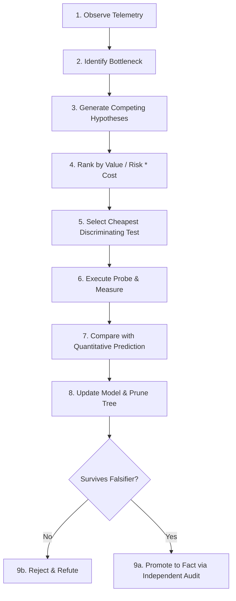

# Performance Mode: Velocity Loop & Multi-Model Falsification Protocol
**Document ID:** `ARCH-PERF-VELOCITY-01`  
**Milestone:** `V-PERF-VELOCITY-01`  
**Classification:** Core System Architecture & Epistemic Protocol  
**Constitutional Invariant:** `VITAL_MAX_HP == 6`  

---

## 1. Executive Summary

In high-performance runtime engineering, intuition and consensus-driven optimization are systemic failure modes. The **Performance Mode Velocity Loop** formalizes a deterministic, fast-converging pipeline that enforces strict epistemic ordering: **hypotheses strictly precede evidence, and evidence strictly precedes facts**.

The runtime cannot promote any assertion to `APPROVED_FACT` without an empirical measurement or executed test. When faced with performance bottlenecks, the system tracks **four competing paradigms** in parallel and selects the **Cheapest Discriminating Test (CDT)** to eliminate the maximum hypothesis space with minimal execution overhead.

---

## 2. Epistemic Invariants & Order of Operations

```
+-----------------------------------------------------------------------------------+
|                        STRICT ORDERING OF OPERATIONS                              |
|                                                                                   |
|  [ Observe Telemetry ] ---> [ Propose Hypotheses ] ---> [ Discriminating Test ]    |
|                                                                 |                 |
|                                                                 v                 |
|  [ Reject / Refute ] <--- [ Independent Audit ] <--- [ Empirical Measurement ]     |
|          |                        |                                               |
|          v                        v                                               |
|  (Refuted Claim)          (Approved Fact)                                         |
+-----------------------------------------------------------------------------------+
```

1. **Ordering Invariant:** $\text{Hypotheses} \prec \text{Evidence} \prec \text{Fact}$. Any promotion of an assertion to fact prior to an executed probe constitutes an epistemic protocol breach.
2. **Prohibition of Self-Certification:** The proposer of a hypothesis cannot act as its validating auditor (`proposer_id != evaluator_id`).
3. **Framing Error Precedence:** If empirical measurements systematically contradict predictions across multiple independent paradigms, the anomaly is diagnosed as a **Framing Error** (misspecified problem boundary) or **Flawed Validator** (corrupted probe/timer), never as implementation dishonesty.
4. **Telemetry Precedence:** Generic engineering rules of thumb are mere bootstrap heuristics; physical hardware telemetry and calibrated measurements override them unconditionally.

---

## 3. The 9-Stage Velocity Loop



### Stage 1: Observe (Zaznamenaj)
Captures raw hardware counters, bus latencies, queue depths, and execution receipts without extrapolative bias.

### Stage 2: Identify Bottleneck (Lokalizuj úzke miesto)
Isolates the throughput- or latency-limiting component (e.g. memory bus contention, lock latency, VSync scanout collision).

### Stage 3: Generate Competing Hypotheses across 4 Paradigms (Viac súperiacich hypotéz)
Formulates alternative models spanning the 4 core paradigms:
* **Conventional:** Naive thread starvation, standard memory leak, CPU core frequency downclocking.
* **Architectural:** Cacheline false sharing, UMA/NUMA cross-node transfer penalty, IPC ring buffer overflow.
* **Interaction:** Asynchronous cross-engine collision, LLM token burst colliding with display scanout, sync barrier phase lock.
* **Adversarial:** Worst-case payload distribution, malicious/corrupted frame headers, high-frequency timer fuzzing.

### Stage 4: Prioritize Hypotheses (Zoraď podľa hodnoty, rizika a nákladov)
Each hypothesis $\mathcal{H}_i$ is ranked by its epistemic efficiency score:
$$\text{Priority}(\mathcal{H}_i) = \frac{\text{EstimatedValue}(\mathcal{H}_i)}{\text{RiskScore}(\mathcal{H}_i) \times \text{TestCostMs}(\mathcal{H}_i)}$$

### Stage 5: Select Cheapest Discriminating Test (CDT)
Chooses the probe $T^*$ that maximizes eliminated paradigms per unit of execution cost:
$$T^* = \arg\max_{T \in \mathcal{T}} \frac{|\text{Paradigms}(T)| \times \text{InformationGain}(T)}{\text{ExecutionCostMs}(T)}$$

### Stage 6: Measure (Zmeraj)
Executes the selected probe in an isolated hardware context and extracts calibrated numerical telemetry.

### Stage 7: Compare with Prediction (Porovnaj s predikciou)
Compares empirical output against the hypothesis target and tolerance band $[y^* - \delta, y^* + \delta]$.

### Stage 8: Update Model (Aktualizuj model)
Updates parameter matrices, prunes falsified branches, and recalculates epistemic entropy.

### Stage 9: Promote or Reject (Povýš alebo odmietni)
Promotes surviving hypotheses to `APPROVED_FACT` via an independent verifier, writing cryptographically chained audit records into the `EpistemicProvenanceLedger`.

---

## 4. The 5-Tuple Hypothesis Specification

Every hypothesis in Performance Mode is an instantiated `Hypothesis5Tuple`:

$$\mathcal{H} = \langle \mathcal{M}, \mathcal{E}, \mathcal{B}, \mathcal{Y}^*, \mathcal{F} \rangle$$

| Attribute | Field Name | Description | Example |
| :--- | :--- | :--- | :--- |
| **Mechanism** | `mechanism` | Physical or algorithmic causal driver | Zero-copy IPC ring eliminates DRAM copy roundtrip |
| **Expected Effect** | `expected_effect` | Operational outcome and direction | Transfer latency drops from 8.2ms to 2.1ms |
| **Baseline** | `baseline_metric` | Empirical state prior to intervention | $8.2\text{ ms}$ |
| **Measurable Output** | `measurable_output_target` | Quantitative target with tolerance band | $2.1\text{ ms} \pm 0.4\text{ ms}$ |
| **Falsifier** | `falsifier_predicate` | Exact condition that immediately refutes | $\text{Measured Latency} \ge 3.0\text{ ms}$ |

---

## 5. Bounded Deep Dives & Stopping Rule

Deep analytical dives are bounded by the **Expected Value of Information (EVOI)**:

$$\text{EVOI}(\Delta \mathcal{I}) = \mathbb{E}[\text{PerformanceGain} \mid \Delta \mathcal{I}] - \text{InvestigationCost}(\Delta \mathcal{I})$$

* **Stop Condition 1 (Sufficient Evidence):** When verified confidence $\mathcal{C} \ge 0.90$, halt testing and commit the optimization.
* **Stop Condition 2 (Cost Bound):** When $\text{EVOI}(\Delta \mathcal{I}) \le \text{InvestigationCost}$, additional depth is economically unviable; finalize the model with current evidence.

---

## 6. Adaptive Communication & Systematic Error Learning

1. **Adaptive Output Density:**
   * **High Certainty ($\mathcal{C} \ge 0.85$):** Concise, direct, factual summary with immediate action items.
   * **High Uncertainty ($\mathcal{C} < 0.85$):** Exploratory breakdown documenting active hypotheses, unresolved questions, and discriminating test vectors.
2. **Error-to-Rule Translation:** Errors are never addressed through cosmetic verbal rewrites. Each diagnosed fault produces an `ErrorPreventionRule`:
   * `rule_id`: Unique identifier (e.g. `EPR-BUS-01`)
   * `symptom`: Observable failure mode
   * `root_cause`: Underlying architectural defect
   * `prevention_invariant`: Enduring architectural invariant enforced in subsequent pipeline stages
   * `vital_max_hp`: Preserves $6$ unconditionally

---

## 7. Constitutional Invariant Verification

$$\text{assert } \text{VITAL\_MAX\_HP} == 6$$

Every dataclass (`Hypothesis5Tuple`, `DiscriminatingTest`, `ErrorPreventionRule`, `VelocityLoopController`, `EpistemicAuditEntry`) validates this invariant in `__post_init__`, raising `ContractViolation` upon discrepancy.
