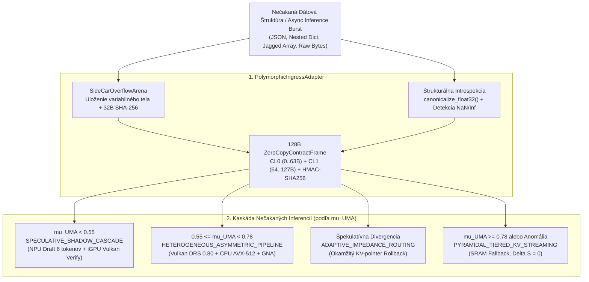

# KRYSTAL STACK: Polymorphic Ingress Adapter & Unexpected Inference Routing Specification

**Document ID:** `KRYSTAL-ARCH-POLYMORPHIC-INGRESS-2026-V1`  
**Module:** [`krystal_kernel/polymorphic_ingress_adapter.py`](../../krystal_kernel/polymorphic_ingress_adapter.py)  
**Constitutional Invariant:** `VITAL_MAX_HP == 6` ($\neg\text{Valid}(A) \implies \Delta S \equiv 0$)  
**Theory Graph:** Frozen at 56 Nodes (0 cycles, no Node 57, no T13)

---

## 1. Architektonický kontext a riešený problém

Nízkoúrovňové bezkópiové protokoly (**128-byte `ZeroCopyContractFrame`**, zarovnané na dva 64B cache riadky) prinášajú extrémny výkon a determinizmus, no ich prirodzenou nevýhodou je **rigidita vstupnej schémy**. Ak externý senzor, cudzí AI agent alebo neštandardný API klient pošle **nečakanú dátovú štruktúru** (vnorený slovník, pole premenlivej dĺžky, binárny stream alebo poškodené IEEE-754 hodnoty `NaN`/`Inf`), priamy C-ABI parser by zlyhal.

Modul [`PolymorphicIngressAdapter`](../../krystal_kernel/polymorphic_ingress_adapter.py) tento problém rieši trojstupňovou abstrakciou bez straty 128-bajtového determinizmu v jadre:

1. **Side-Car Overflow Aréna (`SideCarOverflowArena`):**  
   Premenlivé telo nečakanej štruktúry sa uloží do kruhovo ohraničenej bočnej arény (bez únikov pamäte) a vypočíta sa jeho **32-bajtový binárny SHA-256 odtlačok**.
2. **Kryptografické ukotvenie do 128B rámca:**  
   Tento 32B SHA-256 odtlačok sa zapíše priamo do poľa `predecessor_hash` (`offset 48..79`) v [`ZeroCopyContractFrame`](../../krystal_kernel/zero_copy_contracts.py). Kritická zbernica tak prenáša výhradne 128 bajtov s plným 96-bajtovým HMAC-SHA256 podpisom.
3. **Deterministický záchranný režim (`AUTH_DEGRADED_SAFE_FALLBACK`):**  
   Ak štrukturálna introspekcia odhalí neplatné hodnoty (`NaN`, `Inf`, zápornú latenciu) alebo extrémne preťaženie ($\mu_{\text{UMA}} \ge 0.95$), adaptér prepne verdikt na `AUTH_DEGRADED_SAFE_FALLBACK` (`ID = 2`), nezmení autoritatívny stav ($\Delta S = 0$) a zachová invariant `VITAL_MAX_HP == 6`.

---

## 2. Schéma nečakaných inferencií a Impedančného Routera

---

## 3. Prepojenie na API Endpointy (`PolymorphicApiEndpointConnector`)

| HTTP Metóda & Endpoint | Účel a cieľový subsystém | Výstupný kontrakt |
| :--- | :--- | :--- |
| **`POST /api/v1/ingress/polymorphic`** | Prijíma ľubovoľnú nečakanú dátovú štruktúru, ukladá ju do Side-Car arény a vracia podpísaný 128B rámec. | `PolymorphicIngressReceipt` (`128B hex`, `arena_sha256_hex`, `HP == 6`) |
| **`POST /api/v1/inference/unexpected_burst`** | Dynamicky smeruje nečakané špičky inferencií podľa aktuálneho tlaku na UMA zbernicu ($\mu_{\text{UMA}}$) a špekulatívnej divergencie. | `UnexpectedInferenceRouteDecision` (Topológia, DRS škála, hĺbka draftu) |
| **`POST /api/janet/decode_binary`** | Premosťuje binárny a hexadecimálny stream s hlavičkou `KSYN` (`0x4B53594E`) do 128B zmluvného rámca. | `ksyn_header_hex = 4b53594e` + `128B frame` |
| **`POST /api/wsl/hypervisor_bridge`** | Prenáša normalizované 128B stavové rámce cez paravirtuálny kanál `AF_VSOCK` (Port `19283`) do akcelerovaného Linuxu (WSL2). | `AF_VSOCK_ZERO_COPY_128B` (`Port 19283`, izolované doménové zámky) |
| **`GET /api/v1/telemetry/observer_matrix`** | Poskytuje stav 9×10 pozorovacej matice (Keras Multi-Domain Observer), počet aktívnych slotov arény a strop $\mu_{\text{UMA}} = 0.78$. | `matrix_shape: [9, 10]`, `vital_max_hp: 6` |
