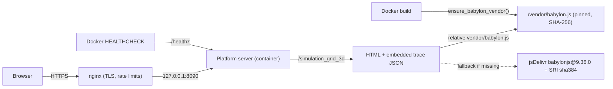

# Production Deployment Model — Platform Server, 3D Simulation Grid

Status legend: **VERIFIED_LOCAL** (ran on the authoring host), **WRITTEN_NOT_BUILT** (artifact exists, never executed), **DESIGN** (not implemented).

## 1. Components

| Component | Artifact | Status |
| --- | --- | --- |
| HTTP server (`ThreadingHTTPServer`) | `krystal_kernel/sovereign_openvino_oneapi_app.py` (`KRYSTAL_HOST`, `KRYSTAL_PORT`, `/healthz`) | VERIFIED_LOCAL (tests) |
| Prompt-edit guard | `KRYSTAL_ENV=production` requires `X-Krystal-Admin-Token == KRYSTAL_ADMIN_TOKEN` | VERIFIED_LOCAL (tests) |
| Pinned dependencies | `requirements-platform.txt` (versions from the local `.venv`, Python 3.14.7) | VERIFIED_LOCAL install on Windows |
| Container image | `docker/Dockerfile.platform` (python:3.14-slim, non-root UID 10001, HEALTHCHECK) | WRITTEN_NOT_BUILT (no Docker on host) |
| Reverse proxy | `deploy/nginx_krystal_platform.conf` (rate limits, upstream :8090) | WRITTEN_NOT_BUILT (no `nginx -t`) |
| 3D simulation grid | `projects/trigonometric_hybrid_platform_framework/simulation_grid_3d.py`, route `/simulation_grid_3d` | VERIFIED_LOCAL (HTTP 200 in tests) |
| Babylon.js bundle | `frontend/vendor/babylon.js` 9.36.0, SHA-256 `7edf5405…9dbc`, served at `/vendor/babylon.js` | VERIFIED_LOCAL (hash check) |

## 2. Key connections

1. **Port contract.** The container binds `0.0.0.0:8090` (`KRYSTAL_HOST/KRYSTAL_PORT`); nginx proxies to `127.0.0.1:8090`. **Mismatch found:** the existing `deploy/nginx_krystal_subdomain_ssl.conf` points `krystal_engine_backend` to `:8089`. One of the two must change before deployment.
2. **Babylon.js path.** One relative URL (`vendor/babylon.js`) works for both the standalone file in `frontend/` and the served page, because the server maps `/vendor/babylon.js` to the same file. The Docker build fetches and hash-verifies it; nginx allows it with long-lived caching.
3. **CDN fallback vs CSP.** The fallback loads jsDelivr with SRI. The existing subdomain CSP allows `https:` scripts, so the fallback is not blocked today. Tightening CSP to `'self'` would silently disable the fallback (fine in the container, where the vendor file is always present).
4. **Health.** Docker `HEALTHCHECK` and nginx `location = /healthz` hit the same cheap endpoint (no subprocess, AST, or Z3).
5. **Load.** `/api/v1/runtime/trigonometric_hybrid_platform` spawns one subprocess per request (~250 ms in local profiling); nginx limits it to 2 r/s per IP. Page routes rely on in-process `lru_cache`, so only the first request pays simulation cost.
6. **Mutation.** Prompt edits change a process-global registry; in production they need the admin token. With multiple worker processes the registry would diverge per process — **DESIGN gap**, not solved (single process today).

## 3. Not done / open

- Docker image build and container run — not executed.
- `nginx -t` validation — not executed.
- TLS certificates, domain, and choosing `:8089` vs `:8090` — operator decision.
- Torch/Keras stay in `.venv-keras`; they are not part of this image.
