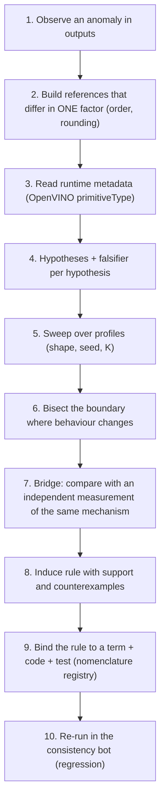

# Reverse-Engineering Schema & Framework Nomenclature

Scope: `projects/trigonometric_hybrid_platform_framework/` on the authoring host (i5-1135G7 + Iris Xe, OpenVINO 2026.4.1, NumPy with OpenBLAS 0.3.34). Evidence labels follow the ENLG lattice.

## 1. Reverse-engineering schema (black box → rule bound to code)

| Step | Tool in code | Rule it enforces |
| --- | --- | --- |
| 2 | `virtual_convolution_pipeline._conv_sequential` | change one factor at a time |
| 3 | `diagnose_bit_identity` (runtime model `primitiveType`) | prefer direct observation over inference |
| 5 | `pattern_profile_environment.run_pattern_sweep` | verdict per hypothesis, conflicts are never averaged |
| 6 | `consistency_bot.blas_sequential_fma_threshold` | neighbours of the boundary are re-checked |
| 7 | `fact_synthesis_engine.induce_rules` (`R_BRIDGE_BLAS_BOUNDARY`) | two independent sources must agree |
| 9 | `nomenclature_registry.validate_nomenclature` | a term without working code is rejected |
| 10 | `consistency_bot.run_bot` | every claim stays an executable check |

### Worked case: GPU output bit-identical to NumPy

| # | Finding | Evidence |
| --- | --- | --- |
| 1 | GPU conv output == NumPy reference bit-for-bit; CPU differs by 2.5e-6 | LOCAL_MEASURED |
| 2 | GPU kernel `convolution_gpu_bfyx_os_iyx_osv16__f32`, CPU kernel `brgconv_avx512_f32` | LOCAL_MEASURED (runtime metadata) |
| 3 | GPU == sequential FMA in natural k order on 8/8 profiles (K 27–576) | SUPPORTED_WITH_SCOPE |
| 4 | CPU matches no sequential recipe on 8/8 profiles | SUPPORTED_WITH_SCOPE |
| 5 | NumPy BLAS == sequential FMA only for K < 449 (last equal 448) | LOCAL_MEASURED (bisection, 32×K · K×1024) |
| 6 | Sweep (fails only at K = 576) agrees with the boundary 449 | SUPPORTED_WITH_SCOPE (bridge) |
| 7 | Hence GPU == NumPy is shared arithmetic, not extra accuracy | DERIVED |
| — | Mechanism of the 449 boundary (assumed: OpenBLAS K-blocking) | UNKNOWN |

## 2. Stack map (modules by layer)

| Layer | Module | Role |
| --- | --- | --- |
| Sync & UI | `adaptive_cross_genre_sync`, `adaptive_sync_card_grid`, `simulation_grid_3d` | connection registry, rollback logic, card / hex / 3D views |
| Compute | `virtual_convolution_pipeline`, `virtual_convolution_contra` | forward conv, adjoint, inverses |
| Control | `matrix_control_processes` | Freivalds verification, operator-word algebra |
| Verification | `pattern_profile_environment`, `consistency_bot` | sweeps, executable claims, JSON/MD/PNG reports |
| Knowledge | `fact_synthesis_engine`, `custom_allocator`, `neurosymbolic_bridge` | facts, rules, bridges, allocation, LLM verification |
| Vocabulary | `nomenclature_registry` | terms bound to code and tests |

## 3. Nomenclature

Source of truth: `nomenclature_registry.TERMS` (18 terms, each resolved to a callable and a test file by `tests/test_nomenclature_registry.py`). The full generated glossary with status per term is `reports/nomenclature_propedeutics.md`.

| Term | Binds to |
| --- | --- |
| Connection registry | `adaptive_cross_genre_sync:validate_connection_graph` |
| Strictest-policy join | `adaptive_cross_genre_sync:join_sync_policy` |
| Adaptive horizon controller | `adaptive_cross_genre_sync:AdaptiveHorizonController` |
| Rollback simulation | `adaptive_cross_genre_sync:simulate_adaptive_rollback` |
| Card grid | `adaptive_sync_card_grid:render_adaptive_sync_card_grid_html` |
| Simulation grid 3D | `simulation_grid_3d:render_simulation_grid_3d_html` |
| Virtual convolution pipeline | `virtual_convolution_pipeline:run_virtual_convolution_pipeline` |
| Summation-order fingerprint | `virtual_convolution_pipeline:diagnose_bit_identity` |
| Contra modules | `virtual_convolution_contra:run_contra_modules` |
| Pattern-over-profiles sweep | `pattern_profile_environment:run_pattern_sweep` |
| Consistency bot | `consistency_bot:run_bot` |
| BLAS K threshold | `consistency_bot:blas_sequential_fma_threshold` |
| Fact synthesis | `fact_synthesis_engine:run_fact_synthesis` |
| Log perception | `fact_synthesis_engine:perceive_ledgers` |
| Module distance | `fact_synthesis_engine:fetch_distance_between_modules` |
| Fact-driven allocator | `custom_allocator:FactDrivenAllocator` |
| Ontology integrity | `custom_allocator:check_ontology_integrity` |
| Neuro-symbolic bridge | `neurosymbolic_bridge:verify_answer` |

Terms that were spoken but do **not** exist in code (and are rejected by the registry if added): memory isolation between CPU and GPU, dynamic stride, zero-copy convolution path.

## 4. Matrix control & combinatorial mashup (validated)

- **Freivalds:** 512×512 product accepted with worst relative gap 3.9e-6 (20 rounds; false-accept bound 2⁻²⁰ in exact arithmetic); a single +0.5 corruption rejected in round 1. LOCAL_MEASURED.
- **Operator words** over {K, KT} up to length 4 (8 words): linearity gap ≤ 2.1e-7, adjoint gap ≤ 1.8e-6, Gram values positive. The ReLU negative control breaks linearity (gap 0.38), so the checks discriminate. VERIFIED_WITH_SCOPE.

## 5. Open items

- The 449 boundary mechanism is UNKNOWN (OpenBLAS blocking is a hypothesis).
- The GPU/CPU allocation break-even (≈530 inferences in the latest run, ≈1590 in an earlier run) is unstable: the median difference (0.28 ms) is smaller than the CPU standard deviation (1.7 ms), and GPU compile time varied 187–2236 ms (likely kernel cache).
- Log perception is dominated by one temporary A/B ledger (328 of 340 entries).
- The LLM bridge has not run against a live model (LM Studio at :1234 not reachable).
