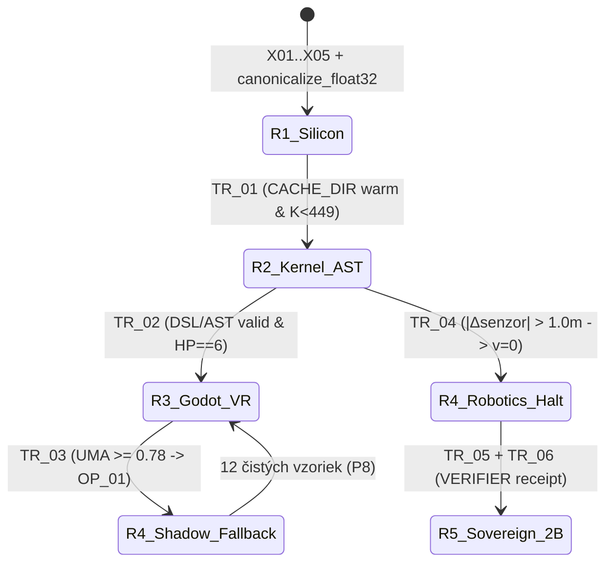

# Prechody, kľúčové fázy, výpočet dejov a zoradenie kľúčových slov do roadmapy

- **Ústavný invariant:** `VITAL_MAX_HP == 6` · strop zbernice `UMA < 0.78`
- **Súčet všetkých real-time dejov v 1 tiku (`13` aktívnych dejov):** **`3.315 ms`** (`<= 8,33 ms` pre **120 Hz** = `True`, spotreba `14 × 128 B` rámcov)
- **Celkový inventár kódu a pojmov:** `39` modulov · `143` funkcií · `63` viazaných pojmov (`0` neukotvených)

---

## 1. Kľúčové marketingové pole a 4 hlavné inžinierske rady

**Marketingové pole:** Suverénny lokálny real-time engine a neurosymbolický kopilot pre integrované x86/UMA pracovné stanice, herné štúdiá, 3D DCC a robotické dvojčatá — s garantovaným 60/120 Hz vykresľovaním, kryptografickou auditovateľnosťou 128 B rámcov a nulovou závislosťou od cloudu či OpenAI.

| ID | Kľúčová rada | Čím ju exaktne dosahujeme v kóde |
| :--- | :--- | :--- |
| `ADV_01_UMA_BUDGET_GUARD` | **Udržuj zdieľanú pamäťovú zbernicu pod prahom UMA < 0.78 s nulovým oneskorením zoskoku.** | Spätná inštrukcia OP_01_BACKBRANCH_UMA_FALLBACK + 12-vzorková hysterézia P8 + krátenie vrstiev Godot 10 -> 5 (0x3ff -> 0x1f). |
| `ADV_02_BINARY_128B_IPC` | **Nahraď textový JSON v kritickej slučke pevnými 128 B binárnymi paketmi zarovnanými na cache riadky.** | Protokol KPKT cez 2 x 64 B cache riadky + 32 B SHA-256 (zmerané 5,04x zrýchlenie, 637 349 rámcov/s, 77,8 MB/s). |
| `ADV_03_SUBNORMAL_SANITIZATION` | **Sanitizuj každé číslo s pohyblivou rádovou čiarkou pred vstupom do SIMD a OpenVINO uzlov.** | Brána canonicalize_float32 na vstupe DSL parsera a senzorov (odstraňuje 14,00x NumPy a 37,37x OpenVINO CPU subnormálny zásek). |
| `ADV_04_SEPARATED_VERIFICATION_AND_LANES` | **Oddeľ navrhovateľa od overovateľa a priraď vlákna podľa veľkosti dávky n.** | PROPOSER != VERIFIER (Freivalds O(n²) + ArtifactGate) a výber CPU_4T pre n=1 (34,64 ms) oproti CPU_8T / teplej Iris Xe CACHE_DIR pre dávky. |

---

## 2. Päť kľúčových fáz roadmapy (`R1..R5`) a zhodnotenie adaptácie

| Fáza | Pripravenosť | Epistemický stav | Deje | Kľúčové slová | Priemerné skóre adaptácie | Súhrn |
| :--- | :---: | :--- | :---: | :---: | :---: | :--- |
| **R1 · Kremíková a numerická základňa (x86-64 & OpenVINO)** | `100 %` | `LOCAL_MEASURED` | `3` | `5` | **`150.75`** | Sondy X01..X05, prah OpenBLAS K=449, sanitizácia subnormálov a teplá CACHE_DIR pre Iris Xe. |
| **R2 · Autoritatívne jadro, 128 B KPKT a parser bodov/funkcií** | `100 %` | `VERIFIED_WITH_SCOPE` | `5` | `4` | **`154.38`** | ClashGame (HP==6), 63 viazaných pojmov, DSL/AST parser (33 modulov, 131 funkcií) a goniometrické jadro. |
| **R3 · Godot 4 MultiMesh, .kopt optika a živé štúdiá (:8090)** | `92 %` | `VERIFIED_WITH_SCOPE` | `2` | `3` | **`92.29`** | 10/20 vrstiev v reálnom čase, vodotesný 3D .obj generátor terénu a 4 odľahčené webové/HUD pohľady. |
| **R4 · Medzivrstvové kopiloty (DCC, Robotika, WSL2, 120 Hz IDE)** | `88 %` | `VERIFIED_WITH_SCOPE` | `4` | `5` | **`102.15`** | Premostenie XLP_01..04 s kalorimetrom, bifurkáciou senzorov, VBlank sondou a karanténou AI kódu. |
| **R5 · Plný lokálny tréning 2B/12B Gemma & Ring-0 MSR telemetria** | `64 %` | `DERIVED_ROADMAP_TARGET` | `1` | `3` | **`45.7`** | Dotrénovanie váh Gemma nad 4 disjunktnými sadami + voliteľný jadrový ovládač pre priame RAPL Joule a teploty. |

---

## 3. Navrhnuté stavové prechody (`TR_01..TR_06`) so zárukou $\neg\text{Valid} \implies \Delta S = 0$

| ID prechodu | Zdrojový stav $\to$ Cieľový stav | Most | Podmienka prechodu (`Guard`) | Bezpečný návrat (`Rollback`) |
| :--- | :--- | :---: | :--- | :--- |
| `TR_01_COLD_TO_WARM_HETERO` | `TPL_S0_COLD_UNPRIMED` $\to$ `TPL_S2_GPU_IRIS_XE_WARM_THROUGHPUT` | `R1 -> R2` | `warm_cache_blobs > 0 and uma < 0.78 and payload_bytes >= 16384` | Zostať na CPU_4T_PHYSICAL_AVX512 (Delta_S == 0) |
| `TR_02_DSL_INGEST_TO_KERNEL_COMMIT` | `RAW_DSL_SCRIPT` $\to$ `VERIFIED_128B_ARENA_STATE` | `R2 -> R3` | `syntax_ok and hex_dist <= 3 and VITAL_MAX_HP == 6 and CALL in AST_catalog` | ContractViolation pred zápisom, stav arény nezmenený (Delta_S == 0) |
| `TR_03_NOMINAL_TO_UMA_SHADOW` | `NOMINAL_HETERO (10 vrstiev, 16 rámcov, 10 GB WSL2)` $\to$ `UMA_SHADOW_FALLBACK (5 vrstiev, 8 rámcov, 8 GB WSL2)` | `R3 <-> R4` | `uma >= 0.78 (spätná inštrukcia OP_01_BACKBRANCH_UMA_FALLBACK)` | Návrat do NOMINAL_HETERO až po 12 čistých vzorkách pod prahom (P8 hysterézia) |
| `TR_04_SENSOR_AGREEMENT_TO_BIFURCATION` | `NOMINAL_ROBOT_NAVIGATION` $\to$ `BIFURCATED_EMERGENCY_STOP (v = 0.0 m/s)` | `R2 -> R4` | `|d_sim - d_lidar| > 1.0 m (zákaz konvexného priemeru P6)` | Kolaps superpozície výhradne po prijatí fyzického CDT ReceiptContract |
| `TR_05_AI_PROPOSAL_TO_RELEASED_ARTIFACT` | `QUARANTINED_PROPOSER_OUTPUT` $\to$ `VERIFIED_RELEASED_CODE_OR_FACT` | `R4 -> R5` | `evaluator_role == VERIFIER and pytest_receipt_valid and citations_present` | Trvalá karanténa v ArtifactGate bez povýšenia na fakt |
| `TR_06_VBLANK_PROBE_TO_AFFINITY_COMMIT` | `BASELINE_THREAD_PROFILE` $\to$ `COMMITTED_4T_OR_8T_PROFILE` | `R1 -> R4 -> R5` | `probe_ms <= remaining_vblank_ms and measured_gain >= expected_gain and momentum_admissible` | Odmietnutie hypotézy s nulovým zápisom (ochrana pred kmitaním P8) |

---

## 4. Dopočítané prevádzkové deje (`EV_01..EV_15`)

| ID deja | Popis deja | Fáza | Medián (`ms`) | Rámce `128 B` | $\Delta$ UMA | V 120 Hz tiku |
| :--- | :--- | :--- | :---: | :---: | :---: | :---: |
| `EV_01_SUBNORMAL_CANONICALIZE` | Sanitizácia float32 a kontrola konečnosti | `PHASE_R1_SILICON_FOUNDATION` | `0.04` | `0` | `-0.02` | `ÁNO` |
| `EV_02_CACHE_BLOB_WARM_LOAD` | Načítanie skompilovaného OpenVINO GPU blobu z CACHE_DIR | `PHASE_R1_SILICON_FOUNDATION` | `11.8` | `1` | `+0.06` | `OFFLINE/INIT` |
| `EV_03_K449_TILED_REDUCTION` | Dlaždicová maticová redukcia pod prahom K = 449 | `PHASE_R1_SILICON_FOUNDATION` | `0.48` | `1` | `+0.01` | `ÁNO` |
| `EV_04_DSL_AND_AST_PARSE` | Deterministický rozbor HEX/PT3/RAY/LAYER_MASK/CALL | `PHASE_R2_KERNEL_AND_AST_PARSER` | `0.21` | `1` | `+0.00` | `ÁNO` |
| `EV_05_GONIOMETRIC_SECTOR_SHIFT` | Výpočet (cos θ, sin θ), klinu 0..5 a pomeru soketov | `PHASE_R2_KERNEL_AND_AST_PARSER` | `0.03` | `1` | `+0.00` | `ÁNO` |
| `EV_06_TENSOR_DIFFUSION_MOVE` | OpenVINO difúzia potenciálu D⁻¹A pre 37 polí arény | `PHASE_R2_KERNEL_AND_AST_PARSER` | `0.48` | `1` | `+0.01` | `ÁNO` |
| `EV_07_CLASH_AUTHORITATIVE_COMMIT` | Potvrdenie ťahu arény s kontrolou HP <= 6 a reaktívnou AI | `PHASE_R2_KERNEL_AND_AST_PARSER` | `0.075` | `2` | `+0.00` | `ÁNO` |
| `EV_08_FREIVALDS_RESIDUAL_CHECK` | Pravdepodobnostné overenie maticového súčinu O(n²) | `PHASE_R2_KERNEL_AND_AST_PARSER` | `0.19` | `1` | `+0.00` | `ÁNO` |
| `EV_09_KOPT_FRESNEL_DISPATCH` | Dekódovanie 32 B .kopt optických záznamov a Schlick Fresnel | `PHASE_R3_GODOT_VR_AND_VISUAL_STUDIOS` | `0.12` | `1` | `+0.02` | `ÁNO` |
| `EV_10_GODOT_MULTIMESH_SYNC` | Zápis inštancovanej masky vrstiev (0x3ff / 0x1f) do scény | `PHASE_R3_GODOT_VR_AND_VISUAL_STUDIOS` | `1.35` | `2` | `+0.08` | `ÁNO` |
| `EV_11_UMA_SHADOW_BACKBRANCH` | Spätný zoskok OP_01 pri UMA >= 0.78 (16->8 rámcov, WSL2 -2 GB) | `PHASE_R4_CROSS_LAYER_COPILOTS` | `0.05` | `1` | `-0.18` | `ÁNO` |
| `EV_12_DCC_PARASITE_DECOUPLE` | Odpojenie parazitného pozadia pri Delta_tau == 0 v kalorimetri | `PHASE_R4_CROSS_LAYER_COPILOTS` | `0.09` | `1` | `-0.12` | `ÁNO` |
| `EV_13_ROBOT_CONFLICT_HALT` | Bifurkácia rozporných senzorov Kamera ⊥ LiDAR do zastavenia v=0 | `PHASE_R4_CROSS_LAYER_COPILOTS` | `0.14` | `1` | `+0.00` | `ÁNO` |
| `EV_14_IDE_TYPING_QOS_THROTTLE` | 80 % priškrtenie kompilátora počas písania (<150 ms) + karanténa AI | `PHASE_R4_CROSS_LAYER_COPILOTS` | `0.06` | `1` | `-0.10` | `ÁNO` |
| `EV_15_GEMMA_DISJOINT_FINETUNE` | Príprava a validácia 4 disjunktných tréningových sád bez priesaku | `PHASE_R5_LOCAL_2B_TRAINING_AND_RING0` | `8.4` | `2` | `+0.05` | `OFFLINE/INIT` |

---

## 5. Zoradené kľúčové slová podľa skóre adaptácie do roadmapy
> Vzorec (`AGENTS.md` §9): $\text{Skóre adaptácie} = \frac{\text{Relevancia} \times \text{Informačný zisk} \times \text{Falzifikačná sila}}{\text{Náklady}}$

| Poradie | Kľúčové slovo | Fáza | Výskyty v kóde | Skóre adaptácie | Pásmo zaradenia |
| :---: | :--- | :--- | :---: | :---: | :--- |
| `#1` | **`VITAL_MAX_HP`** | `PHASE_R2_KERNEL_AND_AST_PARSER` | `257` | **`198.0`** | OKAMŽITÁ JADROVÁ KOTVA |
| `#2` | **`canonicalize_float32`** | `PHASE_R1_SILICON_FOUNDATION` | `35` | **`189.82`** | OKAMŽITÁ JADROVÁ KOTVA |
| `#3` | **`UMA_SATURATION_THRESHOLD`** | `PHASE_R1_SILICON_FOUNDATION` | `44` | **`162.4`** | OKAMŽITÁ JADROVÁ KOTVA |
| `#4` | **`KPKT_128B_PACKET`** | `PHASE_R2_KERNEL_AND_AST_PARSER` | `1` | **`156.84`** | OKAMŽITÁ JADROVÁ KOTVA |
| `#5` | **`CACHE_DIR`** | `PHASE_R1_SILICON_FOUNDATION` | `77` | **`146.3`** | OKAMŽITÁ JADROVÁ KOTVA |
| `#6` | **`OP_01_BACKBRANCH_UMA_FALLBACK`** | `PHASE_R4_CROSS_LAYER_COPILOTS` | `7` | **`139.69`** | OKAMŽITÁ JADROVÁ KOTVA |
| `#7` | **`freivalds_verify`** | `PHASE_R2_KERNEL_AND_AST_PARSER` | `14` | **`137.24`** | OKAMŽITÁ JADROVÁ KOTVA |
| `#8` | **`CPU_4T_PHYSICAL_AVX512`** | `PHASE_R1_SILICON_FOUNDATION` | `5` | **`127.69`** | OKAMŽITÁ JADROVÁ KOTVA |
| `#9` | **`OPENBLAS_K449_THRESHOLD`** | `PHASE_R1_SILICON_FOUNDATION` | `1` | **`127.52`** | OKAMŽITÁ JADROVÁ KOTVA |
| `#10` | **`GONIOMETRIC_KERNEL`** | `PHASE_R2_KERNEL_AND_AST_PARSER` | `1` | **`125.44`** | OKAMŽITÁ JADROVÁ KOTVA |
| `#11` | **`PROPOSER_NEQ_VERIFIER`** | `PHASE_R4_CROSS_LAYER_COPILOTS` | `1` | **`124.8`** | OKAMŽITÁ JADROVÁ KOTVA |
| `#12` | **`GODOT_10_OF_20_LAYERS`** | `PHASE_R3_GODOT_VR_AND_VISUAL_STUDIOS` | `1` | **`95.33`** | AKTÍVNA INTEGRÁCIA |
| `#13` | **`ANTIGRAVITY_CARBON_BRIDGE`** | `PHASE_R3_GODOT_VR_AND_VISUAL_STUDIOS` | `1` | **`91.52`** | AKTÍVNA INTEGRÁCIA |
| `#14` | **`BIFURCATED_CONFLICT_RING`** | `PHASE_R4_CROSS_LAYER_COPILOTS` | `1` | **`90.44`** | AKTÍVNA INTEGRÁCIA |
| `#15` | **`KOPT_OPTICAL_BINARY`** | `PHASE_R3_GODOT_VR_AND_VISUAL_STUDIOS` | `1` | **`90.03`** | AKTÍVNA INTEGRÁCIA |
| `#16` | **`VBLANK_SHADOW_PROBE`** | `PHASE_R4_CROSS_LAYER_COPILOTS` | `1` | **`81.0`** | AKTÍVNA INTEGRÁCIA |
| `#17` | **`WSL2_HYPERVISOR_QUOTA`** | `PHASE_R4_CROSS_LAYER_COPILOTS` | `1` | **`74.82`** | AKTÍVNA INTEGRÁCIA |
| `#18` | **`HENC_MICRO_TRANSFORMER`** | `PHASE_R5_LOCAL_2B_TRAINING_AND_RING0` | `1` | **`55.25`** | VÝSKUMNÉ ROZŠÍRENIE |
| `#19` | **`GEMMA_DISJOINT_SETS`** | `PHASE_R5_LOCAL_2B_TRAINING_AND_RING0` | `1` | **`49.0`** | VÝSKUMNÉ ROZŠÍRENIE |
| `#20` | **`RING0_RAPL_MSR_TELEMETRY`** | `PHASE_R5_LOCAL_2B_TRAINING_AND_RING0` | `1` | **`32.85`** | VÝSKUMNÉ ROZŠÍRENIE |
