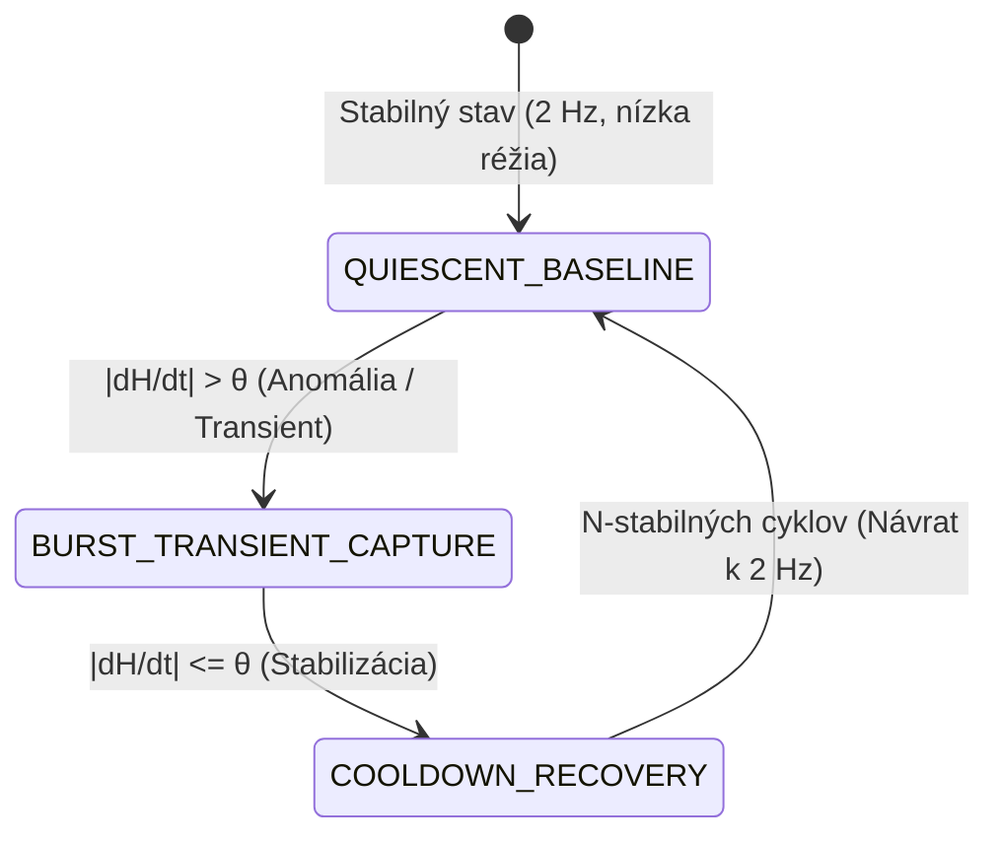

# CRYSTALSEC 2.0: CAUSAL LLM RUNTIME & ADAPTIVE TELEMETRY
## Architektonická špecifikácia výskumnej vetvy (Research Track)

> **Autor:** Senior Principal Research & Cyber-Physical Systems Architect  
> **Status:** Aktívna výskumná vetva (Research Track) pre Krystal-Stack & CrystalSec  
> **Základná premisa:** CrystalSec sa neposúva smerom k agresívnemu heuristickému optimalizátoru, ale k **LLM-aware exekučnej a regulačnej platforme**, ktorá optimalizuje celý kauzálny priebeh príkazu od prijatia cez inferenciu až po telemetriu.

---

## 1. 8-fázový LLM Execution Plane

Namiesto vnímania LLM ako nepriehľadného externého procesu je LLM modelovaný ako kyber-fyzikálny workload s vlastným stavovým životným cyklom:

$$\text{Prompt} \longrightarrow \text{Context} \longrightarrow \text{Routing} \longrightarrow \text{Inference} \longrightarrow \text{Tool Proposal} \longrightarrow \text{Validation} \longrightarrow \text{Execution} \longrightarrow \text{Observation}$$


### Prevádzkový odtlačok každej fázy:
1. **Prompt & Context:** Token sizing, RAG injekcia, pomer kontextového okna voči stropu pamäte.
2. **Routing:** Deterministický dispatch na hardvérový cieľ (Intel Core CPU, Iris Xe 96 EU iGPU cez DP4A, alebo NPU).
3. **Inference:**
   - **TTFT** (Time To First Token) a **ITL** (Inter-Token Latency).
   - **KV-Cache Pressure:** percentuálne zaplnenie host-coherent UMA pamäťových blokov.
   - **Page Faults:** monitoring nulového swapu (`memory.swap.current == 0`).
4. **Tool / Command Proposal:** Generovanie štruktúrovaného B2B/CNC príkazu.
5. **Validation:** Priechod cez 7-stupňový deterministický reťazec `ValidationChainPipeline` s invariantom `VITAL_MAX_HP == 6`.
6. **Execution:** Bezpečné odoslanie do DSC runtime-u alebo hardvéru.
7. **Observation:** Zápis do kryptografického auditného ledgeru a syntéza 10D vektora zdravia $H$.

> [!NOTE]
> **Kauzálne vysvetlenie namiesto zjednodušenia:**  
> Vzniká jasná hranica medzi zjednodušeným tvrdením *„LLM je pomalé“* a presnou kauzálnou diagnózou:  
> *„Konfigurácia $X$ pri workload type $Y$ spôsobila KV-cache memory pressure $\to$ vyvolala CFS scheduler delay $\to$ viedla k akumulácii fronty.“*

---

## 2. CrystalSec ako regulátor: Observe – Reason – Control

CrystalSec vystupuje v troch vzájomne oddelených úlohách:

| Zložka | Úloha | Rozsah pôsobnosti |
| :--- | :--- | :--- |
| **Observe** | Zber telemetrie | Kernel, Linux cgroups v2, OpenVINO streams, Iris Xe VRAM a tokenový pipeline |
| **Reason** | Epistemická analýza | Porovnanie $G_{\text{desired}}(t) \leftrightarrow G_{\text{observed}}(t)$, generovanie konkurenčných hypotéz ($H_1 \dots H_n$) |
| **Control** | Regulácia parametrov | Modifikácia **výhradne explicitne povolených premenných** |

### Množina povolených premenných (Controlled Variables $C$):
$$C = \big(\text{threads},\, \text{streams},\, \text{CPU affinity},\, \text{batch},\, \text{context},\, \text{queue},\, \text{memory limit},\, \text{sampling rate}\big)$$

### Multi-objektívna úžitková funkcia $U(C)$:
Namiesto hľadania jednostrannej maximálnej rýchlosti $\max(\text{tokens/s})$ maximalizujeme vyváženú úžitkovú hodnotu:
$$\max U(C) = w_1 Q + w_2 T - w_3 L - w_4 M - w_5 E - w_6 R$$
- $Q$ : Kvalita a úspešnosť úlohy $[0.0 - 1.0]$
- $T$ : Token a príkazový throughput (tokens/s)
- $L$ : Latencia (TTFT + inter-token delay)
- $M$ : Pamäťový a KV-cache tlak (VRAM/RAM pressure)
- $E$ : Energetická a tepelná cena ($T \le 75^\circ\text{C}$)
- $R$ : Riziko nestability (tail jitter, page faults, retry cykly)

---

## 3. Adaptívne časové rozlíšenie telemetrie (Adaptive Telemetry Resolution)

Vzorkovacia frekvencia telemetrie nie je statická konštanta. Prechádza dynamickou adaptáciou podľa derivácie stavového vektora:

$$\left|\frac{dH}{dt}\right| > \theta$$



1. **QUIESCENT_BASELINE (2 Hz):** Systém je stabilný; minimálna spotreba CPU a I/O pásma.
2. **Detekcia transientu:** Ak stúpne rýchlosť zmeny latencie, teploty vinutia alebo hĺbky fronty nad prah $\theta$, guvernér okamžite prepína do **BURST_TRANSIENT_CAPTURE (50 – 100 Hz)**.
3. **Zachytenie transientu:** Vysokofrekvenčný kruhový buffer zachytí presný priebeh javu na úrovni milisekúnd.
4. **COOLDOWN_RECOVERY (10 Hz):** Po odznení odchýlky sa systém plynule vracia na základnú frekvenciu bez straty forenzných dát.

---

## 4. LLM Research Copilot & Deterministická bezpečnostná brána

Druhá inštancia LLM pôsobí ako **výskumný kopilot nad telemetriou**, ktorý formuluje vysvetlenia a navrhuje minimálne diskriminačné experimenty.

> [!IMPORTANT]
> **Striktné bezpečnostné pravidlo:**  
> Research Copilot nesmie nikdy priamo modifikovať konfiguráciu ani zasahovať do produkčného stavu. Každý návrh musí prejsť deterministickou bezpečnostnou bránou:
> $$\text{Proposal} \longrightarrow \text{Policy Review} \longrightarrow \text{Invariants} \longrightarrow \text{Allowed Variables} \longrightarrow \text{Controlled Lab}$$

```
                    USER / LOCAL API
                           │
                           ▼
                  ┌─────────────────┐
                  │ CrystalSec Gate │
                  └────────┬────────┘
                           │
                  policy + workload
                           ▼
              ┌────────────────────────┐
              │    LLM EXECUTION       │
              │ OpenVINO / local model │
              └───────────┬────────────┘
                          │
             ┌────────────┼─────────────┐
             ▼            ▼             ▼
          tokens       tool calls    runtime
             │            │             │
             └────────────┼─────────────┘
                          ▼
                TELEMETRY FABRIC
           (Adaptive: |dH/dt| > θ)
                          │
                          ▼
                 DIGITAL MIRROR
             desired ↔ observed
                          │
                          ▼
                 HYPOTHESIS ENGINE
                  H1 H2 H3 ... Hn
                          │
                          ▼
                   LLM RESEARCH
                     COPILOT
                          │
                          ▼
                Experiment Proposal
                          │
                          ▼
                POLICY / INVARIANTS
                          │
                   allowed? │
                     ┌──────┴──────┐
                    NO            YES
                     │              │
                   LOG       Controlled Lab
                                    │
                                    ▼
                              new evidence
                                    │
                                    └──► ontology
```

---

## 5. Výsledky implementácie v kóde

Vytvorené a otestované komponenty:
1. [`krystal_kernel/crystalsec_llm_execution_plane.py`](file:///c:/Users/dusan/Documents/GitHub/Krystal-stack-platform-framework/krystal_kernel/crystalsec_llm_execution_plane.py)
   - 8-fázový tracing, zber prevádzkového odtlačku, výpočet $U(C)$.
2. [`krystal_kernel/adaptive_telemetry_resolution.py`](file:///c:/Users/dusan/Documents/GitHub/Krystal-stack-platform-framework/krystal_kernel/adaptive_telemetry_resolution.py)
   - Dynamické riadenie frekvencie vzorkovania (2 Hz $\leftrightarrow$ 100 Hz).
3. [`krystal_kernel/llm_research_copilot.py`](file:///c:/Users/dusan/Documents/GitHub/Krystal-stack-platform-framework/krystal_kernel/llm_research_copilot.py)
   - Telemetrické uvažovanie, izolácia 1 premennej a deterministická bezpečnostná brána.
