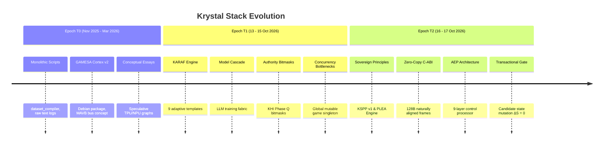

# EVOLUTION: FROM MONOLITH TO AEP
## Historical Traceability, Paradigm Shifts, and Archived Concepts

```text
Document Status:    HISTORICAL EVOLUTION ARCHIVE [EVOLUTION]
Scope:              Epoch T0 (Nov 2025) -> T1 (Oct 2026) -> T2 (Current AEP)
Classification:     Retrospective Architectural Analysis
```

---

## 1. The Three Architectural Epochs

The development of Krystal Stack transitioned through three distinct evolutionary epochs:



---

## 2. Legacy Concepts Moved to Evolution Archive

The following early concepts and artifacts have been superseded by the **Adaptive Execution Processor (AEP)** and are preserved here strictly for historical provenance:

### 1. GAMESA Cortex v2 & MAVB (Memory-Augmented Virtual Bus)
* **Epoch:** $T_0$ (November 2025 – March 2026).
* **Artifact:** `gamesa-cortex-v2_2.0.0_amd64.deb`, `build_gamesa_v2.sh`.
* **Superseded By:** The Universal 128-byte C-ABI Zero-Copy contract (`include/krystal_nexus_api.h`) and `RuntimeRegistry`.
* **Reason:** MAVB relied on monolithic memory buffers without formal invariant verification or cryptographic HMAC bounding.

### 2. Static Configuration Assumptions (`threads = 8`, fixed batch sizes)
* **Epoch:** $T_0$ / $T_1$.
* **Superseded By:** AEP Layer 4 (`PolicyProcessor`) and Layer 7 (`BackpressureController`).
* **Reason:** Static parameters inevitably fail under heterogeneous dynamic workloads (e.g. concurrent 120Hz VSync scanout alongside background LLM token generation).

### 3. Mutate-and-Rollback Pattern
* **Epoch:** Early $T_2$.
* **Superseded By:** AEP Layer 8 (`Transactional State Machine`).
* **Reason:** Modifying authoritative state before verification created risks of state contamination and race conditions. AEP now generates candidate state $S' = T(S, A)$, verifies $I(S')$, and commits only on success ($\Delta S \equiv 0$ on failure).

---

## 3. The Core Paradigm Shift

| Dimensional Axis | Legacy Monolithic Paradigm ($T_0 - T_1$) | Adaptive Execution Processor ($T_2$) |
|---|---|---|
| **System Philosophy** | Fixed configurations, static threads, client-driven state. | Closed-loop regulation, policy selection, server authority. |
| **Authority of State** | $UI \equiv S$ (Client directly updated state). | $\text{Render}(S) \neq S$ (UI is a passive projection). |
| **Invariant Enforcement** | Informal docstrings, unasserted checks. | Constitutional Law Core (L2) with automatic candidate abort. |
| **Memory Architecture** | Variable-length JSON serialization, shared pointers. | 128B naturally aligned zero-copy binary contracts. |
| **Failure Semantics** | Silent fallback, dirty mutation + recovery. | Zero mutation on failure: $S_{t+1} \equiv S_t$. |
| **Observability** | Ad-hoc console `print()` logs. | Universal standardized `AepReceipt`. |
