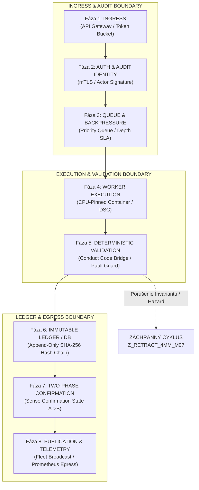
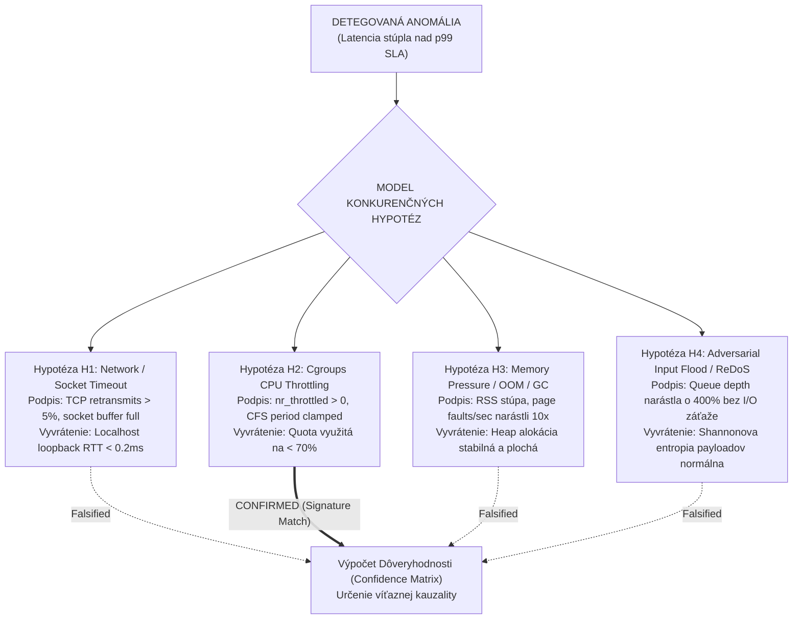

# Normatívny Rámec: Riadenie Integrity Zdrojov, Forenzná Analýza Zlyhaní & Government-Grade Linux Distribúcia pre Krystal-Stack

> [!IMPORTANT]
> **Normatívny princíp architektúry:**
> Optimalizácia výkonu je iba podmnožinou systému, nie jeho primárnym cieľom. **Primárnym cieľom je diagnostikovateľná a deterministická odolnosť.** Každá alokácia zdroja je meraná, auditovateľná a spätne vysvetliteľná. Zákaz tichého throttlingu: každá degradácia zdrojov je klasifikovaná ako bezpečnostná udalosť s unikátnym korelačným ID (`correlation_id`).

---

## 1. Životný Cyklus Spracovania Úloh (8 Fáz Spracovania)

Spracovanie každej transakcie/úlohy v Krystal-Stacku podlieha striktnému 8-fázovému stavovému automatu. Prechod medzi fázami je podmienený kryptografickým podpisom identity a validáciou invariantov.



### Špecifikácia Fáz:

| Fáza | Názov | Kľúčové operácie | Zlyhanie / Fallback |
| :--- | :--- | :--- | :--- |
| **F1** | **Ingress** | Príjem požiadavky cez mTLS / IPC, sanitizácia payloadu, priradenie `correlation_id` a `trace_id`. | `429 Too Many Requests` (Backpressure) |
| **F2** | **Auth & Audit Identity** | Overenie nemenného certifikátu aktéra, kontrola oprávnení, zápis `AUDIT_INGRESS_EVENT`. | `401 / 403 Forbidden`, zalogovanie bezpečnostného incidentu |
| **F3** | **Queue & Backpressure** | Zaradenie do prioritnej fronty, monitorovanie `queue_depth`, SLA časového okna na spracovanie. | Presmerovanie do Dead-Letter Queue (DLQ) pri timeout |
| **F4** | **Worker Execution** | Spracovanie v izolovanom kontajneri s cgroups v2 CPU-pinningom, nulová GC alokácia vo fyzikálnej slučke. | Izolácia kontajnera, aktivácia náhradného workeru |
| **F5** | **Deterministic Validation** | Conduct Code Bridge (`[ACT] [LCK] [CNF>=0.85] [HAZ] [VIT 6HP]`), Pauli Exclusion Guard, Ohmov zákon. | Záchranný cyklus (`Z_RETRACT_4MM_M07` / `DEFLECT`) |
| **F6** | **Database / Immutable Ledger** | Zápis nového stavu do kryptograficky zreťazeného append-only ledgeru (SHA-256 hash chaining). | Rollback transakcie, generovanie forenzného alertu |
| **F7** | **Two-Phase Confirmation** | Dvojfázové potvrdenie prechodu stavu (State A -> State B), overenie invariantu `vital_max_hp == 6`. | `REVERT_STATE_TRANSACTION` |
| **F8** | **Publication & Telemetry** | Egress do fleet managementu, Prometheus metrík a certifikačných ISO 13849 logov. | Asynchrónne opakovanie s exponenciálnym backoffom |

---

## 2. Viazané Telemetrické Metriky & Striktné SLA Kontrakty

Na rozdiel od bežného monitoringu, Krystal-Stack definuje **viazané metriky**, kde odchýlka v jednej metrike automaticky mení váhu a interpretáciu ostatných:

1. **Front Depth (Hĺbka fronty $Q_d$):**
   - Normálny stav: $Q_d \le 50$ položiek.
   - Výstražný prah: $50 < Q_d \le 200$.
   - Kritický prah: $Q_d > 200$ $\rightarrow$ okamžitá aktivácia backpressure a odmietanie nízko-prioritných úloh.
2. **Latencia p95 a p99 ($L_{p95}, L_{p99}$):**
   - $L_{p95} \le 25\text{ ms}$, $L_{p99} \le 50\text{ ms}$ (pre lokálny kernel DSC).
   - $L_{p95} \le 120\text{ ms}$, $L_{p99} \le 250\text{ ms}$ (pre distribuovanú fleet orchestráciu).
3. **Retry Rate ($R_{\text{retry}}$):**
   - Pomer opakovaných pokusov voči celkovým požiadavkám: $R_{\text{retry}} = \frac{N_{\text{retry}}}{N_{\text{total}}}$.
   - Prah: $R_{\text{retry}} > 0.02$ (2%) indikuje jitter alebo tichú nestabilitu na I/O vrstve.
4. **Confirmation Latency ($L_{\text{conf}}$):**
   - Čas od ukončenia výpočtu vo workeri po finálny zápis do nemenného stavového ledgeru: $L_{\text{conf}} \le 10\text{ ms}$.
5. **Audit Eventy zmien konfigurácie a alokácie zdrojov:**
   - Každá zmena konfigurácie (cgroups quota, thread affinity, timeouty) vygeneruje nemenný audit event:
     $$\text{AuditEvent} = \{ \text{id}, \text{timestamp}, \text{actor}, \text{prev\_hash}, \text{new\_hash}, \text{resource\_diff} \}$$

---

## 3. Zákaz Binárneho Hodnotenia „UP/DOWN“: Päťrozmerný Vektor Zdravia

> [!CAUTION]
> **Zákaz tichého throttlingu (No Silent Throttling Rule):**
> V operačnom systéme nesmie nastať situácia, kedy CPU scheduler ticho potlačí (throttle) proces v cgroup bez toho, aby bol vyvolaný forenzný záznam. Ak `cpu.stat nr_throttled` vzrastie o $>0$, generuje sa udalosť `RESOURCE_DEGRADATION_EVENT` s prideleným `correlation_id`.

Binárne hodnotenie „UP/DOWN“ je zakázané. Nahrádza sa kontinuálnym **vektorom zdravia** $\mathbf{H} \in [0, 1]^5$:

$$\mathbf{H} = \begin{bmatrix} H_{\text{liveness}} \\ H_{\text{readiness}} \\ H_{\text{resource}} \\ H_{\text{degradation}} \\ H_{\text{sla}} \end{bmatrix}$$

- $H_{\text{liveness}} \in \{0, 1\}$: Proces žije, PID existuje a IPC socket reaguje.
- $H_{\text{readiness}} \in [0, 1]$: Dostupnosť fronty, DB spojenia a hardvérového watchdogu.
- $H_{\text{resource}} \in [0, 1]$: Rezerva RAM, cgroup CPU limit, žiadny swap-in, rezerva file descriptorov.
- $H_{\text{degradation}} \in [0, 1]$: $0.0 = \text{plný výkon}$, $1.0 = \text{kompletná degradácia / záchranný režim}$.
- $H_{\text{sla}} \in [0, 1]$: Miera plnenia latencií p95/p99 v klzavom okne posledných 1000 transakcií.

---

## 4. Model Konkurenčných Hypotéz (MCH / ACH Engine)

Pri anomálii alebo zlyhaní systém nevráti generickú chybu (napr. `"Internal Server Error"`). Namiesto toho analytický engine automaticky vyhodnotí súbor **konkurenčných hypotéz** s priradeným podpisom v dátach a podmienkou vyvrátenia (falsification condition):



### Matrica Hypotéz:

| Hypotéza | Predpokladaná príčina | Očakávaný podpis v telemetrii | Podmienka vyvrátenia (Falsification) |
| :--- | :--- | :--- | :--- |
| **$H_1$** | Sieťová partícia / Timeout | Nárast TCP retransmits, socket buffer saturation, pokles priepustnosti. | RTT lokálneho loopback socketu $< 0.5\text{ ms}$ a nulové zlyhania paketov. |
| **$H_2$** | Cgroups CPU Throttling | `cpu.stat: nr_throttled > 0`, `throttled_time_usec > 10000`, runqueue delay. | CPU využitie pod limitom cgroup ($< 80\%$) a `nr_throttled == 0`. |
| **$H_3$** | Pamäťový tlak / GC Stall | RSS blížiaca sa k limitu, nárast `memory.events: oom_kill` alebo major page faults. | Alokácia pamäte konštantná, nulový swap, heap delta $< 5\%$. |
| **$H_4$** | Adversarial Flood / Queue Jam | Skokový nárast $Q_d > 200$, nízka sémantická dôvera payloadov ($< 0.85$). | Normálny prítok overených tokenov, rovnomerná distribúcia aktérov. |

---

## 5. Fault Injection Lab: Riadené Experimenty Odolnosti

Systém povinne integruje modul **Fault Injection Lab**, ktorý umožňuje spúšťať riadené poruchy v reálnom čase bez nutnosti simulácie v externom prostredí:

### Parametre Experimentu:
1. **$T_{\text{start}}$ (Začiatok):** Presná časová pečiatka aktivácie poruchy.
2. **Intenzita (Fault Amplitude):** Miera degradácie (napr. 40% CPU steal, 150 ms injektovaná latencia, 85% zaplnenie pamäte).
3. **$T_{\text{end}}$ (Koniec):** Deterministické ukončenie experimentu.
4. **Očakávaná stopa (Blast Radius):** Množina ovplyvnených komponentov a predikovaný podpis v dátach.

### Deterministická Záchranná Slučka (4-Krokový Cyklus):

```
       [ DETEGUJ ]  ──>  Detekcia anomálie do 15 ms (vektor zdravia klesne pod prah)
            │
            ▼
       [  IZOLUJ ]  ──>  Okamžité odpojenie degradovaného kontajnera z fronty, aktivácia fallbacku
            │
            ▼
       [   OBNOV ]  ──>  Vyvolanie deterministického záchranného cyklu (Z-retract, reset cgroups, reštart workera)
            │
            ▼
       [    OVER ]  ──>  Verifikácia integrity stavu, overenie invariantu vital_hp == 6 a návrat do rotácie
```

---

## 6. Architektúra pre Verejné Obstarávanie (Government-Grade Linux & OCI)

Pre potreby verejného obstarávania (kritická infraštruktúra, OEM priemysel, B2B fleet systémy) platforma definuje nezávislú referenčnú architektúru, ktorá **odstraňuje závislosť na ad-hoc WSL prostredí** a prináša plnohodnotný **Hardened Linux Stack**:

### Preklad Technických Pojmov do Akceptačných Kritérií Verejného Obstarávania:

| Technický koncept | Akceptačné kritérium pre verejné obstarávanie | Metóda auditu / Overenia |
| :--- | :--- | :--- |
| **Anti-Silent Throttling** | Zákaz neohláseného zníženia výpočtového výkonu; každá degradácia zdrojov je klasifikovaná ako auditovaný incident. | Kontrola cgroups v2 `cpu.stat`, prepojenie na SIEM cez syslog/auditd. |
| **Nemenný Audit Trail** | Digitálne zreťazený žurnál (append-only ledger) odolný voči manipulácii správcom systému. | Kryptografická verifikácia SHA-256 hashov každej zmeny stavu. |
| **Preukázaná Vysoká Dostupnosť** | Deterministická obnova po poruche (RTO $< 250\text{ ms}$, RPO = 0 transakcií). | Automatizovaný beh scenárov Fault Injection Lab počas akceptačných testov. |
| **SLA Garancia Latencie** | Dodržanie p95 latencie $< 25\text{ ms}$ a p99 $< 50\text{ ms}$ pod 150% nominálnou záťažou. | Stresový záťažový test s paralelnou telemetriou a exportom do formátu OpenTelemetry. |

### Špecifikácia Hardened Linux / OCI Stacku:
- **Operačný systém:** Hardened Linux s `PREEMPT_RT` jadrom (Real-Time determinizmus) a vypnutým transparentným hugepages (THP) pre predvídateľnú alokáciu.
- **Kontajnerizácia:** OCI Runtime (systemd-nspawn / rootless Podman / Docker Engine) s explicitným priradením cgroups v2:
  - `cpu.max = "100000 100000"` (garancia 1.0 CPU bez kolísania)
  - `cpuset.cpus = "2-3"` (fyzické CPU piny pre worker bez prepínania kontextu)
  - `memory.max = "536870912"` (512 MB striktný strop)
  - `memory.swap.max = "0"` (úplný zákaz swapovania)
- **Node.js Orchestrátor:** Asynchrónny I/O dispečer pre API, job dispatch, riadenie životného cyklu a komunikáciu s Fault Injection Labom.
- **Krystal Kernel Core:** Python / Rust / Go / C deterministický engine riadiaci záchranné slučky a fyzikálnu matematiku.
