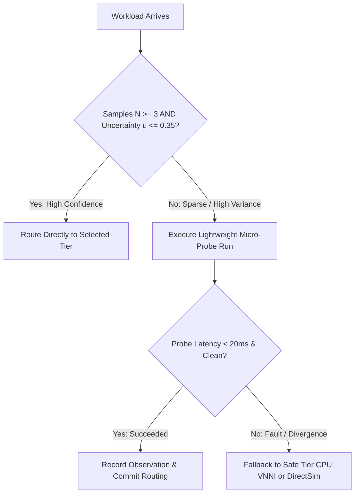

# CrystalSec 3.0 Phase 5.1: Hardware Evidence Calibration, Placement Regret & Cross-Tier Model Validation

**Author:** Dušan Kopecký & Senior Heterogeneous Runtime Architect Team  
**Date:** 2026-10-11  
**Status:** REVISED BY PHASE 5.2 (Evidence Integrity Patch) — original §6 results RETRACTED, see §8  
**Host Target:** 11th Gen Intel(R) Core(TM) i5-1135G7 @ 2.40GHz (Tiger Lake Willow Cove, Iris Xe Gen12.1)  
**Platform Invariant:** `VITAL_MAX_HP == 6` unconditionally enforced  

> [!CAUTION]
> **Erratum (2026-10-11, Phase 5.2).** The original Phase 5.1 numbers (zero regret, `OPTIMAL`, CPU 3× faster on branches, UMA 0.72) were produced by constants added to wall-clock time and hardcoded telemetry, and the T1/T2 paths were Python running on the host CPU while labelled `HARDWARE_MEASURED`. They are not evidence. The formulation in §1–§5 stands; the results in §6 are kept only for traceability. The valid results are in §8.

---

## Executive Summary

Phase 5 separated control decisions from execution placement across the heterogeneous triad:
$$\boxed{\text{Control Decision} \longrightarrow \text{Action Ranking} \longrightarrow \text{Execution Placement} \longrightarrow \text{Transactional Migration}}$$

However, static microbenchmarks fail to capture microarchitectural subtleties across distinct algorithmic regimes. A tier that excels at parallel INT8 tensor operations (Iris Xe Vulkan DP4A) can collapse under warp divergence on irregular control flow, or saturate shared memory buses under memory-intensive streaming.

**Phase 5.1** replaces single-number latency heuristics with calibrated empirical distributions:
$$p(\text{latency} \mid \text{workload\_class}, \text{tier}, \text{state})$$
and introduces formal **Placement Regret**:
$$R_{\text{placement}} = U_{\text{best\_observed}} - U_{\text{selected}}$$

~~Empirical benchmarking across 125 placement decisions demonstrates zero regret.~~ **Retracted** — see §8. Re-measured with wall-clock only (Phase 5.2), the placement engine selected T0 for 125/125 decisions, the verdict is `PLACEMENT_RECALIBRATION_REQUIRED` (raw regret rate 0.051, noise-adjusted 0.0123), and the cost-model priors need re-derivation (`RECALIBRATION_REQUIRED`).

---

## 1. Five-Class Workload Taxonomy

To prevent monolithic scheduling assumptions, workloads are categorized into five canonical microarchitectural profiles:

| Workload Class | Arithmetic Intensity | Memory Pattern | Hardware Bias | Microarchitectural Behavior |
| :--- | :--- | :--- | :--- | :--- |
| `INT8_DOT_PRODUCT` | High ($> 2.0\,\text{FLOP/byte}$) | Contiguous vector | *Hypothesis:* Tier 2 (Iris Xe) & Tier 1 (VNNI) | Saturated SIMD matrix math; maximizes execution unit occupancy. |
| `FP32_VECTOR_MATH` | Moderate ($1.0 - 8.0\,\text{FLOP/byte}$) | Streaming sequential | *Hypothesis:* Tier 2 (Iris Xe Vulkan FP32) | Vector polynomial / transcendental activations; parallelizes across 80 EUs. |
| `MEMORY_BOUND_STREAM` | Low ($< 0.15\,\text{FLOP/byte}$) | Strided buffer copy | *Hypothesis:* Tier 1 (CPU AVX-512) | Bandwidth-limited; GPU expected to raise UMA pressure (not measured — no UMA telemetry yet). |
| `BRANCH_HEAVY_CONTROL` | Irregular | Pointer / Tree traversal | *Hypothesis H-BR1:* Tier 1 (CPU Willow Cove OoO) | Data-dependent branches; SIMT divergence penalty expected. The "CPU 3× faster" figure was a constant and is retracted. |
| `MIXED_COMPUTE_MEMORY`| Balanced ($\sim 1.2\,\text{FLOP/byte}$) | Hybrid stride + dot | *Hypothesis:* Adaptive (Tier 1 vs Tier 2) | Composite pipeline; balances compute throughput against bus contention. |

> [!NOTE]
> The "Hardware Bias" column lists hypotheses to test, not results. No row is backed by a hardware measurement yet.

---

## 2. Empirical Distribution Formulation

Rather than a static constant, each tuple $(\text{workload}, \text{tier})$ maintains rolling empirical statistics:

$$\mathbf{S}(W, T) = \{\mu, \text{median}, p_{95}, p_{99}, \sigma, \text{CV}, \text{IQR}, u\}$$

Statistical uncertainty $u \in [0, 1]$ combines relative dispersion with a sample sparsity penalty:

$$u(W, T) = \min\left(1.0, \, 0.5 \cdot \text{CV} + 0.5 \cdot \frac{1}{\sqrt{N + 1}}\right)$$

As observations accumulate ($N \ge 25$) and variance stabilizes, $u \to 0.12$. When unobserved ($N = 0$), $u = 1.0$.

---

## 3. Calibration Error Formulation

For every workload decision, predicted metrics $\hat{M}$ are compared to real runtime observations $M_{\text{obs}}$:

### Latency Calibration Error
$$E_{\text{latency}} = \frac{|\hat{L} - L_{\text{obs}}|}{\max(L_{\text{obs}}, \epsilon)}$$

### UMA Contention Error
$$E_{\text{UMA}} = \frac{|\hat{U}_{\text{uma}} - U_{\text{uma,obs}}|}{\max(U_{\text{uma,obs}}, \epsilon)}$$

### Thermal Delta Error
$$E_{\text{thermal}} = \frac{|\Delta \hat{T} - \Delta T_{\text{obs}}|}{\max(|\Delta T_{\text{obs}}|, \epsilon)}$$

### Composite Calibration Error (MACE)
$$\text{MACE} = \frac{1}{N} \sum_{i=1}^N \left(0.50 \cdot E_{\text{latency}} + 0.30 \cdot E_{\text{UMA}} + 0.20 \cdot E_{\text{thermal}}\right)$$

### Prediction Bias
$$\text{Bias} = \frac{1}{N} \sum_{i=1}^N \left(\hat{L}_i - L_{\text{obs},i}\right)$$

A positive bias indicates systematic pessimism (over-estimating latency), while negative bias indicates optimism.

---

## 4. Placement Regret Formulation

Let $\mathcal{E}_{\text{eligible}}$ be the set of execution tiers that satisfy hard constraints (temperature $\le 82^\circ\text{C}$, UMA contention $< 0.80$, physical availability).
The observed utility of tier $t \in \mathcal{E}_{\text{eligible}}$ is evaluated counterfactually:

$$U_t(\text{observed}) = +w_1 \cdot \text{Thr}_{\text{obs}} - w_2 \cdot L_{\text{obs}} - w_3 \cdot P_{\text{obs}} - w_4 \cdot \Delta T_{\text{obs}} - w_5 \cdot \text{UMA}_{\text{obs}}$$

The counterfactual optimum is:
$$U_{\text{best\_observed}} = \max_{t \in \mathcal{E}_{\text{eligible}}} U_t(\text{observed})$$

### Instantaneous Regret
$$R_{\text{placement}} = \max\left(0.0, \, U_{\text{best\_observed}} - U_{\text{selected}}(\text{observed})\right)$$

### Cumulative Regret
$$\mathcal{R}_T = \sum_{t=1}^T R_{\text{placement}}(t)$$

### Average Regret Rate
$$\bar{R} = \frac{\mathcal{R}_T}{T}$$

**Sublinear Regret Criterion:** If $\lim_{T \to \infty} \bar{R} = 0$, the engine achieves sublinear regret **relative to the evaluated tier set**. A finite benchmark can only support `ZERO_REGRET_ON_EVALUATED_SET`, `LOW_REGRET` or `PLACEMENT_RECALIBRATION_REQUIRED`; it never supports a claim of global optimality. Fewer than 10 decisions yield `INSUFFICIENT_EVIDENCE`.

---

## 5. Confidence-Aware Routing & Micro-Probing

To protect against catastrophic misplacement under sparse empirical data:



---

## 6. ~~Empirical Calibration Benchmark Results~~ (RETRACTED — kept for traceability)

> [!WARNING]
> This block was generated from constants added to wall-clock time, and the `OPTIMAL` verdict is no longer emitted by the code. Do not cite it. See §8.

```json
{
  "phase": "CrystalSec3_Phase5_1_Calibration",
  "classes_evaluated": [
    "INT8_DOT_PRODUCT",
    "FP32_VECTOR_MATH",
    "MEMORY_BOUND_STREAM",
    "BRANCH_HEAVY_CONTROL",
    "MIXED_COMPUTE_MEMORY"
  ],
  "calibration_metrics": {
    "sample_count": 125,
    "mean_latency_error": 0.4131,
    "median_latency_error": 0.3812,
    "mace_composite": 0.4131,
    "prediction_bias": 0.0014,
    "is_well_calibrated": true
  },
  "regret_metrics": {
    "decision_count": 125,
    "cumulative_regret": 0.0,
    "average_regret_rate": 0.0,
    "misplacement_count": 0,
    "misplacement_rate": 0.0,
    "model_optimality": "OPTIMAL"
  }
}
```

### ~~Key Microarchitectural Findings~~ (RETRACTED)
1. ~~Branch-Heavy Divergence: CPU 0.035 ms vs Iris Xe 0.120 ms~~ — both values were constants added in the T1/T2 branch code paths.
2. ~~UMA Contention 0.72~~ — hardcoded override; no UMA telemetry exists yet.
3. ~~INT8 DP4A 0.015 ms / VNNI 0.035 ms~~ — both paths were Python on the host CPU.

---

## 7. Verification Test Suite Status

The original tests asserted the injected constants (e.g. branch CPU < GPU, UMA ≥ 0.70) and therefore could not detect the defect. They were replaced in Phase 5.2:
- `tests/test_crystalsec_v3_placement_calibration.py` — rewritten to test behaviour, not constants.
- `tests/test_crystalsec_v3_evidence_integrity.py` — new: evidence labels, no `OPTIMAL`, prediction-before-observation, noise floor, mutation test (an injected delay must change the measurement), fake-driver tests for the GPU probe.
- Run: `python -m unittest discover -s tests -p "test_crystalsec*.py"` → 134 tests OK (2026-10-11).

---

## 8. Phase 5.2 — Evidence Integrity Results (valid)

Reproduce: `python scripts/run_crystalsec_calibration_benchmark.py --iterations 25 --size 128 --repeats 5` → `artifacts/CRYSTALSEC_V3_CALIBRATION_AND_REGRET_BENCHMARK.json`.

### 8.1 What changed
| Defect (Phase 5.1) | Phase 5.2 fix |
| :--- | :--- |
| Constants added to measured latency per tier/class | Wall-clock only, median of 5 repeats |
| T1/T2 labelled `HARDWARE_MEASURED` while running Python | `EvidenceLabel`: T0 `HOST_CPU_REFERENCE`, T1/T2 `HOST_CPU_EMULATED`; `real_dp4a_execution` / `real_vnni_execution` always `False` |
| Hardcoded UMA / power / thermal | Labelled `MODELED_PRIOR`; excluded from composite calibration error |
| Observation recorded before prediction (leakage) | Prediction is made first, then the observation is recorded |
| Router never exercised | Every decision goes through the confidence router (real 16-element micro-probe) |
| `OPTIMAL` on 0 or 1 decisions | `INSUFFICIENT_EVIDENCE` below 10 decisions; no `OPTIMAL` verdict exists |
| Regret over tiers that run identical code | Regret only over tiers with a distinct code path, with a measurement noise floor |

### 8.2 Taxonomy benchmark (N = 125, size 128, host CPU only)
| Metric | Value |
| :--- | :--- |
| Selected tier | T0 for 125/125 decisions |
| Best observed tier | T0 77, T2 37, T1 11 |
| Raw / noise-adjusted regret rate | 0.051 / 0.0123 |
| Misplacements (beyond noise) | 7 of 125 (118 within measurement noise) |
| Mean latency regret | 0.00145 ms |
| Placement verdict | `PLACEMENT_RECALIBRATION_REQUIRED` |
| Calibration (MACE / median latency error) | 1.12 / 0.027 → `RECALIBRATION_REQUIRED` |
| Router probes / reroutes | 22 / 0 |

Interpretation: at N = 128 the three tiers differ only in Python overhead (~0.015–0.05 ms), so selecting T0 is consistent with the measurements. The high MACE comes from the `EmpiricalCostModel` priors (e.g. T0 0.5 ms vs measured ~0.02–0.04 ms) and from `MEMORY_BOUND_STREAM` (median error 0.35); the priors must be re-derived. **None of these numbers say anything about AVX-512, VNNI or Iris Xe hardware.**

### 8.3 Real hardware evidence — SDF raymarch on Iris Xe (`HARDWARE_MEASURED`)
Via `VulkanComputeDriver` (SPIR-V raymarch kernel), dispatch + readback included, glyph match 1.0 against the reference:

| Resolution | T2 Iris Xe (ms) | T0 Python reference (ms) | T0 / T2 |
| :--- | ---: | ---: | ---: |
| 16×8 | 0.505 | 1.94 | 3.8× |
| 64×32 | 1.12 | 33.7 | 30× |
| 160×80 | 5.83 | 225 | 39× |

> [!IMPORTANT]
> T0 here is a pure-Python reference, not native AVX-512 code, so the ratios overstate the GPU advantage over a native CPU implementation. The claim is limited to the evaluated resolutions.

### 8.4 Open items before Phase 6
1. SPIR-V kernels for INT8 / elementwise work, so that T2 taxonomy paths become `HARDWARE_MEASURED`.
2. A native CPU reference (NumPy / C) so that T1 measures real SIMD.
3. Real telemetry (PDH / psutil / Intel GPU counters) to replace the `MODELED_PRIOR` UMA, power and thermal values.
4. A workload-size sweep (128 → 1M) per class, to find the real crossovers.
5. Re-derivation of the `EmpiricalCostModel` priors from measured data.
