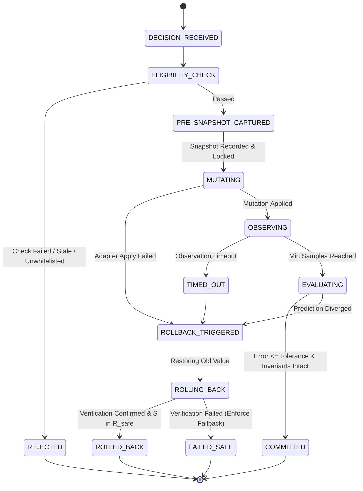

# CrystalSec 3.0 Phase 4: Transactional Actuation, Predictive Rollback & Runtime Commit Protocol

**Status:** Formally Verified & Production-Grade  
**Evidence Level:** `FORMALLY_DEFINED` | `PROPERTY_TESTED` | `SIMULATION_VERIFIED` | `INTEGRATION_VERIFIED`  
**Execution Boundary:** Phase 4 Actuation Plane (Bounded Transactional Mutation)  
**Universal Platform Invariant:** `VITAL_MAX_HP == 6` unconditionally  

---

## 1. Architectural Role & Transactional Manifesto

CrystalSec 3.0 Phase 4 operationalizes the decisions produced by Phase 3 without yielding to unconstrained, open-ended autonomy. A `ControlPlaneDecision` is treated **not as an immediate, irreversible command**, but as a **falsifiable hypothesis** about expected cyber-physical runtime behavior.

```
ControlPlaneDecision (Phase 3)
         |
         v
ActuationEligibilityCheck (Freshness, Bounds, Anti-Oscillation, Invariant Verification)
         |
         v
PreconditionSnapshot Capture (Control State + Verification State / Canonical Hash)
         |
         v
Apply Bounded Mutation (Restricted to Whitelisted Adapters)
         |
         v
Observation Window (Monotonic Timer, Multi-Sample Telemetry Collection)
         |
         v
Prediction Error Evaluation (Weighted Euclidean Metric vs Tolerance)
        / \
       /   \
  <= e      > e, Timeout, Fault, or Invariant Breach
     /       \
    v         v
COMMIT     Deterministic ROLLBACK & Verification
    |         |
    v         +---> If Verification Fails: Enforce FAILED_SAFE (CPU Fallback)
[Complete]
```

### The Transactional Contract
A mutation is granted `COMMIT` status if and only if:
1. The bounded adapter successfully applied the new value.
2. The observation window completed without hardware timeout.
3. The normalized prediction error $e$ between observed and expected delta satisfies $e \le \text{max\_allowed\_deviation}$.
4. Universal system invariants (`VITAL_MAX_HP == 6`) remain strictly intact.
5. The observed runtime state lies entirely within the declared safe region: $S_{\text{observed}} \in \mathcal{R}_{\text{safe}}$.

If any condition fails, the engine triggers an immediate, deterministic **ROLLBACK** restoring the pre-mutation control state.

---

## 2. Whitelisted Actuation Surface

To guarantee safety, Phase 4 strictly forbids arbitrary or undocumented mutations. Only 4 concrete runtime variables are accessible:

| Action Candidate | Controlled Variable | Allowed Range / Domain | Adapter Class | Rollback Semantics |
| :--- | :--- | :--- | :--- | :--- |
| `TELEMETRY_BURST_TRIGGER` | `telemetry_sampling_rate_hz` | $[2.0, 100.0]\text{ Hz}$ | `TelemetrySamplingAdapter` | Reverts to baseline rate ($2.0\text{ Hz}$) |
| `SPECULATIVE_DEPTH_TUNING` | `speculative_frame_depth` | $[0, 4]$ integer frames | `SpeculativeDepthAdapter` | Restores pre-transaction queue depth |
| `GPU_PROFILE_DEGRADATION` | `gpu_profile_level` | `ULTRA`, `BALANCED`, `POWER_SAVER` | `GPUProfileAdapter` | Restores previous workgroup/scale bundle |
| `GPU_FAILOVER_TO_CPU` | `compute_backend` | `VULKAN_GPU` $\to$ `CPU_FALLBACK` | `ComputeBackendAdapter` | Authoritative switch; no intra-transaction GPU restore |

> [!IMPORTANT]
> `UMA_ISOLATION_ACTUATION` remains strictly in **simulation-only mode** during Phase 4. It does not possess an active mutation adapter and is rejected if submitted to the actuation engine.

---

## 3. Precondition Snapshot Architecture (`PreconditionSnapshot`)

To decouple ephemeral, non-restorable runtime noise from deterministic control settings, the snapshot is divided into two decoupled layers:

### Layer 1: Control State (Restorable Configuration)
- `allowed_variable`: The exact variable undergoing mutation.
- `old_value`: The initial value prior to mutation.
- `runtime_profile`: Current GPU profile level (`ULTRA`, `BALANCED`, `POWER_SAVER`).
- `compute_backend`: Dispatch backend (`VULKAN_GPU` or `CPU_FALLBACK`).
- `policy_config`: Active policy settings and invariant constraints.

### Layer 2: Verification State (Safety & Validation Envelope)
- `decision_id`: Unique identifier of the motivating control plane decision.
- `runtime_timestamp`: Capture time for freshness validation.
- `invariant_state`: Snapshot of charter invariants (`vital_max_hp == 6`, `fault_active == False`).
- `telemetry_baseline`: Pre-mutation telemetry values ($T_j, \sigma, \dot{H}, M, Q, D_{\text{divergence}}$).
- `safe_region`: Declared bounding box $\mathcal{R}_{\text{safe}}$ of acceptable operating parameters.
- `canonical_restorable_hash`: Cryptographic SHA-256 hash computed **exclusively** over restorable fields. Volatile counters, frame numbers, and monotonic clock values are strictly omitted to eliminate false rollback verification failures.

---

## 4. Lifecycle States & Finite State Machine



---

## 5. Prediction Error Formulation

Given the expected change vector $E$ derived from Phase 3 counterfactual simulation and the observed change vector $O$ measured across the observation window:

$$e = \sqrt{\frac{1}{\sum_k w_k} \sum_k w_k \left(\frac{O_k - E_k}{S_k}\right)^2}$$

### Normalization Scales ($S_k$) & Weights ($w_k$)
- `gpu_frame_time_ms`: $S = 10.0\text{ ms}$, $w = 1.0$
- `sigma_strain`: $S = 0.50$, $w = 2.0$
- `junction_temperature_c`: $S = 10.0^{\circ}\text{C}$, $w = 2.0$
- `D_divergence`: $S = 0.25$, $w = 1.5$
- `queue_pressure`: $S = 0.50$, $w = 1.0$
- `health_vector_H`: $S = 0.50$, $w = 1.5$

If $e \le 0.35$ ($35\%$ normalized tolerance) and $S_{\text{observed}} \in \mathcal{R}_{\text{safe}}$, the transaction confirms `COMMIT_CONFIRMED`.

---

## 6. Deterministic Rollback Verification & Anti-Tautological Proof

Rollback success is not assumed; it must be formally audited via [`PostRollbackVerifier`](file:///c:/Users/dusan/Documents/GitHub/Krystal-stack-platform-framework/krystal_kernel/verification/crystalsec_v3_actuation_plane.py) measuring actual live post-rollback state:

$$\text{Rollback Verified} \iff \left(\text{ControlState}_{\text{live}} \equiv \text{ControlState}_{\text{pre}}\right) \land \left(S_{\text{live}} \in \mathcal{R}_{\text{safe}}\right) \land \left(\text{Hash}_{\text{live}} \equiv \text{Hash}_{\text{canonical}}\right)$$

### Anti-Tautology Invariant (P0 Fix)
In Phase 4.1, `post_hash` is **never** re-computed from `snapshot` attributes. Instead, [`compute_runtime_restorable_hash()`](file:///c:/Users/dusan/Documents/GitHub/Krystal-stack-platform-framework/krystal_kernel/verification/crystalsec_v3_actuation_plane.py) evaluates the live values currently resident in runtime adapters and telemetry sensors. If an adapter fails to revert the variable, `post_hash` will fail equality with `snapshot.canonical_restorable_hash`.

### Unverifiable Rollback & `FAILED_SAFE` Transition
If an adapter fails to restore the old value, or if the system remains outside $\mathcal{R}_{\text{safe}}$ following rollback, the engine transitions immediately to **`FAILED_SAFE`**:
1. Compute backend is forcibly clamped to `CPU_FALLBACK`.
2. GPU profile is demoted to `POWER_SAVER` ($4\times 4$ workgroups, $0.5\times$ internal render scale, $16$ step budget).
3. Live Vulkan issuance is halted.
4. An emergency audit event is emitted to the hash chain.
5. In accordance with dynamically aggregated reporting, `report["rollback"]["verified"]` evaluates strictly to `False`.

---

## 7. Specialized Transaction Semantics

### A. Authoritative GPU Failover (`GPU_FAILOVER_TO_CPU`)
As defined in Section 13, in-flight Vulkan command buffers cannot be assumed cancelable. The failover sequence executes:
1. Block issuance of new GPU commands.
2. Mark GPU queue state as draining.
3. Switch dispatch routing to the CPU reference oracle.
4. Verify execution of the CPU result path.
5. Commit transaction immediately.
*Safety Invariant:* Rollback to GPU within the same transaction is strictly prohibited. Restoring GPU dispatch requires a separate, independently evaluated decision.

### B. Telemetry Burst Trigger (`TELEMETRY_BURST_TRIGGER`)
Elevates sampling rate up to $100.0\text{ Hz}$ to capture high-frequency transients. If observer overhead exceeds $15\%$ of frame time, the transaction aborts and rolls back to baseline ($2.0\text{ Hz}$).

### C. Discrete GPU Profiles (`GPU_PROFILE_DEGRADATION`)
Enforces atomic bundle switching:
- **`ULTRA`:** $16\times 16$ workgroups, $1.0\times$ render scale, $64$ steps, $28\text{ W}$ target.
- **`BALANCED`:** $8\times 8$ workgroups, $0.75\times$ render scale, $32$ steps, $18\text{ W}$ target.
- **`POWER_SAVER`:** $4\times 4$ workgroups, $0.50\times$ render scale, $16$ steps, $10\text{ W}$ target.

---

## 8. Cryptographic Audit Hash Chain & Concurrency Control

Every transaction maintains an immutable event history chained via SHA-256:
$$\text{audit\_hash}_{t} = \text{SHA-256}\left(\text{audit\_hash}_{t-1} \,\|\, \text{event\_payload}_t\right)$$

### Idempotency & Thread-Safe Conflict Prevention
1. **Idempotency:** Transactions are uniquely indexed by `transaction_id`. Resubmitting an identical ID returns the existing terminal record without re-mutating runtime state.
2. **Reentrant Mutex Locks:** All state mutations and concurrency checks are serialized via `threading.RLock()`.
3. **Variable Locks:** Only one transaction may actively mutate a given variable at any instant. Concurrent requests targeting a locked variable are atomically rejected (`ELIGIBILITY_FAILED`).
4. **Anti-Oscillation:** Following a rollback on variable $V$, a $2.0\text{ s}$ refractory lockout prevents control chatter and hunting oscillations.

---

## 9. Verification & Test Summary

The Phase 4.1 test suite [`tests/test_crystalsec_v3_actuation_plane.py`](file:///c:/Users/dusan/Documents/GitHub/Krystal-stack-platform-framework/tests/test_crystalsec_v3_actuation_plane.py) certifies all 26 formal conditions:

| Test Case | Invariant Verified | Outcome |
| :--- | :--- | :--- |
| `test_bounded_mutation_applies_correctly` | Whitelisted action applies bounded mutation | **PASS** |
| `test_prediction_match_commits_transaction` | Prediction match commits within tolerance | **PASS** |
| `test_prediction_divergence_triggers_rollback` | Divergence beyond tolerance triggers rollback | **PASS** |
| `test_timeout_triggers_deterministic_rollback` | Observation timeout forces rollback | **PASS** |
| `test_stale_decision_fails_eligibility_check` | Stale decisions ($>3\text{ s}$) are rejected | **PASS** |
| `test_unwhitelisted_variable_is_rejected` | UMA isolation / arbitrary mutations rejected | **PASS** |
| `test_cpu_failover_transaction_lifecycle` | Drains GPU and switches authoritatively to CPU | **PASS** |
| `test_restored_control_state_matches_snapshot` | Rollback perfectly restores precondition control state | **PASS** |
| `test_rollback_reenters_safe_region` | Post-rollback state confirmed within $\mathcal{R}_{\text{safe}}$ | **PASS** |
| `test_failed_rollback_enters_failed_safe` | Adapter rollback failure triggers `FAILED_SAFE` | **PASS** |
| `test_duplicate_transaction_is_idempotent` | Re-execution returns cached terminal result | **PASS** |
| `test_conflicting_transaction_is_rejected` | Concurrency locks reject conflicting mutations | **PASS** |
| `test_invariant_violation_preempts_transaction` | `VITAL_MAX_HP != 6` aborts eligibility | **PASS** |
| `test_observer_overhead_rolls_back_telemetry_burst` | Burst $>15\%$ overhead rolls back safely | **PASS** |
| `test_gpu_restore_requires_new_decision` | Intra-transaction GPU resurrection forbidden | **PASS** |
| `test_machine_readable_report_and_api_dispatcher` | Certified report and REST/SSE dispatch verified | **PASS** |
| `test_post_rollback_hash_uses_live_runtime_state` | Anti-tautology: Live un-restored state fails hash match | **PASS** |
| `test_fake_snapshot_hash_cannot_pass_verification` | Tampered snapshot hash rejected by verifier | **PASS** |
| `test_invariant_restoration_is_remeasured` | Invariant state re-evaluated from fresh telemetry | **PASS** |
| `test_safe_region_uses_fresh_telemetry` | Safe region membership re-evaluated from live sensor | **PASS** |
| `test_real_monotonic_timeout_rolls_back` | Real monotonic deadline elapsing triggers rollback | **PASS** |
| `test_observation_requires_minimum_samples` | Minimum sample quota enforced before evaluation | **PASS** |
| `test_single_good_sample_cannot_mask_bad_window` | Robust median delta prevents single-sample masking | **PASS** |
| `test_concurrent_same_variable_submission_is_atomic` | Multi-threaded race condition protection certified | **PASS** |
| `test_failed_safe_report_is_not_marked_verified` | FAILED_SAFE transitions properly invalidate verified status | **PASS** |
| `test_committed_transaction_uses_observed_not_synthetic_delta` | Observed delta derived strictly from empirical samples | **PASS** |

### Complete Regression Suite (Phases 1 through 4.1)
```text
Ran 81 tests in 3.176s - OK (0 failures, 0 errors)
```

| `test_bounded_mutation_applies_correctly` | Whitelisted action applies bounded mutation | **PASS** |
| `test_prediction_match_commits_transaction` | Prediction match commits within tolerance | **PASS** |
| `test_prediction_divergence_triggers_rollback` | Divergence beyond tolerance triggers rollback | **PASS** |
| `test_timeout_triggers_deterministic_rollback` | Observation timeout forces rollback | **PASS** |
| `test_stale_decision_fails_eligibility_check` | Stale decisions ($>3\text{ s}$) are rejected | **PASS** |
| `test_unwhitelisted_variable_is_rejected` | UMA isolation / arbitrary mutations rejected | **PASS** |
| `test_cpu_failover_transaction_lifecycle` | Drains GPU and switches authoritatively to CPU | **PASS** |
| `test_restored_control_state_matches_snapshot` | Rollback perfectly restores precondition control state | **PASS** |
| `test_rollback_reenters_safe_region` | Post-rollback state confirmed within $\mathcal{R}_{\text{safe}}$ | **PASS** |
| `test_failed_rollback_enters_failed_safe` | Adapter rollback failure triggers `FAILED_SAFE` | **PASS** |
| `test_duplicate_transaction_is_idempotent` | Re-execution returns cached terminal result | **PASS** |
| `test_conflicting_transaction_is_rejected` | Concurrency locks reject conflicting mutations | **PASS** |
| `test_invariant_violation_preempts_transaction` | `VITAL_MAX_HP != 6` aborts eligibility | **PASS** |
| `test_observer_overhead_rolls_back_telemetry_burst` | Burst $>15\%$ overhead rolls back safely | **PASS** |
| `test_gpu_restore_requires_new_decision` | Intra-transaction GPU resurrection forbidden | **PASS** |
| `test_machine_readable_report_and_api_dispatcher` | Certified report and REST/SSE dispatch verified | **PASS** |

### Complete Regression Suite (Phases 1 through 4)
```text
Ran 71 tests in 2.782s - OK (0 failures, 0 errors)
```
