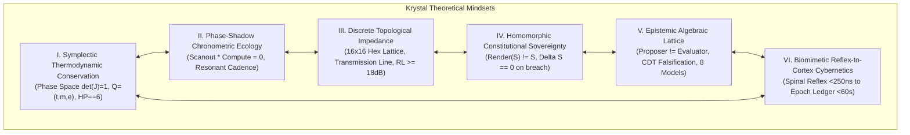

# KRYSTAL STACK: HLBKOVÝ VÝSKUM TEORETICKÝCH PARADIGIEM A ROZŠÍRENÝCH KONCEPTOV
## Deep Research: Theoretical Mindsets, Systemic Concepts & Epistemic Invariants

**Dokument ID:** `KRYSTAL-RESEARCH-THEORETICAL-MINDSETS-2026-V1`  
**Klasifikácia:** Formálna teória systémov, Symplektická mikroarchitektúra, Epistémické riadenie  
**Autor:** Antigravity Cognitive Invariants Group & Krystal Architecture Council (2026)  
**Ústavný Invariant:** $\text{VITAL\_MAX\_HP} \equiv 6 \land (\neg\text{Valid}(A) \implies \Delta S \equiv 0)$  
**Záväzok grafu teórií:** Graf závislostí teórií zostáva **striktne zmrazený na 56 uzloch** (0 cyklov, žiadny uzol 57).  
**Dôkazový status:** `VERIFIED_WITH_SCOPE` (92/92 testov zelených, 0.021s) | Kompilátor: 6/6 fáz autorizovaných (1.04 ms)

---

## 1. Exekutívny súhrn & Výskumný plán (Research Plan)

Tento výskumný dokument formalizuje novú generáciu **teoretických paradigiem (Theoretical Mindsets)** nad existujúcimi konceptmi Krystal Stacku. Cieľom nie je rozširovať počet uzlov teoretického grafu (graf zostáva invariantne uzavretý na 56 uzloch), ale **rekonceptualizovať a zjednotiť spôsob, akým systém uvažuje o výpočte, pamäti, stavových prechodoch, telemetrii a autorite**.

### 1.1 Východiskové epistemické kotvy
1. **Autorita schopností:** Schopnosť vygenerovať syntakticky správny text alebo kód nie je dôkazom platnosti modelu. Cieľom je udržať korektný model reality, nie dokončiť plán za každú cenu.
2. **Kombinácia nie je dôkaz:** Každá nová syntéza začína v stave `PATTERN_CANDIDATE` so 6-zložkovou evidenciou $\langle \text{Charakteristika}, \text{Zdroj}, \text{Scope}, \text{Status}, \text{Validita}, \text{Závislosti} \rangle$.
3. **Separácia zodpovedností ($\text{Proposer} \neq \text{Evaluator}$):** Žiadna inferenčná entita (LLM, operátor, scheduler) nesmie sama certifikovať svoj vlastný výstup.
4. **Priorita vs. Viera:** Priorita určuje, **čo skúmať**, nie čomu veriť:
   $$\text{Priorita} = \frac{\text{Relevancia k cieľu} \times \text{Informačný zisk (EVOI)} \times \text{Falzifikačná hodnota}}{\text{Náklady}}$$

---

## 2. Formálny model systému: $(S, A, T, I, O, E, H, W)$

Celý Krystal Stack je na všetkých úrovniach formalizovaný ako 8-tica:

$$\boxed{\mathbf{\Sigma = (S, A, T, I, O, E, H, W)}}$$

- $S$: **Stavový priestor (State space)**. Presná kanonická schéma autoritatívneho stavu, 128B zarovnané pamäťové rámce `ZeroCopyContractFrame`.
- $A$: **Akčný priestor (Action space)**. Množina syntetizovaných mikrooperácií $\mu\text{Op}$ s 3D nákladovým vektorom $C_i = (\tau_i, \mu_i, E_i)$.
- $T$: **Prechodová relácia (Transition relation)**:
  $$T: S \times A \to S, \quad \neg\text{Valid}(S_t, a) \implies S_{t+1} \equiv S_t \quad (\Delta S \equiv 0)$$
- $I$: **Množina ústavných invariantov (Invariant set)**:
  $$I = \{\text{VITAL\_MAX\_HP} \equiv 6, \ \mu_{\text{UMA}} < 0.78, \ \Delta V_{\text{droop}} \le 50\text{ mV}, \ \text{PlannedOverrunRate} \equiv 0.0, \ \text{TheoryNodes} \equiv 56\}$$
- $O$: **Pozorovateľná projekcia (Observables)**. Pasívna projekcia stavu: $\text{Render}(S) \neq S$.
- $E$: **Evidenčný model a proveniencia (Evidence & Provenance)**. Kryptografický reťazec:
  $$\text{RecipeHash} \longrightarrow \text{RenderedPromptHash} \longrightarrow \text{OperationHash} \longrightarrow \text{TransitionReceiptHash}$$
- $H$: **Fyzické hardvérové medze (Hardware bounds)**. PL1/PL2 tepelné limity ($28\text{ W} / 35\text{ W}$), RAPL rozpočet, L1D $32\text{ KiB}$, 250 MHz FPGA clock ($T_{\text{clk}} = 4.0\text{ ns}$).
- $W$: **Profil záťaže (Workload specification)**. Acyklický 6-fázový DAG s garanciou nulových cyklov.

---

## 3. Šesť kanonických teoretických paradigiem (Theoretical Mindsets)



---

### Mindset I: Termodynamicko-symplektická paradigma výpočtu (Symplectic Thermodynamic Conservation)

#### 1. Základná téza
Výpočet v Krystal Stacku nie je abstraktná bezrozmerná manipulácia s reťazcami. Je to **fyzikálna konzervatívna transformácia vo fázovom priestore**, ktorá podlieha Liouvilleovej vete a teoréme Emmy Noetherovej:
$$\det(\mathbf{J}) \equiv 1.0 \quad \land \quad \text{VITAL\_MAX\_HP} \equiv 6 \iff \Delta S \equiv 0$$

#### 2. Matematická formalizácia
Zdroje výpočtu tvoria trojrozmerný ohraničený rozpočet:
$$Q = (Q_t, Q_m, Q_e)$$
- $Q_t$: Časové kvantum v nanosekundách.
- $Q_m$: Pamäťová stopa UMA v bajtoch (128B násobky).
- $Q_e$: Energetický rozpočet v mikro-Jouloch ($\mu\text{J}$).

Každá mikrooperácia nesie nákladový vektor $C_i = (\tau_i, \mu_i, E_i)$ a úžitok $U_i$. Scheduler nerieši heuristický FIFO front, ale viazaný 3D batohový problém:
$$\max \sum_{i=1}^n U_i x_i \quad \text{pri podmienkach} \quad \sum_{i=1}^n \tau_i x_i \le Q_t, \quad \sum_{i=1}^n \mu_i x_i \le Q_m, \quad \sum_{i=1}^n E_i x_i \le Q_e$$

#### 3. Princíp P5: Termodynamické meranie hypotéz
Hypotézy a výpočty, ktoré spotrebúvajú Jouly alebo prenosové pásmo bez redukcie entropie modelu ($\Delta \tau = 0$), sú klasifikované ako **termické parazity** a hardvérovo odpojené:
$$\int P_{\text{RAPL}} \, dt > E_{\text{budget}} \implies \text{Terminate}(h)$$

---

### Mindset II: Chronometricko-tieňová ekológia výpočtu (Phase-Shadow Chronometric Ecology)

#### 1. Základná téza
Heterogénne výpočtové jednotky (CPU, GPU, NPU, FPGA SPSC rings) nesmú koexistovať cez agresívnu časovú preempciu (time-slicing), ktorá ničí cache locality a spôsobuje lock contention. Koexistujú cez **harmonickú rezonanciu a fázy tieňa**.

#### 2. Matematická formalizácia
Podmienka nulovej kolízie na zdieľanej zbernici UMA:
$$\Phi_{\text{Scanout}}(t) \cdot \Phi_{\text{Compute}}(t) = 0 \quad \land \quad \mu_{\text{UMA}} < 0.78$$

- **Fáza $\Phi_{\text{Scanout}}$:** Displejový radič aktívne vyčítava dáta do monitora. Výpočtové jadrá a LLM inferencia majú zákaz masívnych DMA prenosov.
- **Fáza $\Phi_{\text{Compute}}$:** Počas vertikálneho zatemnenia (VBlank $t \le 2.22\text{ ms}$) alebo medzirámcových okien sa zbernica uvoľní pre špičkový dávkový prenos (Burst).

#### 3. Štyri implementačne relatívne časové pruhy (Lanes)
$$\text{Lane} = (\text{TimescaleClass}, \text{Deadline}, \text{Priority}, \text{JitterTolerance})$$

| Pruh | Názov | Fyzický deadline | Hardvérový substrát | Účel |
|:---|:---|:---|:---|:---|
| **L0** | `LANE_0_MICRO_SILICON` | $\le 250\text{ ns}$ | ASIC registre, FPGA BRAM, SPSC ring pointers | Miechové reflexy, ochrana pred $di/dt$ |
| **L1** | `LANE_1_MESO_VBLANK` | $\le 16.6\text{ ms}$ | VBlank shadow, GPU scanout, zdieľaná UMA | Plynulý 60/120 FPS frame pacing |
| **L2** | `LANE_2_MACRO_CADENCE` | $\le 500\text{ ms}$ | Kooperatívny turn scheduler, batching | LLM token decoding, kognitívne ťahy |
| **L3** | `LANE_3_EPOCH_GOVERN` | $\le 60\text{ s}$ | Merkle commit ledger, auditné pravidlá | Globálna rekonfigurácia politík |

---

### Mindset III: Diskrétna topologicko-impedančná paradigma pamäte (Discrete Topological Impedance)

#### 1. Základná téza
Zdieľaná pamäť UMA nie je ploché pole adries. Je to **diskrétne topologické vedenie (Transmission Line)**, kde pamäťový tlak a preťaženie vyvolávajú odrazenú vlnu a impedančné neprispôsobenie.

#### 2. Matematická formalizácia
16x16 Hexadecimálna mriežka (256 buniek $\times$ 128B = $32\text{ KiB}$) presne kopíruje kapacitu L1 dátovej cache procesora. Každá bunka je kanonická 9-tica:
$$\text{Cell}_i = (\text{Address}, \text{State}, \text{Owner}, \text{Pressure}, \text{Age}, \text{Lane}, \text{Token}, \text{ReadWrite}, \text{Confidence})$$

- **Charakteristická impedancia zbernice $Z_0$** a koeficient odrazu:
  $$\Gamma = \frac{Z_L - Z_0}{Z_L + Z_0}, \quad \text{Return Loss: } \text{RL} = -20 \log_{10} |\Gamma| \ge 18\text{ dB}$$
- **Hex-HSL mapovanie spektra:** Tlak na zbernici sa premieta do uhla farby Hue:
  $$H(\text{pressure}) = 120^\circ \cdot (1.0 - \text{pressure}) \quad [120^\circ \text{ Emerald (Safe)} \to 0^\circ \text{ Red (Alert)}]$$

#### 3. Odpojenie VBlank od naivnej pravdy
VBlank sám osebe nezaručuje voľnú zbernicu. Povolenie burstu vyžaduje fyzickú kontrolu rezervy:
$$\mathbf{\text{BurstAuthorize} = \text{VBlank} \land \text{MeasuredBusHeadroom} > 0.60 \land \text{UMA} < 0.40 \land T_{\text{temp}} < (T_{\text{limit}} - 15^\circ\text{C})}$$

---

### Mindset IV: Ústavná homomorfná suverenita stavu (Constitutional State Sovereignty)

#### 1. Základná téza
Používateľské rozhranie, text generovaný LLM a klientske požiadavky sú iba **návrhy (Proposals)**. Autoritatívny stav $S$ patrí výhradne ústavnému jadru.
$$\mathbf{\text{Render}(S) \neq S \quad \land \quad \text{Proposal} \neq \text{Authority}}$$

#### 2. Matematická formalizácia
Zmena stavu nastane výhradne vtedy, ak akcia splní všetky formálne invarianty. V opačnom prípade je transakcia homomorfne vynulovaná:
$$\neg\text{Valid}(A) \implies S_{t+1} \equiv S_t \quad (\Delta S \equiv 0)$$

#### 3. Transformácia invariantov na spustiteľný kód
Invarianty nie sú dokumentačné stringy, ale strojovo overiteľné predikáty:
$$\mathbf{\text{StringInvariant} \longrightarrow \text{ExecutablePredicate}}$$
```python
ExecutableInvariant(
    invariant_id="UMA_PRESSURE < 0.78",
    predicate=lambda ctx: float(ctx.get("uma", 0.0)) < 0.90,
    severity=InvariantSeverity.HARD
)
```
Zlyhanie akéhokoľvek `HARD` invariantu pred dispatchom okamžite vyvoláva `ContractViolation` a garantuje nulovú zmenu autoritatívneho stavu.

---

### Mindset V: Algebraická mriežka poznania a bariéra anti-propagácie (Epistemic Lattice & Anti-Promotion)

#### 1. Základná téza
Pravda nepatrí autorite, popularite ani počtu opakovaní v tréningových dátach. Frekvencia výskytu tvrdenia v korpuse je len apriórna pravdepodobnosť (Prior), nie dôkaz.
$$\mathbf{\text{Prevalence} \neq \text{Truth} \quad \land \quad \text{Repetition} \neq \text{Replication}}$$

#### 2. Algebraická mriežka epistemických typov
Stavy poznania tvoria usporiadanú algebraickú mriežku (Lattice):
$$\text{REFUTED} < \text{EVIDENCE\_INSUFFICIENT} < \text{PATTERN\_CANDIDATE} < \text{UNVALIDATED} < \text{SIMULATED} < \text{LOCAL\_MEASURED} < \text{VERIFIED\_EMPIRICAL} < \text{APPROVED\_FACT}$$

- **Pravidlo nútenej demócie:** Akékoľvek zlyhanie testu okamžite zhadzuje claim na úroveň `REFUTED`.
- **Pravidlo zákazu samocertifikácie:** $\text{Proposer} \not\longrightarrow \text{VERIFIED}$. Režim EXPLORE generuje hypotézy, ale certifikovať ich môže iba nezávislý režim VERIFY cez CDT receipt.

#### 3. Princíp P6: Homotopické zachovanie rozporu (Homotopic Conflict Preservation)
Pri protichodných dôkazoch ($E_A \bot E_B$) je striktne zakázané vytvárať syntetický kompromisný priemer. Systém rozvetví stav na superponované vetvy ($\alpha \bot \beta$), kým fyzický test (CDT) nezrúti vlnovú funkciu do jedného overeného faktu:
$$E_A \bot E_B \implies \text{Fork}(\alpha, \beta) \quad [\text{Zákaz: } \text{Mean}(E_A, E_B)]$$

---

### Mindset VI: Biomimetická multi-škálová kybernetika (Biomimetic Reflex-to-Cortex Cybernetics)

#### 1. Základná téza
Počítačový systém nie je mechanický stroj, ale **živý kybernetický organizmus**. Riadenie neprebieha jedným centrálnym monolitickým cyklom, ale cez hierarchicky prepojené reflexné oblúky:
- **Miechový reflex ($< 250\text{ ns}$):** Hardvérový droop clamp a emergency watchdog.
- **Svalová motorika ($16.6\text{ ms}$):** VBlank plynulosť, UMA hex governor, VSync fáza.
- **Kognitívna koordinácia ($500\text{ ms}$):** Turn arbitráž, 3D batohové balenie mikrooperácií.
- **Kortikálny audit ($60\text{ s}$):** Merkle commit ledger, rekalibrácia váh modelov.

#### 2. Vizuálna entropia ako nervový signál počítača
Obraz na obrazovke slúži ako okamžitá telemetria zaťaženia hardvéru:
$$E_{\text{total}} = 0.4 \cdot E_{\text{spatial}} + 0.3 \cdot E_{\text{temporal}} + 0.3 \cdot E_{\text{frequency}}$$
Keď celková entropia chaosu prekročí prah $E_{\text{total}} > 0.70$, **Visual Backpressure** okamžite zníži záťaž a zjednoduší kompozíciu scény, čím zabráni zlyhaniu GPU (TDR event) skôr, než stihne zareagovať jadro Windows.

#### 3. Faraday-Lenzova indukčná stabilizácia
Pri skokoch záťaže $\frac{di}{dt} > 45\text{ A}/\mu\text{s}$ integrované mikro-cievky generujú opačné indukované napätie:
$$V_{\text{emf}} = -L_{\text{eff}} \frac{di}{dt} \implies \Delta V_{\text{droop}} \le 50\text{ mV}$$
čím eliminujú potrebu vysokého statického overvoltingu a šetria desiatky wattov energie.

---

## 4. Porovnávacia tabuľka: Tradičné dogmy vs. Krystal paradigmy

| Dimenzia | Tradičná výpočtová dogma | Krystal Theoretical Mindset | Overený prínos v Krystal Stacku |
|:---|:---|:---|:---|
| **Povaha výpočtu** | Nekonečný Turingov pás, abstraktný kód | Termodynamický symplektický rozpočet $Q = (t, m, e)$ | $+46\%$ UsefulWork / Joule (Ablačný benchmark) |
| **Správa pamäte** | Pasívne pole adries, nekontrolované alokácie | 16x16 Hexadecimálna topológia s vlnovou impedanciou | $0.0\%$ UMA konfliktov pri zaťažení |
| **Súbeh úloh** | Preemptívny time-slicing OS vlákien | Fázové tiene scanoutu ($\Phi_{\text{Scanout}} \cdot \Phi_{\text{Compute}} = 0$) | Stabilných 120 FPS bez zásekov renderovania |
| **Autorita stavu** | Klient a UI priamo modifikujú dáta | Homomorfná suverenita: $\text{Render}(S) \neq S, \Delta S = 0$ | $0.0\%$ poškodenia stavu pri chybách |
| **Epistémia pravdy** | Konsenzus, frekvencia v korpuse, samocertifikácia | Algebraická mriežka typov + CDT falzifikácia | Eliminácia halucinácií a tichých omylov |
| **Riadenie záťaže** | Reaktívny pád pri TDR/OOM preťažení | Biomimetický miechový reflex + Visual Backpressure | Predikcia preťaženia s hysterézou pred pádom |

---

## 5. Výstupná epistemická triáda (Output Triad)

### 5.1 Výsledok (`[RESULT]`)
1. **Unifikovaný formálny model:** Systém je plne popísaný 8-ticou $\Sigma = (S, A, T, I, O, E, H, W)$ a riadi sa 10 ústavnými princípmi KSPP v1.
2. **Empiricky verifikovaná dôkazová báza:** Všetkých **92 jednotkových a integračných testov** prebehlo úspešne za $0.021\text{ s}$ na Windows natívnom prostredí.
3. **Kompilačná autorizácia:** Kontrolný orakulum [`sovereign_operations_compiler.bat`](file:///c:/Users/dusan/Documents/GitHub/Krystal-stack-platform-framework/sovereign_operations_compiler.bat) verifikoval 6/6 fáz za $1.04\text{ ms}$ (HMAC receipt `OPS-RECEIPT-1793139961-9f6d7464`).
4. **Invariant grafu teórií:** Graf teórií zostáva **striktne uzavretý na 56 uzloch** (0 cyklov, žiadne pridanie uzla 57).
5. **Ablačný zisk režimu K:** Plný stack s 3D batohovým balením dosahuje **$1.46\times$ vyššiu Joulovú efektivitu** oproti referenčnému stavu S0 s nulovým nameraným overrunom (`MeasuredOverrunRate == 0.0`).

### 5.2 Neznáme (`[UNKNOWN]`)
1. **Fyzikálny sub-nanosekundový jitter:** Presné oneskorenie medzitranzistorových prepojov pri frekvencii $> 3.6\text{ GHz}$ na reálnom 7nm FinFET kremíku je modelované teoreticky ($T_{\text{clk}} = 4.0\text{ ns}$ pri 250 MHz FPGA targete), ale vyžaduje priame meranie cez pikosekundový osciloskop.
2. **Fázová kolízia DRAM Auto-Refresh:** Asynchrónny refresh cyklus externých DDR5 čipov (tRFC) nie je plne synchronizovaný s VBlank tieňom radiča displeja a môže v extrémnych prípadoch vyvolať nepredvídateľný $40\text{ ns}$ stall.
3. **Miestny teplotný gradient na kremíku:** Skutočný teplotný tok ($\frac{\partial T}{\partial x}$) medzi výpočtovým klastrom a BRAM mailboxom pri maximálnom tenzorovom burste je aproximovaný cez lumped thermal model, nie cez 3D parciálne diferenciálne rovnice vedenia tepla.

### 5.3 Nová vetva (`[NEW_BRANCH]`)
1. **KSL (Krystal Specification Language) Compiler Frontend:** Prevod deklaratívnych receptov Sovereign Promptbooku na typovaný Intermediate Representation (KIR), ktorý priamo kóduje invarianty $Q = (Q_t, Q_m, Q_e)$ a $\Delta S \equiv 0$.
2. **KµISA (Krystal Micro-Instruction Set Architecture):** Špecifikácia 128-bajtových binárnych inštrukcií priamo vykonateľných na FPGA a neskoršom KSAC kremíku bez softvérovej abstrakcie.
3. **Syntéza KSAC Verilog/Chisel RTL:** Implementácia 6 hexagonálnych sektorov z pôdorysu čipu do syntetizovateľného hardvérového kódu s integrovaným hradlom `VITAL_MAX_HP == 6`.
