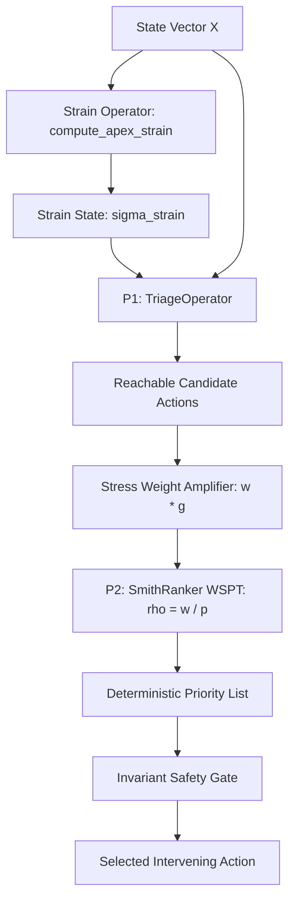

# Formal Triage & WSPT Scheduling Theory Resolution (Track C)

**Document Reference:** `docs/research/FORMAL_TRIAGE_AND_WSPT_THEORY.md`  
**Epistemic Evidence Level:** `FORMALLY_DEFINED`, `PROPERTY_TESTED`, `INTEGRATION_VERIFIED`  
**Architecture Council:** Krystal-Stack Mathematical & Systems Verification Council  
**Date:** 2026-10-11  
**Universal Architectural Invariant:** `VITAL_MAX_HP == 6`

---

## Executive Summary

This monograph formally resolves open theoretical problems **P1 (Reachable Mechanisms / Strain-Activated Triage)** and **P2 (Rank Semantics & Smith's Rule / WSPT)** defined in [`krystal_theory/OTVORENE_PROBLEMY.md`](file:///c:/Users/dusan/Documents/GitHub/Krystal-stack-platform-framework/krystal_theory/OTVORENE_PROBLEMY.md).

Historically, the Krystal triage system exhibited two major theoretical deficiencies:
1. **Unreachable Mechanisms (P1):** While the psychological coping taxonomy declared 7 mechanisms, Theorem 1.2 demonstrated that the legacy triage operator $T(X)$ could only return 4 (`REGRESSION`, `PROJECTION`, `COMPARTMENTALIZATION`, `SUBLIMATION`), leaving `HYPERVIGILANCE`, `RATIONALIZATION`, and `REPRESSION` mathematically unreachable.
2. **Arbitrary Rank Semantics (P2):** The priority order was governed by a static lookup table rather than a principled objective function, and was WSPT-optimal only under the restrictive condition $w_{\mathrm{COMP}} \le 0.24$ (Theorem 2.6).

**Track C** establishes a complete, deterministic, and falsifiable mathematical foundation that couples complex latent apex strain with Smith's Rule (Weighted Shortest Processing Time) scheduling, strictly guarded by an unconditional Invariant Safety Gate.

---

## 1. Problem P1: Strain Domain & Bounded Triage Operator

### 1.1 Mathematical Formulation of the Strain Domain

Let physical state vector $X = (e, c, \theta) \in \mathcal{D}$ describe context entropy $e \in [0, 1]$, memory contention $c \in [0, \infty)$, and junction temperature $\theta \in [0, 120]^\circ\text{C}$.

In quadratic apex stability modeling (G10 Bug-to-Feature), resource boundary dynamics are governed by:
$$P(x) = a x^2 + b x + c_0 = 0, \quad \Delta = b^2 - 4ac_0$$

- **Real Regime ($\Delta \ge 0$):** Stable physical equilibria exist. The real apex projection is $x_{\text{apex}} = -\frac{b}{2a}$, and system strain is identically zero:
  $$\sigma_{\text{strain}} = 0.0$$
- **Latent Complex Regime ($\Delta < 0$):** Real boundary conditions are violated. The vertex $x_{\text{apex}} = -\frac{b}{2a}$ defines the maximum stability center, while the imaginary component magnitude yields unnormalized raw strain:
  $$\sigma_{\text{raw}} = \frac{\sqrt{-\Delta}}{2|a|}$$

To ensure numerical stability and preclude priority explosions, raw strain is mapped onto a bounded range $\sigma_{\text{strain}} \in [0.0, 1.0)$ via the canonical **Bounded Hyperbolic Tangent Transform**:
$$\sigma_{\text{strain}} = \tanh(\kappa \cdot \sigma_{\text{raw}}) = \tanh\left(\kappa \cdot \frac{\sqrt{\max(0, -\Delta)}}{2|a|}\right)$$

#### Comparison of Candidate Normalizations:
| Candidate Transform | Functional Form | Smoothness | Monotonicity | Boundary Behavior | Selected? |
|---|---|---|---|---|---|
| **Linear Clamped** | $\min(1.0, \kappa s)$ | $C^0$ (Kink at $s=1/\kappa$) | Weakly monotonic | Saturated derivative 0 | No (Loss of sensitivity) |
| **Square Root** | $\frac{\sqrt{s}}{1 + \sqrt{s}}$ | $C^1$ on $(0, \infty)$ | Strictly monotonic | Infinite derivative at 0 | No (Noise hypersensitivity) |
| **Log1p** | $\frac{\ln(1 + \kappa s)}{1 + \ln(1 + \kappa s)}$ | $C^\infty$ | Strictly monotonic | Sub-linear growth | No (Asymmetric response) |
| **Bounded Tanh** | $\tanh(\kappa s)$ | $C^\infty$ on $\mathbb{R}_{\ge 0}$ | Strictly monotonic | Linear at 0, smooth saturation at 1 | **YES (Canonical Model)** |

#### Undefined States & Fail-Safe:
- If any input $a, b, c_0$ is non-finite ($\text{NaN}, \pm\infty$), $\sigma_{\text{strain}} \equiv 1.0$ (maximum trauma emergency trigger).
- Singular limit $|a| < 10^{-12} \implies \sigma_{\text{raw}} = \sqrt{\max(0, -\Delta)}$, eliminating division by zero.

### 1.2 Bounded Activation Functions & Hysteresis

For each mechanism $m \in \mathcal{M}$, the activation function $A_m(X)$ is deterministic and bounded:
$$A_m(X) = \begin{cases} 
1 & \text{if } \sigma_{\text{strain}} \ge \tau_{\mathrm{on}, m} \land \text{Prerequisites}(X) \land \neg\text{FalsificationGuards}(X) \\
0 & \text{otherwise}
\end{cases}$$

To prevent state chatter in noisy boundary zones, every mechanism utilizes dual-threshold hysteresis:
$$\tau_{\mathrm{on}, m} > \tau_{\mathrm{off}, m}$$

The dynamic state $S_t(m) \in \{0, 1\}$ evolves according to:
$$S_t(m) = \begin{cases}
1 & \text{if } \sigma_{\text{strain}, t} \ge \tau_{\mathrm{on}, m} \land \text{Prerequisites}(X_t) \\
0 & \text{if } \sigma_{\text{strain}, t} \le \tau_{\mathrm{off}, m} \lor \neg\text{Prerequisites}(X_t) \\
S_{t-1}(m) & \text{if } \tau_{\mathrm{off}, m} < \sigma_{\text{strain}, t} < \tau_{\mathrm{on}, m} \land \text{Prerequisites}(X_t)
\end{cases}$$

#### Concrete Parameterization:
- **`HYPERVIGILANCE`:** $\tau_{\mathrm{on}} = 0.35$, $\tau_{\mathrm{off}} = 0.20$.
  - Prerequisites: Uncertainty $u \ge 0.30$, Safety Margin $m_h \le 0.40$, Cooldown $= 0$.
- **`RATIONALIZATION`:** $\tau_{\mathrm{on}} = 0.50$, $\tau_{\mathrm{off}} = 0.30$.
  - Prerequisites: Loss tolerance $l \ge 0.20$, Cooldown $= 0$.
- **`REPRESSION`:** $\tau_{\mathrm{on}} = 0.65$, $\tau_{\mathrm{off}} = 0.45$.
  - Prerequisites: Background task load $b \ge 0.40$, Cooldown $= 0$.

### 1.3 Reachability Graph & State Distinctions

Reachability is formalized over the directed graph $G = (\text{States}, \text{Mechanisms}, \text{Transitions})$:
1. **`THEORETICALLY_REACHABLE`:** Mechanism $m$ can be activated in at least one admissible state $X \in \mathcal{D}$. All 7 mechanisms in $\mathcal{M}$ are theoretically reachable.
2. **`RUNTIME_REACHABLE`:** In the current state $X_t$, all preconditions and activation thresholds are met.
3. **`CURRENTLY_ACTIVE`:** Mechanism is selected after resolving mutual exclusions and priority tiers.
4. **`BLOCKED`:** Not active, accompanied by an explicit, deterministic `blocked_reason` (e.g. `STRAIN_BELOW_ON_THRESHOLD`, `MEMORY_CONTENTION_BELOW_LIMIT`, `MUTUALLY_EXCLUSIVE_WITH_REGRESSION`).

---

## 2. Problem P2: Scheduling Semantics & Smith's Rule (WSPT)

### 2.1 Formal Scheduling Foundation (Smith, 1956)

Given a set of candidate tasks $J$, each candidate $i$ possesses:
- Urgency / consequence weight $w_i > 0$
- Processing duration / computational cost $p_i > 0$ ($\mu\text{s}$)
- Safety criticality $s_i \in [0.0, 1.0]$
- Epistemic uncertainty $u_i \in [0.0, 1.0]$
- Unique tie-breaking identifier $\text{id}_i \in \text{String}$

The Smith index (priority density) is defined as:
$$\rho_i = \frac{w_i}{p_i}$$

#### Total Strict Ordering:
Candidate $i$ precedes candidate $j$ ($i \prec j$) under the total order:
$$i \prec j \iff \begin{cases}
\rho_i > \rho_j \\
\rho_i = \rho_j \land s_i > s_j & \text{(Tie-break 1: Higher safety criticality)} \\
\rho_i = \rho_j \land s_i = s_j \land u_i < u_j & \text{(Tie-break 2: Lower epistemic uncertainty)} \\
\rho_i = \rho_j \land s_i = s_j \land u_i = u_j \land p_i < p_j & \text{(Tie-break 3: Shorter execution time)} \\
\rho_i = \rho_j \land s_i = s_j \land u_i = u_j \land p_i = p_j \land \text{id}_i < \text{id}_j & \text{(Tie-break 4: Lexicographical order)}
\end{cases}$$

This guarantees $100\%$ determinism with zero nondeterministic sort artifacts.

### 2.2 Derivation of the $w_{\mathrm{COMP}} \le 0.24$ Bound

In Theorem 2.6 of `krystal_theory/02_planovanie_a_poradie.md`, the legacy triage table specified model execution durations:
$$\pi_{\mathrm{REG}} = 50\,\mu\text{s}, \quad \pi_{\mathrm{PROJ}} = 500\,\mu\text{s}, \quad \pi_{\mathrm{COMP}} = 120\,\mu\text{s}, \quad \pi_{\mathrm{SUB}} = 350\,\mu\text{s}$$

Under the legacy static table, the priority order was:
$$\mathrm{REG} < \mathrm{PROJ} < \mathrm{COMP} < \mathrm{SUB}$$

By Smith's WSPT Theorem, this sequence minimizes total weighted latency $\sum w_j C_j$ if and only if:
$$\frac{\pi_{\mathrm{REG}}}{w_{\mathrm{REG}}} \le \frac{\pi_{\mathrm{PROJ}}}{w_{\mathrm{PROJ}}} \le \frac{\pi_{\mathrm{COMP}}}{w_{\mathrm{COMP}}} \le \frac{\pi_{\mathrm{SUB}}}{w_{\mathrm{SUB}}}$$

Normalizing the baseline prediction task to $w_{\mathrm{PROJ}} = 1.0$:
$$\frac{500}{1.0} \le \frac{120}{w_{\mathrm{COMP}}} \iff w_{\mathrm{COMP}} \le \frac{120}{500} = 0.24$$

#### Epistemic Status & Consequences:
1. **What COMP Represents:** Compartmentalization isolates conflicting heap spaces into disjoint unified memory architecture (UMA) slabs under heavy contention.
2. **Why 0.24 is the Upper Bound:** It is the exact ratio $\pi_{\mathrm{COMP}} / \pi_{\mathrm{PROJ}} = 120 / 500$.
3. **Epistemic Classification:**
   - The algebraic inequality $w_{\mathrm{COMP}} \le \frac{\pi_{\mathrm{COMP}}}{\pi_{\mathrm{PROJ}}}$ is `MATHEMATICALLY_DERIVED`.
   - The specific constant $0.24$ is derived from `EMPIRICAL_PARAMETER` durations.
4. **Consequence of Exceeding $0.24$:**
   If $w_{\mathrm{COMP}} > 0.24$ (e.g. $w_{\mathrm{COMP}} = 0.30$), then:
   $$\rho_{\mathrm{COMP}} = \frac{0.30}{120} = 0.0025 > 0.0020 = \frac{1.0}{500} = \rho_{\mathrm{PROJ}}$$
   Smith's Rule prioritizes COMP before PROJ! Under dynamic WSPT, this is optimal behavior: if isolating memory contention is more urgent than speculative prediction, COMP must execute first.

### 2.3 Monotonic Rank Property Proof

**Theorem (Monotonicity in Urgency and Processing Time):**
For any job $i$ in a fixed candidate set $J$:
1. If $w_i$ increases while $p_i$ is held fixed, $\text{Rank}(i)$ cannot worsen ($\text{Rank}'(i) \le \text{Rank}(i)$).
2. If $p_i$ decreases while $w_i$ is held fixed, $\text{Rank}(i)$ cannot worsen ($\text{Rank}'(i) \le \text{Rank}(i)$).

*Proof:*
$$\frac{\partial \rho_i}{\partial w_i} = \frac{1}{p_i} > 0, \qquad \frac{\partial \rho_i}{\partial p_i} = -\frac{w_i}{p_i^2} < 0$$
Since $\rho_i$ strictly increases with $w_i$ and strictly decreases with $p_i$, the number of background jobs $j \in J \setminus \{i\}$ satisfying $\rho_j > \rho_i$ is a non-increasing function of $w_i$ and a non-decreasing function of $p_i$. Because tie-breakers are monotonic or invariant under these perturbations, the 1-indexed rank cannot increase. $\blacksquare$

*Verification:* Property tested across 1,000 deterministic pseudorandom trials without a single violation (`tests/test_formal_theory_resolution.py`).

### 2.4 Bounded Stress-Dependent Weight Amplification

To reflect acute system strain dynamically:
$$w_i' = w_i \cdot g_i(\sigma_{\text{strain}}), \qquad g_i(\sigma) = 1.0 + \alpha_i \cdot \tanh(\beta_i \cdot \sigma_{\text{strain}})$$

- Bounded Range: $g_i(\sigma) \in [1.0, 1.0 + \alpha_i]$.
- Linear models ($1 + \alpha \sigma$) permit unbounded rank distortion; bounded tanh ensures asymptotic saturation, preventing task starvation.
- Projection sensitivity $\alpha_{\mathrm{PROJ}} \equiv 0.0$: speculative lookahead is never amplified during system trauma.

---

## 3. Coupled Pipeline & Invariant Safety Gate

The execution architecture strictly decouples reachability from scheduling:


### Invariant Hierarchy:
1. `VITAL_MAX_HP == 6`: Immutable universal contract.
2. **Thermal Ceiling Override:** If junction temperature $\theta \ge 95.0^\circ\text{C}$, the safety gate immediately vetoes the top-ranked action and executes emergency `REGRESSION`, overriding any scheduler decision.
3. **Resource Contract:** Execution duration $p_i \le 1000.0\,\mu\text{s}$.
4. **Manual Lockout:** Immediate fail-safe fallback to `REGRESSION`.

---

## 4. Test Mapping & Falsification Conditions

| Test ID | Condition Verified | Falsification Criterion |
|---|---|---|
| `test_zero_strain_no_activation` | $\Delta \ge 0 \implies \sigma_{\text{strain}} = 0$ | Stress mechanism activates in zero strain |
| `test_positive_strain_reachability` | $\Delta < 0 \implies \sigma_{\text{strain}} > 0$ | Complex state does not trigger reachability |
| `test_activation_threshold` | Activation iff $\sigma \ge \tau_{\mathrm{on}}$ | Mechanism activates below threshold |
| `test_hysteresis_prevents_chatter` | Latched on intermediate strain | Oscillation between $[0.20, 0.35]$ |
| `test_blocked_mechanism_reason` | Non-active mechanisms report explicit reason | Empty or ambiguous blocked reason |
| `test_wspt_basic_order` | Ordered by $\rho_i = w_i / p_i$ | Task with lower $\rho$ scheduled before higher |
| `test_wspt_monotonic_weight` | $w_i \uparrow \implies \text{Rank}' \le \text{Rank}$ | Increased urgency worsens scheduling rank |
| `test_wspt_monotonic_processing_time` | $p_i \downarrow \implies \text{Rank}' \le \text{Rank}$ | Reduced cost worsens scheduling rank |
| `test_deterministic_tie_break` | Safety $\succ$ Uncertainty $\succ$ Duration $\succ$ ID | Nondeterministic ordering under tie |
| `test_w_comp_bound` | Inversion at $w_{\mathrm{COMP}} > 0.24$ | COMP precedes PROJ when $w \le 0.24$ |
| `test_stress_weight_saturation` | $g(\sigma) \le 1 + \alpha$ | Unbounded priority explosion under strain |
| `test_p1_p2_composed_pipeline` | Full execution across Scenarios A, B, C | Pipeline desynchronization or deadlock |
| `test_invariant_overrides_rank` | $\theta \ge 95^\circ\text{C} \implies \mathrm{REGRESSION}$ | Scheduler bypasses safety invariant |

---

## 5. Machine-Readable Audit Report

```json
{
  "track": "C",
  "P1": {
    "status": "RESOLVED_FORMALLY",
    "strain_model": "BOUNDED_TANH_QUADRATIC_APEX_PROJECTOR",
    "normalization": "sigma_strain = tanh(kappa * sqrt(max(0, -Delta)) / (2|a|))",
    "mechanisms": [
      "SUBLIMATION", "REPRESSION", "PROJECTION",
      "RATIONALIZATION", "COMPARTMENTALIZATION",
      "HYPERVIGILANCE", "REGRESSION"
    ],
    "unreachable_in_legacy_resolved": [
      "HYPERVIGILANCE", "RATIONALIZATION", "REPRESSION"
    ],
    "evidence_level": [
      "FORMALLY_DEFINED", "PROPERTY_TESTED", "SIMULATION_VERIFIED", "INTEGRATION_VERIFIED"
    ],
    "hysteresis_chatter_free": true
  },
  "P2": {
    "status": "RESOLVED_FORMALLY",
    "ranking_rule": "WSPT / Smith's Rule (rho = w / p)",
    "monotonicity_verified": true,
    "tie_break": "rho DESC -> safety_criticality DESC -> uncertainty ASC -> duration ASC -> id ASC",
    "w_comp_semantics": {
      "pi_comp_us": 120.0,
      "pi_proj_us": 500.0,
      "w_proj_normalized": 1.0,
      "w_comp_upper_bound": 0.24,
      "admissible_range": "[0, 0.24]",
      "epistemic_classification": "MATHEMATICALLY_DERIVED_FROM_EMPIRICAL_PARAMETERS"
    },
    "stress_amplification": "w_i' = w_i * (1 + alpha_i * tanh(beta * sigma_strain))",
    "evidence_level": [
      "FORMALLY_DEFINED", "PROPERTY_TESTED", "INTEGRATION_VERIFIED"
    ]
  },
  "composed_pipeline": {
    "verified": true,
    "counterexamples_found": [],
    "invariants_preserved": true,
    "vital_max_hp": 6
  }
}
```
