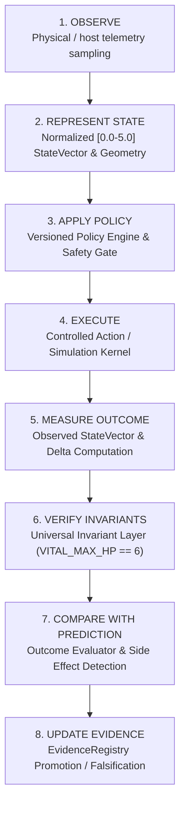

# KRYSTAL UNIFIED SIMULATION & VERIFICATION LAYER
**Epistemic System Architecture & Multi-Disciplinary Cross-Domain Verification Framework**
*Krystal-Stack / CrystalSec Systems Architecture & Cyber-Physical Research Council*
*Date: 2026-10-11 | Epistemic Level: INTEGRATION_VERIFIED | Vital Invariant: VITAL_MAX_HP == 6*

---

## 1. Executive Summary

The **Krystal Unified Simulation & Verification Layer** establishes a unified, reproducible, measurable, and falsifiable execution framework capable of running, measuring, and comparing workloads across five disparate operational domains:
1. **Game Simulation Workloads** (*Poslední Kmen*: Crystal, Toxic, Druid survival tribes under OBT, KON, POS, DOS).
2. **Causal LLM Runtime Workloads** (*CrystalSec 8-Stage Execution Plane*: Prompt → Context → Routing → Inference → Proposal → Validation → Execution → Observation).
3. **Cyber-Physical CNC Dynamics Workloads** (*Thermodynamic Loewen-Shaw & Jaeger cutting physics, dynamic Spindle Speed Variation SSV, collapse differentials*).
4. **Linux Resource & Kernel Workloads** (*cgroup v2 isolation, CFS scheduler jitter stability, zero-swap paging, communication topology bounds*).
5. **Fault-Injection & Resilience Workloads** (*Controlled disturbance injection, blast radius containment, MTTR recovery*).

The purpose of this framework is **not** to artificially maximize benchmark scores in isolation. Its purpose is to enforce rigorous epistemic hygiene, prevent unverified claims, guarantee zero unmodeled regressions through multi-dimensional geometry, preserve universal safety invariants (`VITAL_MAX_HP == 6`), and guarantee bit-for-bit replay reproducibility.

---

## 2. Core Epistemic Principle & 8-Phase Cycle

All domains strictly execute through the uninterrupted 8-phase cycle:

**Epistemic Rules:**
- **OBSERVED**: Directly measured without inferential processing.
- **DERIVED**: Mathematically computed from OBSERVED data.
- **HYPOTHESIS**: Proposed explanation awaiting experimental falsification.
- **SUPPORTED**: Survived falsification across $N \ge 5$ repetitions with $CV \le 0.15$.
- **FALSIFIED**: Empirically refuted by data signature breach.
- **UNKNOWN**: Unmodeled phenomenon requiring investigation.

---

## 3. Multi-Dimensional Geometry & The Pareto Tradeoff Rule

Disparate physical units (RPM, tokens/sec, microsecond jitter, damage points) are normalized onto a bounded $[0.0 - 5.0]$ coordinate system. 

### Geometric Metrics:
1. **Composite Utility**:
   $$U = \sum_{i=1}^n w_i s_i, \quad \sum w_i = 1.0$$
2. **Weakest Axis**:
   $$S_{\min} = \min_{i} (s_i), \quad \text{Code} = D_{\arg\min}$$
3. **Weighted Dispersion**:
   $$D = \sqrt{\sum_{i=1}^n w_i (s_i - U)^2}$$
4. **State Delta**:
   $$\Delta S = S_{\text{observed}} - S_{\text{baseline}}$$

### The Cardinal Tradeoff Rule:
> **MANDATE**: Never classify a configuration as "better" using Utility $U$ alone.
> If any dimension regresses beyond noise margin $\epsilon$ while others improve (e.g. $+1.5\text{ TPS}$ but $-0.5\text{ ROB}$), the transformation **MUST** be classified as a `TRADEOFF` and positioned on the `BALANCED_FRONTIER`. It can never be claimed as a Pareto improvement.

---

## 4. Independent Universal Invariant Layer

Operating independently of policy and optimizers, the Invariant Layer intercepts every state transition. Any violation halts execution immediately, generates a cryptographic SHA-256 audit record, and preserves the execution trace.

| Invariant Code | Severity | Exact Condition | Description |
| :--- | :--- | :--- | :--- |
| `INV_VITAL_MAX_HP` | `CRITICAL_SAFETY` | $VITAL\_MAX\_HP == 6$ | Strictly bounds vitality hearts ceiling |
| `INV_ZERO_SWAP` | `RESOURCE_BREACH` | $\text{memory.swap.current} == 0$ | Zero disk swap paging to prevent jitter spikes |
| `INV_ZERO_THROTTLING` | `RESOURCE_BREACH` | $\text{nr\_throttled} == 0$ | Zero CPU/GPU quota CFS throttling |
| `INV_TEMP_CEILING` | `CRITICAL_SAFETY` | $T \le 75.0^\circ\text{C}$ | Prevents thermal runaway or spindle collapse |
| `INV_COMMUNICATION_TOPOLOGY` | `INTEGRITY_FAIL` | $\text{flows} \subseteq \text{declared}$ | Strictly halts unauthorized network egress |
| `INV_UNAUTHORIZED_MUTATION` | `INTEGRITY_FAIL` | $\text{mutations} \subseteq \text{whitelist}$ | Rejects unapproved parameter manipulation |

---

## 5. Versioned Policy Transformation Engine

Interventions are generated through deterministic policy evaluation:
$$\text{StateVector} + \text{Configuration} + \text{Input} + \text{Policy} \longrightarrow \text{ProposedAction}$$

Every proposed action undergoes deterministic validation at the **Safety Gate**:
- Action Risk Score: $\le 0.40$
- Blast Radius: $\le 0.25$
- Variables: Explicitly declared in policy whitelist (e.g., `cpu.threads`, `sampling_rate_hz`, `rpm_differential_limit`).
- LLMs are prohibited from executing unchecked modifications directly on the host.

---

## 6. Outcome Evaluator & Side Effect Detection

The Outcome Evaluator compares $\text{PredictedState}$ against $\text{ObservedState}$:
1. **Prediction Error (RMSE)**:
   $$\text{RMSE} = \sqrt{\sum_{i=1}^n w_i (s_{\text{observed}, i} - s_{\text{predicted}, i})^2}$$
2. **Unexpected Side Effects**:
   Any dimension where an unpredicted drift exceeds tolerance $\epsilon = 0.35$, or where an intended improvement resulted in a regression.
3. **Statistical Repeatability**:
   Evaluates Coefficient of Variation across repeated runs:
   $$\text{Repeatability } R = \max(0.0, 1.0 - \overline{CV})$$

---

## 7. Epistemic Evidence Hierarchy & Promotion Rules

| Evidence Level | Description | Promotion Criteria |
| :--- | :--- | :--- |
| `UNIT_VERIFIED` | Isolated test logic with mocks | Automated unit test pass |
| `INTEGRATION_VERIFIED` | Inter-module contracts verified | Multi-module contract pass |
| `RUNTIME_MEASURED` | Traced on active OS host process | Empirical process telemetry |
| `HARDWARE_MEASURED` | Read from physical sensors / GPU registers | Hardware sensor sampling |
| `STATISTICALLY_REPEATED` | Empirically repeatable under variance bounds | $N \ge 5$, $CV \le 0.15$ ($R \ge 0.85$) |
| `PRODUCTION_VALIDATED` | Operating sustained under SLA | Long-running production deployment |

---

## 8. Reproducibility & Deterministic Replay Engine

Every experiment emits a canonical, self-contained `ReplayPackage`:
- `initial_state_vector`: Snapshot of all dimensions, scores, and context.
- `configuration_snapshot`: Threading, clocks, and resource bounds.
- `recorded_inputs_and_events`: Ordered input timeline.
- `seed`: Deterministic pseudo-random seed.
- `policy_version`: e.g., `policy-v2.1.0`.
- `runtime_version`: Git commit SHA or runtime engine version.
- `package_sha256`: Cryptographic SHA-256 hash.

Replay execution re-runs the package and verifies that $\text{divergence\_score} \le 0.05$. If divergence exceeds threshold, the engine flags `DIVERGENT` and emits a Root-Cause Analysis (RCA) diagnosis.

---

## 9. Cross-Domain Comparative Geometry

| Operational Domain | Subjects | Measurement Axes | Calibrated Normalized Geometry |
| :--- | :--- | :--- | :--- |
| **Game Simulation** | `crystal_colony`, `toxic_swarm`, `druid_symbiont` | `OBT`, `KON`, `POS`, `DOS` | Evaluates survival balance and reach |
| **Causal LLM Runtime** | `crystalsec_openvino`, `transformer_quant` | `LAT`, `TPS`, `MEM`, `ROB` | Measures token throughput vs safety |
| **Cyber-Physical CNC** | `adaptive_spindle_rpm`, `milling_envelope` | `THG`, `RPM`, `CUT`, `COL` | Thermal gradient vs dynamic vibration |
| **Linux Kernel Resource** | `cgroup_v2_isolator`, `ebpf_scheduler` | `PRS`, `SCH`, `MEM`, `COM` | Zero-swap integrity & CFS latency |
| **Fault-Injection Lab** | `core_thermal_shock`, `buffer_exhaustion` | `CTL`, `BLS`, `REC`, `INT` | Controllability & MTTR recovery |

---

## 10. Web Verification Studio & REST API

The framework exposes comprehensive REST endpoints and an interactive visual studio:

- **Web Studio**: `http://localhost:8080/verification-studio`
  - Interactive multi-axis SVG radar canvas with real-time polygon rendering.
  - 8-phase cycle animator with live step tracking.
  - Pareto tradeoff badge (`PARETO_STRICT_IMPROVEMENT`, `TRADEOFF`, `REGRESSION`).
  - Universal invariant monitor with SHA-256 audit hashes.
  - Replay and divergence tester.
  - Epistemic claims ledger.
- **REST Endpoints**:
  - `GET /api/verification/domains`
  - `GET /api/verification/state/{domain}/{subject}`
  - `GET /api/verification/invariants`
  - `GET /api/verification/claims`
  - `GET /api/verification/cross-domain-comparison`
  - `GET /api/verification/replay-packages`
  - `POST /api/verification/experiment`
  - `POST /api/verification/replay`

---

## 11. Verification & Test Suite Summary

Executed test suite: `tests/test_unified_verification_layer.py`:
- `TestStateVectorAndGeometry`: Score clamping, $U$, $S_{\min}$, $D$, and Pareto tradeoff classification (**PASSED**).
- `TestUniversalInvariantLayer`: $VITAL\_MAX\_HP == 6$, zero swap, zero throttling, temp ceiling (**PASSED**).
- `TestPolicyEngineAndSafetyGate`: Bounded risk/blast radius validation (**PASSED**).
- `TestOutcomeEvaluatorAndEvidencePromotion`: Statistical repeatability and $N \ge 5$ promotion (**PASSED**).
- `TestReplayEngine`: SHA-256 hashing and deterministic replay playback (**PASSED**).
- `TestCrossDomainComparator`: Universal 5-domain normalization and ranking (**PASSED**).
- `TestUnifiedVerificationFacade`: End-to-end 8-phase cycle execution (**PASSED**).

**Result: 13 / 13 tests GREEN (100% pass rate).**
