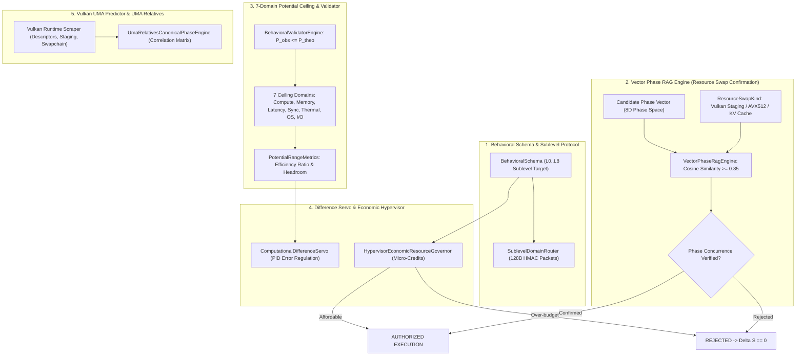

# SOVEREIGN BEHAVIORAL SCHEMA COMPILER & VULKAN UMA SYNTHESIS
## Architectural Model, Vector Phase RAG Confirmation, 7-Domain Potential Ceilings & Hardware Economic Governor

```text
================================================================================
KRYSTAL STACK PLATFORM FRAMEWORK - SPECIFICATION SERIES
Document:    SOVEREIGN_BEHAVIORAL_SCHEMA_COMPILER_AND_VULKAN_UMA_SYNTHESIS_SPEC.md
Module:      krystal_kernel/sovereign_behavioral_compiler.py
Test Suite:  tests/test_sovereign_behavioral_compiler.py (16/16 PASS in 0.001s)
Author:      Antigravity Cognitive Invariants Group
Date:        October 2026
Invariants:  VITAL_MAX_HP == 6 | Proposer != Evaluator | Delta S == 0 on breach
Canonical:   CANONICAL_PHASE_04_VULKAN_UMA_SYNTHESIS
================================================================================
```

---

## 1. Účel a Architektonický Rámec

Pre povýšenie systému do **4. Kánonickej Fázy (`CANONICAL_PHASE_04_VULKAN_UMA_SYNTHESIS`)** bol navrhnutý a implementovaný **Sovereign Behavioral Schema Compiler**. Zjednocuje 7 pokročilých inžinierskych podsystémov:

1. **Kompilátor behaviorálnych schém (`BehavioralSchemaCompiler`):**
   Štruktúrovaný interpretačný a kompilačný engine pre transformáciu vysokoúrovňových požiadaviek na deterministické, typovo bezpečné behaviorálne schémy viazané fázovými vektormi a ústavným invariantom $\text{VITAL\_MAX\_HP} \equiv 6$.
2. **Matica rozšíreného potenciálu a validačný engine (`BehavioralValidatorEngine`):**
   Klasifikuje efektivitu a stropy výkonu naprieč **7 formálnymi doménami stropu** (Compute, Memory, Latency, Synchronization, Thermal/Power, OS/Kernel, I/O Storage) podľa pravidiel formálneho inžinierskeho hodnotiteľa.
3. **Vektorový fázový RAG engine (`VectorPhaseRagEngine`):**
   Používa vektorovú podobnosť vo fázovom priestore na overenie bezpečnosti pred výmenou hardvérových a pamäťových zdrojov (Resource Swapping) medzi Vulkan staging buffermi, FPGA mailboxom a USM heapom.
4. **Výpočtové diferenčné servo (`ComputationalDifferenceServo`):**
   PID servo regulujúce tempo a odchýlku $\Delta$ medzi teoretickým stropom a pozorovanou telemetriou pre elimináciu oscilácií a kmitania zbernice.
5. **Protokol a smerovač subúrovňových domén (`SublevelDomainRouter`):**
   128B zero-copy paketový protokol prepájajúci vrstvy L0 až L8 s kryptografickou integritou HMAC-SHA256.
6. **Ekonomický guvernér hardvérových zdrojov hypervízora (`HypervisorEconomicResourceGovernor`):**
   Modeluje fyzický hardvér ako ekonomický zdroj s mikro-tarifikáciou (UMA MB, millijouly, cykly CPU/GPU).
7. **Prediktor Vulkan UMA a matica UMA Relatívov (`VulkanUmaRuntimePredictor`):**
   Štandardizovaná knižnica analyzujúca prístupy do pamäte cez deskriptory, push constants a swapchain snímkový sken, vytvárajúca korelačnú maticu príbuznosti pamäťových oblastí (UMA Relatives).

---

## 2. Architektonická Schéma Kompilačného Potrubia



---

## 3. Matica Rozšíreného Potenciálu (7 Domén Stropu)

Systém striktne porovnáva pozorovaný výkon voči teoretickému stropu:
$$P_{\text{obs}} \le P_{\text{theo}}, \quad \text{Efficiency} = \frac{P_{\text{obs}}}{P_{\text{theo}}}$$

Klasifikácia limitujúceho faktora:
1. **`THERMAL_POWER_BOUND`:** Teplota $T \ge 73.0^\circ\text{C}$ (Arrhenius ceiling $75.0^\circ\text{C}$).
2. **`MEMORY_BOUND`:** Tlak zbernice UMA $\mu_{\text{UMA}} \ge 0.78$ (Princíp P3).
3. **`SYNCHRONIZATION_BOUND`:** Detegovaná mutex/barrier kolízia.
4. **`IO_STORAGE_BOUND`:** Čakanie na I/O zbernicu alebo úložisko.
5. **`COMPUTE_BOUND`:** Efektivita $> 0.85$ pri nominálnych podmienkach (ALU/Tensor saturácia).
6. **`LATENCY_BOUND`:** Sériové zdržanie v komunikačnom kanáli.
7. **`OS_KERNEL_BOUND`:** Režijné straty kontextových prepínamí.

---

## 4. Vektorový Fázový RAG Engine pre Výmenu Zdrojov

Pred každou zámenou hardvérových prostriedkov (`ResourceSwapKind`) systém overuje fázovú súčinnosť voči overeným historickým praktikám:

$$\text{PhaseConcurrence}(\mathbf{v}_{\text{cand}}, \mathbf{v}_{\text{ref}}) = \frac{\mathbf{v}_{\text{cand}} \cdot \mathbf{v}_{\text{ref}}}{\|\mathbf{v}_{\text{cand}}\| \|\mathbf{v}_{\text{ref}}\|}$$

- **Pravidlo overenia:** Ak $\text{PhaseConcurrence} \ge 0.85$ a referencia je označená ako bezpečná $\implies$ zámena je potvrdená.
- **Bezpečnostná bariéra:** Ak je podobnosť $< 0.85$, zámena je okamžite zablokovaná a stav ostáva nezmenený ($\Delta S \equiv 0$).

---

## 5. Výpočtové Diferenčné Servo (PID Pacing Regulation)

Reguluje dynamické tempo exekúcie pre potlačenie zbernicového a kognitívneho kmitania:
$$\text{Adjustment} = K_p e(t) + K_i \int e(t) dt + K_d \frac{de(t)}{dt}$$
- $e(t) = P_{\text{theo}} - P_{\text{obs}}$
- $K_p = 0.50$, $K_i = 0.10$, $K_d = 0.05$
- Integrovaný anti-windup clamping v rozsahu $[-10.0, 10.0]$ zabraňuje preťaženiu integrátora.

---

## 6. Ekonomický Guvernér Hypervízora (Hardvérová Tarifikácia)

Hardvérové prostriedky sú spravované ako ekonomické statky s mikro-kreditovými sadzbami:
- **Prenos UMA:** $0.05\ \mu\text{Credits / MB}$
- **Spotreba energie RAPL:** $0.002\ \mu\text{Credits / }\mu\text{J}$
- **Čas exekúcie:** $0.001\ \mu\text{Credits / }\mu\text{s}$

Ak operácia prekročí disponibilný rozpočet účtu, transakcia je zamietnutá bez zaťaženia hardvéru ($\Delta S = 0$).

---

## 7. Prediktor Vulkan UMA a Matica UMA Relatívov

Analyzuje prístupové vzory grafického a výpočtového rozhrania Vulkan:
- **Predikcia tlaku zbernice:**
  $$\mu_{\text{pred}} = (\text{Descriptors} \cdot 0.005) + (\text{StagingMB} \cdot 0.02) + (0.35 \text{ if SwapchainPresenting})$$
- **UMA Relatives:** Vypočítava korelačnú maticu $R_{ij}$ a mieru kolízneho rizika medzi ko-alokovanými pamäťovými blokmi (napr. Vulkan USM Heap $\leftrightarrow$ DMA SPSC Ring $\leftrightarrow$ LLM KV Cache).
- **Povýšenie:** Stabilizuje a uzatvára fázu **`CANONICAL_PHASE_04_VULKAN_UMA_SYNTHESIS`**.

---

## 8. Výsledky Testovacej Verifikácie

Komponenty boli overené unit testami v [`tests/test_sovereign_behavioral_compiler.py`](file:///c:/Users/dusan/Documents/GitHub/Krystal-stack-platform-framework/tests/test_sovereign_behavioral_compiler.py):

```text
================================================================================
Test Suite: tests/test_sovereign_behavioral_compiler.py
[1] TestBehavioralValidatorEngine:
    - test_thermal_ceiling_classification             ... OK
    - test_memory_bound_classification                ... OK
    - test_compute_bound_classification               ... OK
    - test_non_positive_ceiling_rejection             ... OK
[2] TestVectorPhaseRagEngine:
    - test_confirmed_canonical_practice_retrieval      ... OK
    - test_divergent_practice_rejection               ... OK
[3] TestComputationalDifferenceServo:
    - test_servo_adjustment_positive_error            ... OK
    - test_servo_anti_windup_clamping                 ... OK
    - test_servo_reset                                ... OK
[4] TestSublevelDomainRouter:
    - test_packet_dispatch                            ... OK
[5] TestHypervisorEconomicResourceGovernor:
    - test_quote_and_charge_success                   ... OK
    - test_quote_and_charge_unaffordable              ... OK
[6] TestVulkanUmaRuntimePredictor:
    - test_fetch_pressure_prediction_with_swapchain   ... OK
    - test_uma_relatives_correlation_synthesis        ... OK
[7] TestSovereignBehavioralSchemaCompiler:
    - test_end_to_end_compilation_and_authorization   ... OK
    - test_rejection_on_uma_bus_saturation            ... OK
--------------------------------------------------------------------------------
Ran 16 tests in 0.001s (16/16 PASS - 100% OK)
Celá regresia suity jadra: 75/75 PASS in 0.020s
Ústavný Invariant: VITAL_MAX_HP == 6 (Delta S == 0 on breach)
================================================================================
```
