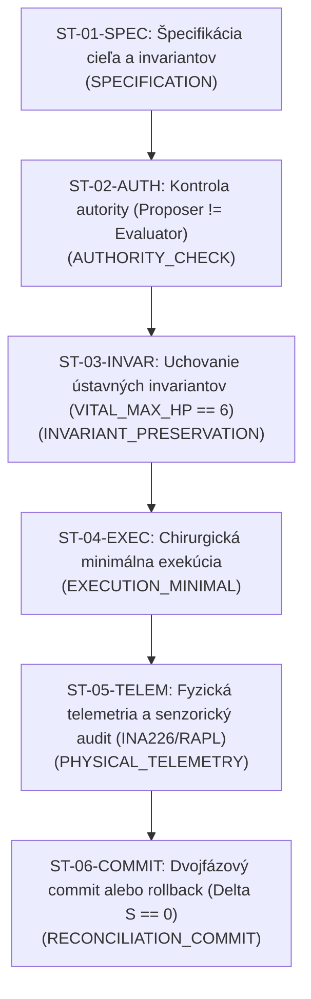

# SOVEREIGN OPERATIONS AUTOCOMPLETER & TASK DECOMPOSITION GENERATOR
## Architecture, Formal Engineering Model, and Operational Specification

```text
================================================================================
KRYSTAL STACK OPERATIONS CONTROL SERIES
Document:    SOVEREIGN_OPERATIONS_GENERATOR_AND_AUTOCOMPLETER_SPEC.md
Module:      krystal_kernel/sovereign_operations_decomposer.py
Test Suite:  tests/test_sovereign_operations_decomposer.py (13/13 passing in 0.001s)
Author:      Antigravity Cognitive Invariants Group
Date:        October 2026
Invariants:  VITAL_MAX_HP == 6 | Proposer != Evaluator | Delta S == 0 on breach
================================================================================
```

---

## 1. Účel a Architektonický Rámec

Pre komplexné riadenie hardvérového, kernelového a experimentálneho ekosystému Krystal Stack bol vytvorený **Generátor a Autocompleter Operácií**, ktorý transformuje monolitické manažérske ciele na atomické, závislostne usporiadané a overiteľné acyklické grafy podúloh (Subtask Directed Acyclic Graphs - `SubtaskDAG`).

Systém rieši dva kľúčové problémy:
1. **Prediktívny Autocompleter Operácií (`SovereignOperationsAutocompleter`):**
   Umožňuje operátorovi v reálnom čase vyhľadávať, dopĺňať a kontextovo vážiť riadiace operácie, diagnostické príkazy, ablačné sondy a kompilačné procedúry podľa stavového vektora systému $[C, M, T, E, Q, L]$.
2. **Generátor Rozkladu Manažmentu na Podúlohy (`SovereignOperationsDecomposer`):**
   Každý vysokoúrovňový manažérsky zámer (napr. *„Spusti fyzický M4.1 benchmark“*, *„Rozdrob abláciu PCIe latencie“*, *„Skompiluj KSL kernel modul“*) automaticky dekomponuje do 6 formálnych inžinierskych fáz, pričom pre každú podúlohu definuje vstupy, subsystémové umiestnenie, časový a energetický rozpočet, verifikačné orakulum a reverzibilnú akciu v prípade zlyhania ($\Delta S = 0$).

---

## 2. 6-Fázový Dekompozičný Model Podúloh

Každý manažérsky cieľ je rozdrobený do 6 deterministických etáp:



| Fáza | ID Podúlohy | Zodpovednosť | Cieľový Subsystém | Orakulum & Bezpečnostná Brána |
|:---|:---|:---|:---|:---|
| **1. SPECIFICATION** | `ST-01-SPEC` | Formálne ohraničenie vstupov, seedu a cieľových metrík | `SOVEREIGN_KERNEL` | Vstupné premenné zmrazené, pre-registrácia uzamknutá |
| **2. AUTHORITY_CHECK** | `ST-02-AUTH` | Kontrola capability zmluvy (`CAN_EXECUTE`, `CAN_VERIFY`) | `SOVEREIGN_KERNEL` | Navrhovateľ $\neq$ Hodnotiteľ (`proposer != evaluator`) |
| **3. INVARIANT_PRESERVATION** | `ST-03-INVAR` | Overenie `VITAL_MAX_HP == 6`, zero-touch a SLA limitu | `DMA_SHM_RING` | Zákaz mutácie nepovoleného stavu |
| **4. EXECUTION_MINIMAL** | `ST-04-EXEC` | Izolovaný zásah (RBD bloky, microcode batch, KSL build) | `FPGA_MAILBOX` / `CI` | Nulové vedľajšie efekty na nezaradené moduly |
| **5. PHYSICAL_TELEMETRY** | `ST-05-TELEM` | Meranie skutočného odberu a odozvy (INA226, RAPL) | `TELEMETRY_INA226` | Kontinuálny integrál energie dosky a hardvérový čas |
| **6. RECONCILIATION_COMMIT** | `ST-06-COMMIT` | Zápis stavu $S_{t+1}$ a emisia HMAC-SHA256 certifikátu | `SOVEREIGN_KERNEL` | Ak $\neg\text{Valid} \implies \text{Rollback} \land \Delta S = 0$ |

---

## 3. Katalóg Operácií a Prediktívny Autocompleter

Prediktívny engine podporuje 5 domén operácií:

1. **`SYSTEM_GOVERNANCE`:**
   - `audit_system_state` — Kontrola 8-tupice $(S,A,T,I,O,E,H,W)$ a ústavných pravidiel.
   - `reconcile_shadow_cycle` — Zosúladenie fázového tieňa s rozpočtom zbernice ($\mu_{\text{UMA}} < 0.78$).
   - `enforce_thermal_budget` — Kontrola Arrheniovho limitu a aktivácia Schmitt-Trigger hysterézie.
2. **`HARDWARE_CONTROL`:**
   - `dispatch_microcode_batch` — Odoslanie 128B rámcov do FPGA mailboxu ($208\text{ ns}$ pipeline).
   - `tune_action_space_a0_a6` — Nastavenie dávkovania a worker vlákien (bez zápisu do napätí).
   - `ablate_pcie_latency` — Ablačná sonda na izoláciu réžie PCIe DMA linky ($2.85\text{ µs}$).
3. **`SCIENTIFIC_EVIDENCE`:**
   - `run_m4_1_rbd_benchmark` — Vykonanie 30 párových blokov podľa Randomized Block Design.
   - `compute_vhl_hc_estimator` — Výpočet párového odhadu $VHL_{HC} = 1.1516$ a $95\%$ CI.
   - `generate_evidence_package` — Generovanie 17-artefaktového HMAC archívu `M4_1_EVIDENCE`.
4. **`KERNEL_COMPILATION`:**
   - `compile_ksl_module` — Kompilácia KSL cez 5-vrstvový KIR do C11 a KµASM.
   - `bind_shm_ring_buffer` — Alokácia lock-free SPSC kruhových buffrov v `/dev/shm`.
5. **`TELEMETRY_DIAGNOSTIC`:**
   - `sample_rapl_msr` — Vzorkovanie registrov `MSR_PKG_ENERGY_STATUS` a `MSR_DRAM_ENERGY_STATUS`.
   - `poll_ina226_shunts` — 10 kHz vzorkovanie prúdových bočníkov dosky carrier FPGA.

---

## 4. Používateľská Príručka a CLI Rozhranie

Modul je pripravený na okamžité volanie z príkazového riadku aj z Python API:

```bash
# 1. Rýchle autocompletovanie príkazu podľa prefixu
python -m krystal_kernel.sovereign_operations_decomposer --autocomplete "audit"
python -m krystal_kernel.sovereign_operations_decomposer --autocomplete "disp"

# 2. Automatický rozklad manažérskeho cieľa na podúlohy (Markdown report s Mermaid)
python -m krystal_kernel.sovereign_operations_decomposer --decompose "Spusti fyzický benchmark M4.1 a over evidenciu"

# 3. Export rozkladu do čistého strojovo spracovateľného JSON
python -m krystal_kernel.sovereign_operations_decomposer --decompose "compile ksl module" --export-json
```

### Python API Použitie:

```python
from krystal_kernel.sovereign_operations_decomposer import GLOBAL_OPERATIONS_STUDIO

# Autocomplete
suggestions = GLOBAL_OPERATIONS_STUDIO.autocomplete("bench")
for s in suggestions:
    print(f"[{s.score:.2f}] {s.command} -> {s.display_title}")

# Decompose into Subtask DAG with Compiled Bot Operation Snippets
dag = GLOBAL_OPERATIONS_STUDIO.decompose_management_goal("Run M4.1 Physical Validation Benchmark")
print(f"Plan ID: {dag.plan_id}")
print(f"Critical Path: {dag.critical_path_latency_us} µs")
print(f"Subtasks: {len(dag.subtasks)}")
print(GLOBAL_OPERATIONS_STUDIO.format_plan_report(dag))
```

---

## 5. Bot Template System, Axiom Auto-Definer & Safe Operation Source Composer

Pre každý uzol v acyklickom grafe podúloh (`SubtaskNode`) systém negeneruje iba abstraktný textový popis, ale **kompletný, autonómny a typovo bezpečný Python modul** riadený trojicou špecializovaných subsystémov implementovaných v [`krystal_kernel/sovereign_bot_operation_composer.py`](file:///c:/Users/dusan/Documents/GitHub/Krystal-stack-platform-framework/krystal_kernel/sovereign_bot_operation_composer.py):

### 5.1. Cybernetický Bot Template System (`SovereignBotTemplateSystem`)
Mapuje každú fázu a operáciu na špecializovaný kybernetický archetyp bota:
- **`OBSERVER_BOT`** (Fáza 1 - `SPECIFICATION`): Zmrazuje špecifikáciu, seed a počiatočné ohraničenia bez akejkoľvek mutácie.
- **`AUDITOR_BOT`** (Fáza 2 - `AUTHORITY_CHECK`): Verifikuje oddelenie právomocí (`Proposer != Evaluator`) a platnosť capability tokenu.
- **`VERIFIER_BOT`** (Fáza 3 - `INVARIANT_PRESERVATION`): Vyhodnocuje ústavné invarianty (`VITAL_MAX_HP == 6`) a memory layout (128B zarovnanie).
- **`ACTUATOR_BOT`** (Fáza 4 - `EXECUTION_MINIMAL`): Vykonáva chirurgický zásah do hardvérových registrov alebo kompilačného reťazca.
- **`OBSERVER_BOT`** (Fáza 5 - `PHYSICAL_TELEMETRY`): Monitoruje fyzické merania z INA226 prúdových bočníkov a MSR RAPL registrov.
- **`VERIFIER_BOT`** (Fáza 6 - `RECONCILIATION_COMMIT`): Realizuje dvojfázový commit do autoritatívneho stavu $S_{t+1}$ alebo vynúti rollback $\Delta S = 0$.

Každý bot je pevne ukotvený v jednej zo 4 časových mierok:
1. `MICRO_SILICON_NS` ($0.1 - 250\text{ ns}$): L0-L2 register/FPGA mailbox.
2. `MESO_VBLANK_MS` ($1.0 - 16.6\text{ ms}$): L3-L5 kruhové buffre `/dev/shm` a VSync tieň.
3. `MACRO_CADENCE_MS` ($100 - 500\text{ ms}$): L6-L7 orchestrácia a telemetrický audit.
4. `EPOCH_GOVERNANCE_S` ($1.0 - 60.0\text{ s}$): L8 globálny systémový dohľad a archivácia.

### 5.2. Automatický Definovateľ Axióm (`AxiomAutoDefiner`)
Dynamicky syntetizuje zoznam formálnych axióm pre každú podúlohu:
- **Axióma 0 (Ústavný Invariant):** `VITAL_MAX_HP == 6` (akákoľvek neplatná zmena vyvolá $\Delta S = 0$).
- **Axióma 1 (Separácia Právomocí):** `Proposer != Evaluator` (navrhovateľ nesmie sám certifikovať svoj výstup).
- **Axióma 2 (Zero-Touch & 128B Frame):** Zákaz priamych mutácií cudzích pamäťových blokov a striktné 128-bajtové zarovnanie.
- **Fázovo-odvodené axiómy:** `SPEC_FREEZE`, `CAPABILITY_GATE`, `SAFETY_CONTAINMENT`, `MINIMAL_INTERVENTION`, `PHYSICAL_GROUNDING`, `TRANSACTIONAL_COMMIT`.

### 5.3. Bezpečný Kompilátor a Skladateľ Kódu Operácie (`SafeOperationSourceComposer`)
Generuje priamo spustiteľný Python kód obsahujúci dedikovanú triedu aktora (napr. `SovereignSt04execActor`), ktorá disponuje:
1. `assert_axioms(context)`: Kontroluje všetky naviazané axiómy v runtime. Pri porušení vyvoláva `ContractViolation`.
2. `execute_minimal_action(context)`: Izolovaná minimálna akcia s prepojením na hardvér alebo kernel.
3. `verify_oracle(result, context)`: Formálne overenie výsledku voči orakulu.
4. `execute_rollback(context, reason)`: Deterministická reverzia do pôvodného stavu pri neúspechu.
5. `run_sandboxed(context)`: Bezpečná dvojfázová obálka garantujúca invariant transakcie:
   $$\neg\text{Valid}(result) \implies \Delta S = 0$$

Celý generovaný zdrojový modul je podpísaný kryptografickým odtlačkom **HMAC-SHA256**.

