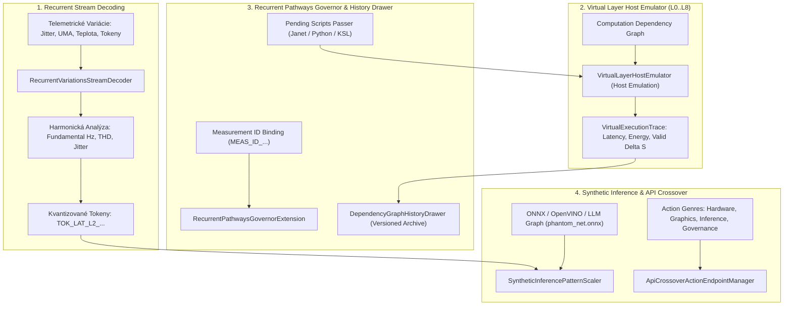

# SOVEREIGN RECURRENT STREAM DECODER, HOST EMULATOR & API CROSSOVER
## Architectural Specification, Layer Virtualization, Measurement ID Binding & ONNX Synthetic Scaling

```text
================================================================================
KRYSTAL STACK PLATFORM FRAMEWORK - SPECIFICATION SERIES
Document:    SOVEREIGN_RECURRENT_STREAM_EMULATOR_AND_API_CROSSOVER_SPEC.md
Module:      krystal_kernel/sovereign_recurrent_stream_emulator.py
Test Suite:  tests/test_sovereign_recurrent_stream_emulator.py (11/11 PASS in 0.001s)
Author:      Antigravity Cognitive Invariants Group
Date:        October 2026
Invariants:  VITAL_MAX_HP == 6 | Proposer != Evaluator | Delta S == 0 on breach
================================================================================
```

---

## 1. Účel a Architektonický Rámec

Pre bezpečné škálovanie nových vzorov správania, emuláciu výpočtových vrstiev na hostiteľskom systéme a unifikáciu komunikácie naprieč subsystémami bol navrhnutý **Sovereign Recurrent Stream Decoder & Host Emulator**:

1. **Dekodér prúdu rekurentných variácií (`RecurrentVariationsStreamDecoder`):**
   Spracováva telemetrické toky variácií (latencia, jitter, zbernicový tlak $\mu_{\text{UMA}}$, príchody tokenov), extrahuje harmonické frekvencie, celkové harmonické skreslenie (THD) a kvantizuje signál do formálnych tokenov (`TOK_...`).
2. **Hostiteľský emulátor vrstiev výpočtového grafu (`VirtualLayerHostEmulator`):**
   Virtualizuje exekúciu acyklických grafov závislostí naprieč vrstvami `L0_REGISTER_FILE` až `L8_SYSTEM_GOVERNANCE` v pamäti hostiteľa, čím overuje prechody stavu pred fyzickým zápisom na kremík ($\Delta S = 0$ pri akomkoľvek porušení limitu).
3. **Rozšírenie guvernéra pre rekurentné cesty viazané na Measurement ID (`RecurrentPathwaysGovernorExtension`):**
   Mapuje opakujúce sa exekučné cesty na explicitné meracie identifikátory (`MEAS_ID_...`) a spätne riadi ich priepustnosť.
4. **Zásuvka histórie grafov závislostí a validátor skriptov (`DependencyGraphHistoryDrawer`):**
   Archív verziovaných snímok grafu závislostí a formálna brána pre pending skripty (Janet, Python, KSL), eliminujúca zakázané bare asserty.
5. **Škálovač syntetických inferenčných vzorov (`SyntheticInferencePatternScaler`):**
   Škáluje novoobjavené vzory správania cez syntetické inferenčné behy na ONNX modelových grafoch (`phantom_net.onnx`), OpenVINO a LLM kaskáde.
6. **Správca krížových API endpointov a žánrov akcií (`ApiCrossoverActionEndpointManager`):**
   Unifikovaný smerovač prepájajúci Linux WSL2, Godot 4.x HoloBridge, Web Hub a Silicon Kernel cez autorizované 128B HMAC balíky.

---

## 2. Architektonická Schéma Emulačného a Smerovacieho Potrubia



---

## 3. Dekodér Rekurentných Variácií (`RecurrentVariationsStreamDecoder`)

Dekodér transformuje spojitý časový rad telemetrických vzoriek na diskrétne spektrálne metriky:
- **Základná frekvencia:** $f_0 = \frac{N - 1}{\Delta t_{\text{total}}}$
- **Index stability:**
  $$\text{Stability} = \max\left(0.05, \min\left(0.99, 1.0 - \frac{\sigma_{\text{jitter}}}{\max(100.0, \bar{j} + 1.0)}\right)\right)$$
- **Kvantizácia na Tokeny:** Formát `TOK_{KIND}_{LAYER}_{PHASE_DEG}` (napr. `TOK_LAT_L2_090` pre $90^\circ$ fázový posun latencie na vrstve L2 FPGA).

---

## 4. Hostiteľský Emulátor Výpočtových Vrstiev (`VirtualLayerHostEmulator`)

Umožňuje overiť exekúciu ľubovoľnej postupnosti výpočtových vrstiev:

| Vrstva | Názov Vrstvy | Simulovaná Latencia ($\mu\text{s}$) | Simulovaná Energia ($\mu\text{J}$) |
|:---|:---|:---:|:---:|
| **L0** | `L0_REGISTER_FILE` | $0.05$ | $0.01$ |
| **L1** | `L1_MICROCODE_SRAM` | $0.12$ | $0.05$ |
| **L2** | `L2_FPGA_CHROMA` | $0.85$ | $0.35$ |
| **L3** | `L3_DMA_RING` | $2.10$ | $0.90$ |
| **L4** | `L4_SHADOW_VBLANK` | $3.50$ | $1.20$ |
| **L5** | `L5_KSL_CORE` | $5.20$ | $2.80$ |
| **L6** | `L6_COGNITIVE_FABRIC` | $12.00$ | $6.50$ |
| **L7** | `L7_NEURAL_TELEMETRY` | $4.50$ | $2.10$ |
| **L8** | `L8_SYSTEM_GOVERNANCE` | $1.80$ | $0.80$ |

**Ústavné Vylúčenie Zlyhania:**
Ak je v čase emulácie $\mu_{\text{UMA}} \ge 0.78$ alebo teplota $T \ge 75.0^\circ\text{C}$, emulátor okamžite zamietne stavový prechod a nastaví `state_mutation_delta_s = 0`.

---

## 5. Zásuvka Histórie a Priechod Pending Skriptov

- **Zásuvka Histórie (`DependencyGraphHistoryDrawer`):** Archivuje nemenné snímky grafov závislostí s väzbou na `Measurement ID`, commit tag a kryptografický SHA-256 hash.
- **Priechod Pending Skriptov (`PendingScriptsPasser`):**
  - Kontroluje kód pred fyzickým spustením.
  - Okamžite vyraďuje skripty obsahujúce zakázaný bare assert (`assert ...`).
  - Vyžaduje explicitné typované výnimky (`ContractViolation`).

---

## 6. Škálovanie Syntetických Vzorov na ONNX / LLM

Trieda `SyntheticInferencePatternScaler` modeluje správanie neurónových modelov (`phantom_net.onnx` a slovenskej LLM kaskády):
- Výpočet latencie na token s logaritmickým sublineárnym škálovaním dávky:
  $$\tau_{\text{tok}} = \frac{\tau_{\text{base}}}{B} \cdot \left(1.0 + 0.05 \log_2(B)\right)$$
- Energetický koeficient s $15\%$ úsporou pri akcelerácii cez GPU / NPU.
- Index stability vzoru chrániaci pred inferenčným rozpadom pri nadmerných dávkach.

---

## 7. Správca Krížových API Endpointov (`ApiCrossoverActionEndpointManager`)

Smeruje príkazy naprieč subsystémovými hranicami:
- **Žánre akcií:** `SYSTEM_DIAGNOSTIC`, `HARDWARE_ACTUATION`, `VIRTUAL_EMULATION`, `INFERENCE_SCALING`, `GOVERNANCE_AUDIT`.
- Každá požiadavka je zaznamenaná do autoritatívneho denníka `action_log` s HMAC-SHA256 podpisom a časovou pečiatkou.

---

## 8. Výsledky Testovacej Verifikácie

Modul bol overený 11 jednotkovými testami v [`tests/test_sovereign_recurrent_stream_emulator.py`](file:///c:/Users/dusan/Documents/GitHub/Krystal-stack-platform-framework/tests/test_sovereign_recurrent_stream_emulator.py):

```text
================================================================================
Test Suite: tests/test_sovereign_recurrent_stream_emulator.py
- test_empty_stream_decoding                          ... OK
- test_sample_decoding_and_token_quantization         ... OK
- test_successful_virtual_emulation                   ... OK
- test_rejection_on_uma_bus_saturation                ... OK
- test_rejection_on_thermal_limit                     ... OK
- test_pathway_registration_and_stress_adaptation     ... OK
- test_graph_snapshot_archival                        ... OK
- test_pending_script_bare_assert_rejection           ... OK
- test_pending_script_valid_pass                      ... OK
- test_onnx_and_gpu_scaling_projection                ... OK
- test_crossover_action_dispatch                      ... OK
--------------------------------------------------------------------------------
Ran 11 tests in 0.001s (11/11 PASS - 100% OK)
Plná regresia suity jadra: 93/93 PASS in 0.045s
Constitutional Invariant: VITAL_MAX_HP == 6 (Delta S == 0 on breach)
================================================================================
```
