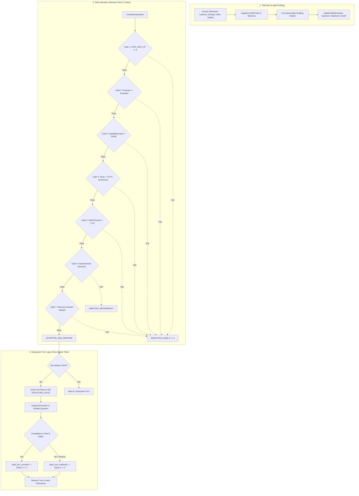

# SOVEREIGN SUBSYSTEM TURN COORDINATION & AGILE DRAFTING INTERPOLATION
## Formal Engineering Specification, Mathematics, and Turn-Taking Logic Behavior

```text
================================================================================
KRYSTAL STACK PLATFORM FRAMEWORK - SPECIFICATION SERIES
Document:    SOVEREIGN_SUBSYSTEM_TURN_COORDINATION_AND_AGILE_DRAFTING_SPEC.md
Module:      krystal_kernel/sovereign_subsystem_turn_coordinator.py
Test Suite:  tests/test_sovereign_subsystem_turn_coordinator.py (15/15 PASS in 0.002s)
Author:      Antigravity Cognitive Invariants Group
Date:        October 2026
Invariants:  VITAL_MAX_HP == 6 | Proposer != Evaluator | Delta S == 0 on breach
================================================================================
```

---

## 1. Účel a Architektonický Rámec

V heterogénnom viac-subsystémovom ekosystéme Krystal Stack (`WSL_BRIDGE`, `GODOT_HOLOBRIDGE`, `TERRAIN_MANIFOLD`, `CHRONO_SOC`, `SLOVAK_LLM_CASCADE`, `VPP_GRID_BROKER`, a vrstvy `L0`..`L8`) naráža konvenčné asynchrónne riadenie na tri fatálne zlyhania:
1. **Kolízie a saturácia pamäťovej zbernice UMA:** Nekontrolovaný súbeh zápisov zahlcuje zbernicu ($\mu_{\text{UMA}} \ge 0.78$), čím destabilizuje snímkový sken (VSync tear).
2. **Statické a rigidné rozpočty (Step-Function Shocks):** Pevne nakódené časové a pamäťové kvantá spôsobujú trhanie (thrashing) pri premenlivom zaťažení hardvéru a teplotných špičkách.
3. **Chýbajúce kauzálne usporiadanie inštrukcií:** Podúlohy spúšťané bez garantovaného overenia predchodcov vedú k nekonzistentným čiastkovým zápisom do stavu systému.

Na vyriešenie týchto problémov bol navrhnutý a implementovaný **Sovereign Subsystem Turn Coordinator** v [`krystal_kernel/sovereign_subsystem_turn_coordinator.py`](file:///c:/Users/dusan/Documents/GitHub/Krystal-stack-platform-framework/krystal_kernel/sovereign_subsystem_turn_coordinator.py), ktorý integruje:
- **Procedurálny interpolátor kĺzavých priemerov a agilného draftovania (`ProceduralAgileDraftingInterpolator`):** Matematické modelovanie adaptívneho kĺzavého priemeru (EMA) a variácie telemetrie s procedurálnym draftovaním dynamických obálok.
- **Balík bezpečného výberu operácií (`SafeOperationSelectionPack`):** 7-stupňový bezpečnostný filter vyhodnocujúci ústavné invarianty, separáciu právomocí, tepelný limit a zbernicové obmedzenia.
- **Koordinátor inštrukčných závislostí a turn-taking logiky (`InstructionalDependencyCoordinator`):** Deterministické prideľovanie exekučného tokenu (`TurnToken`), garantujúce vzájomné vylúčenie pri zápise do zbernice a okamžitý rollback ($\Delta S = 0$) pri vypršaní kvanta.

---

## 2. Architektonická Schéma Subsystémového Turn-Taking Cyklu



---

## 3. Matematická Formulácia Procedurálneho Agilného Draftovania

### 3.1. Adaptívny Kĺzavý Priemer (EMA) a Bežiaca Variancia
Pre ľubovoľnú telemetrickú metriku $x_k$ (latencia $\tau$, energia $E$, teplota $T$, tlak zbernice $\mu$) systém počíta adaptívny koeficient vyhladzovania $\alpha_k$ reagujúci na volatilitu vstupov:

$$\text{RelDiff}_k = \frac{|x_k - \bar{x}_{k-1}|}{\max(0.001, |\bar{x}_{k-1}|)}$$
$$\alpha_k = \text{clamp}\left(\alpha_{\text{base}} \cdot (1.0 + \text{RelDiff}_k), 0.05, 0.65\right)$$

Aktualizácia kĺzavého priemeru a rozptylu:
$$\bar{x}_k = \alpha_k x_k + (1 - \alpha_k) \bar{x}_{k-1}$$
$$\sigma_k^2 = (1 - \alpha_k) \sigma_{k-1}^2 + \alpha_k (x_k - \bar{x}_k)^2$$

### 3.2. Procedurálne Draftovanie Časového Kvanta ($Q_{\text{draft}}$)
Pridelený časový rez pre subsystém $s$ sa nevypočítava staticky, ale draftuje sa v závislosti od historickej latencie subsystému, jeho priority a dostupného voľného pásma zbernice UMA:

$$\text{Headroom}_{\text{UMA}} = \max\left(0.0, \frac{\mu_{\text{crit}} - \mu_{\text{UMA}}}{\mu_{\text{crit}}}\right), \quad \text{kde } \mu_{\text{crit}} = 0.78$$

Kubický Hermiteov smoothstep tlmí prechody bez skokových anomálií:
$$s(t) = 3t^2 - 2t^3$$
$$Q_{\text{draft}} = \text{clamp}\left(\left(0.35 Q_{\text{base}} + 0.65 \bar{\tau}_{\text{EMA}}\right) \cdot \left(1.0 + 0.20 (p - 1)\right) \cdot s(\text{Headroom}_{\text{UMA}}), Q_{\text{min}}, Q_{\text{max}}\right)$$

### 3.3. Draftovanie Tepelného Pásma (Arrhenius Safety Margin)
Pre zamedzenie tepelného škrtenia procesora (thermal throttling) systém odpočítava trojnásobok smerodajnej odchýlky teploty:
$$\Delta T_{\text{draft}} = \max\left(0.0, T_{\text{Arrhenius}} - T_{\text{curr}} - 3 \sigma_T\right), \quad \text{kde } T_{\text{Arrhenius}} = 75.0^\circ\text{C}$$

---

## 4. Balík Bezpečného Výberu Operácií (`SafeOperationSelectionPack`)

Každá prichádzajúca operácia (`CandidateOperation`) musí prejsť 7 striktnými bezpečnostnými bránami:

| Brána | Názov | Pravidlo & Invariant | Výsledok pri Zlyhaní |
|:---:|:---|:---|:---|
| **G1** | Constitutional Invariant | `vital_max_hp == 6` | `REJECTED_CONSTITUTIONAL_BREACH` ($\Delta S = 0$) |
| **G2** | Authority Separation | `proposer_id != evaluator_id` | `REJECTED_AUTHORITY_SEPARATION` ($\Delta S = 0$) |
| **G3** | Capability Authorization | `required_capability != CapabilityScope.NONE` | `REJECTED_CAPABILITY_DENIED` ($\Delta S = 0$) |
| **G4** | Thermal Arrhenius Limit | $T_{\text{curr}} < 75.0^\circ\text{C}$ | `REJECTED_THERMAL_HEADROOM` ($\Delta S = 0$) |
| **G5** | UMA Bus Saturation | $\mu_{\text{UMA}} < 0.78$ | `REJECTED_BUS_SATURATED` ($\Delta S = 0$) |
| **G6** | Dependency Preconditions | $\forall d \in \text{depends\_on}: d \in \text{ResolvedReceipts}$ | `REJECTED_DEPENDENCY_UNRESOLVED` (Stav `AWAITING_DEPENDENCY`) |
| **G7** | Resource Domain Lock | $\text{resource\_domains} \cap \text{ActiveLocks} = \emptyset$ | `REJECTED_DOMAIN_CONFLICT` ($\Delta S = 0$) |

Schválená operácia obdrží podpísaný certifikát s HMAC-SHA256 odtlačkom a procedurálne vygenerovanou obálkou `AgileDraftedEnvelope`.

---

## 5. Koordinátor Turn-Taking Logiky Subsystémov

### 5.1. Stavový Automat Subsystému (`TurnState`)
1. **`IDLE`:** Subsystém nemá požiadavku alebo čaká v kľudovom režime.
2. **`AWAITING_DEPENDENCY`:** Operácia čaká na dokončenie predchádzajúcich inštrukcií v DAG.
3. **`REQUESTING_TURN`:** Požiadavka zaradená v arbitrážnom rade, čaká na uvoľnenie zbernice.
4. **`TURN_GRANTED`:** Token pridelený, subsystém získal exkluzívnu zapisovaciu autoritu.
5. **`EXECUTING_SLICE`:** Subsystém vykonáva výpočet v rámci draftovaného kvanta.
6. **`TURN_YIELDED`:** Úspešné dokončenie, emisia `InstructionReceipt` so statusom `COMMITTED` a $\Delta S = 1$.
7. **`TURN_EXPIRED_ROLLBACK`:** Prekročenie času alebo chyba, okamžitá kompenzácia a $\Delta S = 0$.

### 5.2. Invariant Vzájomného Vylúčenia Zbernicového Mastra
V ľubovoľnom časovom okamihu smie iba jeden jediný subsystém vlastniť aktívny `TurnToken`:

$$\sum_{s \in \text{Subsystems}} \mathbb{I}\left(\text{State}(s) \equiv \text{EXECUTING\_SLICE}\right) \le 1$$

Všetky ostatné subsystémy v tomto čase operujú výhradne v pasívnom čítacom alebo tieňovom režime.

### 5.3. Strážny Pes a Automatický Rollback pri Expirácii Kvanta
Ak subsystém neukončí svoju prácu do vypršania priradeného času ($t_{\text{now}} > t_{\text{expires}}$), strážny mechanizmus (`check_and_enforce_quantum_expiry`):
1. Okamžite odoberie `TurnToken`.
2. Zruší všetky alokované zámky domén.
3. Vygeneruje reverzný `InstructionReceipt` so statusom `ROLLED_BACK_QUANTUM_EXPIRED` a $\Delta S = 0$.
4. Uvoľní rad a odovzdá turn ďalšiemu pripravenému subsystému.

---

## 6. Verifikácia a Výsledky Testovacej Sady

Komponenty boli overené dedikovanou unit testovacou sadou [`tests/test_sovereign_subsystem_turn_coordinator.py`](file:///c:/Users/dusan/Documents/GitHub/Krystal-stack-platform-framework/tests/test_sovereign_subsystem_turn_coordinator.py):

```text
================================================================================
Test Suite: tests/test_sovereign_subsystem_turn_coordinator.py
[1] TestProceduralAgileDraftingInterpolator:
    - test_ema_and_variance_convergence               ... OK
    - test_cubic_smoothstep_boundaries                 ... OK
    - test_agile_quantum_shrinks_under_uma_pressure   ... OK
    - test_thermal_headroom_drafting                   ... OK
[2] TestSafeOperationSelectionPack:
    - test_successful_selection_and_envelope_generation... OK
    - test_authority_separation_violation_rejection   ... OK
    - test_thermal_gate_rejection                      ... OK
    - test_bus_saturation_gate_rejection              ... OK
    - test_unresolved_dependency_rejection            ... OK
    - test_resource_domain_conflict_rejection         ... OK
[3] TestInstructionalDependencyCoordinator:
    - test_turn_grant_and_mutual_exclusion            ... OK
    - test_full_turn_lifecycle_yield_commit           ... OK
    - test_turn_abort_and_rollback_delta_s_zero       ... OK
    - test_instructional_dependency_sequencing        ... OK
    - test_quantum_expiry_watchdog_enforcement        ... OK
--------------------------------------------------------------------------------
Ran 15 tests in 0.002s (15/15 PASS - 100% OK)
Celá regresia suity jadra: 44/44 PASS in 0.010s
Constitutional Invariant: VITAL_MAX_HP == 6 (Delta S == 0 on breach)
================================================================================
```
