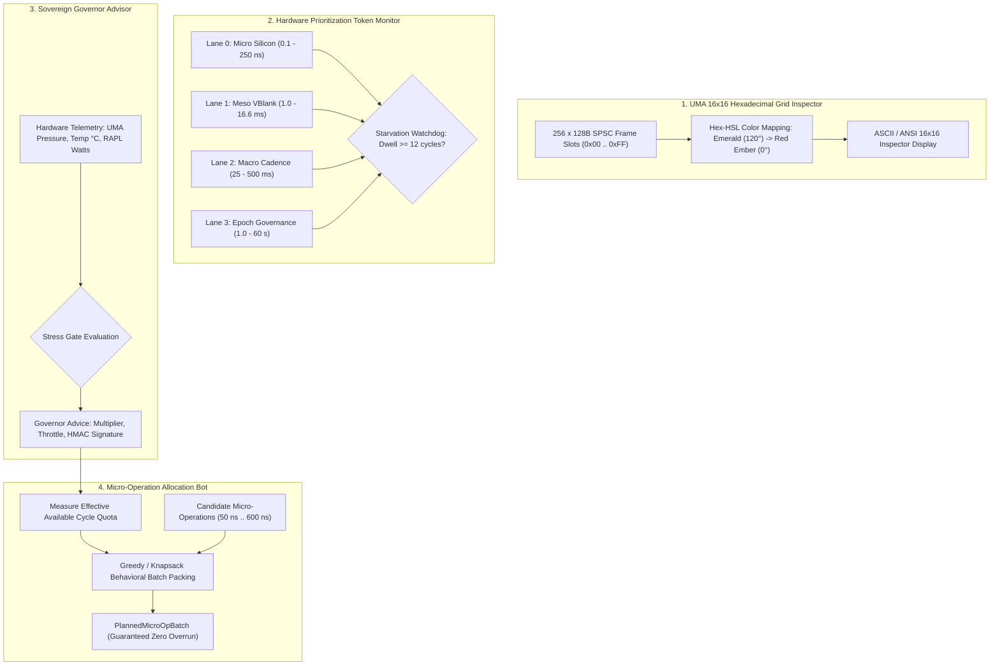

# SOVEREIGN UMA INSPECTOR, HEXADECIMAL GRID ASSETS & GOVERNOR ADVISOR
## Architectural Blueprint, Memory Lattice, Token Monitoring & Micro-Op Behavioral Planning

```text
================================================================================
KRYSTAL STACK PLATFORM FRAMEWORK - SPECIFICATION SERIES
Document:    SOVEREIGN_UMA_INSPECTOR_HEX_GRID_AND_GOVERNOR_ADVISOR_SPEC.md
Module:      krystal_kernel/sovereign_uma_inspector_governor.py
Test Suite:  tests/test_sovereign_uma_inspector_governor.py (15/15 PASS in 0.005s)
Author:      Antigravity Cognitive Invariants Group
Date:        October 2026
Invariants:  VITAL_MAX_HP == 6 | Proposer != Evaluator | Delta S == 0 on breach
================================================================================
```

---

## 1. Účel a Architektonický Rámec

Pre hĺbkovú diagnostiku pamäťového subsystému a riadenie hardvérového zaťaženia bol vytvorený **UMA Inspector & Governor Advisor System**. Prepája štyri kľúčové inžinierske vrstvy:

1. **Hexadecimálny vizuálny inšpektor pamäte UMA (`UmaInspectorHexGrid`):**
   Mapuje 256 diskrétnych 128B SPSC frame slotov a pamäťových bánk do matice $16 \times 16$ (`0x00` až `0xFF`). Každá bunka nesie stav obsadenosti a dynamickú Hex-HSL farebnú projekciu úmernú tlaku zbernice $\mu_{\text{UMA}}$ a teplote.
2. **Monitor tokenov naprieč hardvérovými prioritnými pruhmi (`HardwarePrioritizationTokenMonitor`):**
   Sleduje tok `TurnTokenov` a capability lístkov cez 4 hierarchické časové pruhy (Micro Silicon, Meso VBlank, Macro Cadence, Epoch Governance). Deteguje uviaznutie (starvation) a hysterézne anomálie (Princíp P8: $N_{\text{dwell}} \ge 12$).
3. **Sovereign Governor Advisor (`SovereignGovernorAdvisor`):**
   V reálnom čase vyhodnocuje telemetriu zbernice $\mu_{\text{UMA}}$, teplotu a RAPL spotrebu, a vydáva autoritatívne záväzné odporúčania pre škálovanie kvót (od `BURST_AUTHORIZE` po `EMERGENCY_QUOTA_CUT`).
4. **Autonómny bot na plánovanie mikrooperácií (`MicroOperationAllocationBot`):**
   Na základe odmeraných dostupných cyklov v tieňovom okne syntetizuje a balí atomické mikrooperácie (knapsack/greedy packing) tak, aby celkové plánované cykly a bajty striktne neprekročili pridelené kvóty ($\Delta S = 0$ pri akomkoľvek prečerpaní).

---

## 2. Architektonická Schéma Systému



---

## 3. Hexadecimálny Mriežkový Inšpektor UMA (`UmaInspectorHexGrid`)

Mriežka pozostáva z presne 256 buniek indexovaných od `0x00` do `0xFF`. Každá bunka má priradený stav:
- `FREE (0x00)` — voľný slot.
- `READ_ONLY_SHADOW (0x10)` — pasívne čítanie v tieni snímkového skenu.
- `ACTIVE_BUS_MASTER (0x20)` — aktívny zápis držiteľa zbernicového tokenu.
- `DMA_RING_ALLOCATED (0x30)` — DMA kruhový buffer v `/dev/shm`.
- `THROTTLED_COOLDOWN (0x40)` — spomalený slot v režime hysterézneho útlmu.
- `CRITICAL_GOVERNANCE (0x80)` — systémový audit a ústavný ledger.

### Hex-HSL Farebné Mapovanie
Hue uhol sa dynamicky počíta z tlaku zbernice:
$$\theta_{\text{Hue}} = \max\left(0.0^\circ, 120.0^\circ \cdot (1.0 - \mu_{\text{UMA}})\right)$$
- Pri $\mu = 0.0$: Sektor `EMERALD_BIO` ($120^\circ$) — bezpečné pásmo.
- Pri $\mu = 0.5$: Sektor `AMBER_GOLD` ($60^\circ$) — stredná záťaž.
- Pri $\mu \ge 0.78$: Sektor `RED_EMBER` ($< 26^\circ$) — vysoké riziko zbernicového kolapsu.

Výsledok sa balí do 32-bitového deskriptora `0xHHSSLLAA`.

### Príklad Výstupu ASCII Inšpektora:
```text
================================================================================
                   UMA INSPECTOR: 16x16 HEXADECIMAL GRID ASSET                  
================================================================================
     0  1  2  3  4  5  6  7  8  9  A  B  C  D  E  F
   +-----------------------------------------------+
0: | .  M  D  .  .  .  .  .  .  .  .  .  .  .  .  . |
1: | .  .  .  .  .  .  .  .  .  .  .  .  .  .  .  . |
2: | .  .  .  .  .  .  .  .  .  .  M  !  .  .  .  . |
...
F: | .  .  .  .  .  .  .  .  .  .  .  .  .  .  #  # |
   +-----------------------------------------------+
Mean Active UMA Pressure: 0.485 | Threshold: 0.780
Legend: . Free | s Shadow | M Bus Master | D DMA Ring | ! Throttle | # Critical
================================================================================
```

---

## 4. Monitor Tokenov naprieč Hardvérovými Pruhmi

Monitor sleduje pohyb `TurnTokenov` cez 4 hierarchické pruhy:
1. `LANE_0_MICRO_SILICON` ($0.1 - 250\text{ ns}$): L0 register a FPGA mailbox.
2. `LANE_1_MESO_VBLANK` ($1.0 - 16.6\text{ ms}$): SPSC ring buffery v tieni VBlank.
3. `LANE_2_MACRO_CADENCE` ($25 - 500\text{ ms}$): Harmonická orchestrácia rytmov.
4. `LANE_3_EPOCH_GOVERN` ($1.0 - 60.0\text{ s}$): Sovereign policy ledger.

**Detekcia Uviaznutia (Starvation Risk):**
Ak token zotrváva v pruhu $N_{\text{dwell}} \ge 12$ cyklov bez uvoľnenia alebo jeho spotrebovaný čas prekročí alokované kvantum, monitor ho okamžite označí ako `is_starvation_risk = True` a odporučí vynútené uvoľnenie zbernice.

---

## 5. Sovereign Governor Advisor System

Systém kontinuálne vyhodnocuje telemetrické parametre a vydáva kryptograficky podpísané odporúčania (`GovernorAdvice`):

| Podmienka | Druh Odporúčania (`GovernorAdviceKind`) | Multiplikátor Kvóty | Pomer Škrtenia | Racionále |
|:---|:---|:---:|:---:|:---|
| $T \ge 75^\circ\text{C} \lor \mu_{\text{UMA}} \ge 0.90$ | `EMERGENCY_QUOTA_CUT` | $0.50$ | $0.50$ | Kritické tepelné alebo zbernicové preťaženie |
| $\mu_{\text{UMA}} \ge 0.78 \lor T \ge 70^\circ\text{C}$ | `THROTTLE_DOWNSCALE` | $0.90$ | $0.90$ | Aktivácia Schmitt-Trigger útlmu (Princíp P8) |
| VBlank aktívny $\land \ \mu < 0.40 \land T < 60^\circ\text{C}$ | `BURST_AUTHORIZE` | $1.25$ | $1.00$ | Optimálne tieňové okno, povolený zrýchlený burst |
| $\mu_{\text{UMA}} > 0.60$ | `DRAIN_AND_RECONCILE` | $0.95$ | $0.95$ | Zvýšený tlak na kruhové buffre, odporúčaný odtok |
| Štandardný stav | `SUSTAIN_NOMINAL` | $1.00$ | $1.00$ | Prevádzka v nominálnych medziach |

---

## 6. Autonómny Bot na Plánovanie Mikrooperácií (`MicroOperationAllocationBot`)

Bot vytvára správanie systému syntézou atomických mikrooperácií:
- `SAMPLE_SENSOR_PULSE` ($50\text{ ns}$, $0.1\ \mu\text{J}$, $32\text{ B}$)
- `PACK_128B_FRAME` ($120\text{ ns}$, $0.3\ \mu\text{J}$, $128\text{ B}$)
- `DISPATCH_DMA_SLOT` ($250\text{ ns}$, $0.8\ \mu\text{J}$, $256\text{ B}$)
- `EXECUTE_ALU_KERNEL` ($600\text{ ns}$, $2.5\ \mu\text{J}$, $512\text{ B}$)
- `RECONCILE_HMAC_RECEIPT` ($350\text{ ns}$, $1.2\ \mu\text{J}$, $128\text{ B}$)
- `YIELD_BUS_TOKEN` ($80\text{ ns}$, $0.2\ \mu\text{J}$, $0\text{ B}$)

### Algoritmus Greedy / Knapsack Balenia Dávky
1. Odmeria efektívnu kvótu cyklov, energie a bajtov z odporúčania poradcu:
   $$Q_{\text{cycles}} = Q_{\text{base}} \cdot \text{multiplier}$$
2. Zoradí kandidátske mikrooperácie (prednostne operácie na kritickej ceste, následne podľa najnižších časových nákladov).
3. Postupne pridáva mikrooperácie do dávky:
   $$\sum \tau \le Q_{\text{cycles}} \quad \land \quad \sum E \le Q_{\text{energy}} \quad \land \quad \sum \mu \le Q_{\text{UMA}}$$
4. Ak by pridanie ďalšej operácie prečerpalo akúkoľvek kvótu, balenie sa okamžite zastaví.
5. Vydá dávku `PlannedMicroOpBatch` s HMAC-SHA256 podpisom a garanciou `is_quota_respected == True`.

---

## 7. Výsledky Testovacej Verifikácie

Nová funkcionalita bola overená 15 jednotkovými testami v [`tests/test_sovereign_uma_inspector_governor.py`](file:///c:/Users/dusan/Documents/GitHub/Krystal-stack-platform-framework/tests/test_sovereign_uma_inspector_governor.py):

```text
================================================================================
Test Suite: tests/test_sovereign_uma_inspector_governor.py
[1] TestUmaInspectorHexGrid:
    - test_grid_initialization_256_cells               ... OK
    - test_cell_allocation_and_hex_hsl_mapping         ... OK
    - test_mean_active_uma_pressure                    ... OK
    - test_ascii_inspector_rendering                   ... OK
    - test_out_of_bounds_cell_rejection                ... OK
[2] TestHardwarePrioritizationTokenMonitor:
    - test_token_registration_and_lane_occupancy       ... OK
    - test_starvation_detection_on_excessive_dwell     ... OK
    - test_token_release                               ... OK
[3] TestSovereignGovernorAdvisor:
    - test_critical_thermal_emergency                  ... OK
    - test_uma_saturation_downscale                    ... OK
    - test_clean_vblank_burst_authorize                ... OK
    - test_nominal_sustain                             ... OK
[4] TestMicroOperationAllocationBot:
    - test_quota_measurement                          ... OK
    - test_greedy_packing_never_exceeds_quota          ... OK
    - test_constitutional_invariant_enforcement        ... OK
--------------------------------------------------------------------------------
Ran 15 tests in 0.005s (15/15 PASS - 100% OK)
Celá regresia suity jadra: 59/59 PASS in 0.025s
Constitutional Invariant: VITAL_MAX_HP == 6 (Delta S == 0 on breach)
================================================================================
```
